# Architecture — DevOps Control Plane

**Status:** Draft for review. No implementation has started.
**Source of truth:** [`../PRD.md`](../PRD.md). Where this document adds a decision the PRD does not make, it is recorded as `AD-nn` in [§18](#18-architecture-decisions) and, where unresolved, as `OPEN-nn` in [§19](#19-open-decisions).
**Related:** [TECH_STACK.md](TECH_STACK.md) · [SECURITY.md](SECURITY.md) · [DATABASE.md](DATABASE.md) · [API_CONTRACTS.md](API_CONTRACTS.md) · [IMPLEMENTATION_PLAN.md](IMPLEMENTATION_PLAN.md) · [TESTING.md](TESTING.md)

---

## 1. Product architecture and system boundaries

The DevOps Control Plane (DCP) is an internal web portal that *aggregates and orchestrates* existing infrastructure systems. It does not replace them.

DCP **owns**:

- Server, application, service, and cloud-account inventory (PostgreSQL).
- Identity-to-permission mapping, approval policy, and the audit trail.
- The operation and deployment lifecycle state machines.
- Query construction for metrics and logs on behalf of an authorised user.

DCP **does not own** (and must never reimplement — PRD §14):

| Concern | System of record | DCP's role |
|---|---|---|
| Time-series metrics | Prometheus | Read-only PromQL client |
| Log storage and search | Grafana Loki | Read-only LogQL client (queries built server-side) |
| Alert evaluation | Prometheus rules + Alertmanager | Webhook receiver, lifecycle and acknowledgement store |
| Build and deploy execution | Jenkins | Trigger, poll, record, present |
| Remote command execution | AWS SSM / Azure Run Command / restricted agent | Invoker of **allowlisted, predefined** operations only |
| Secret material | AWS Secrets Manager / Azure Key Vault | Reader at process start / on cache miss; never a store |

### 1.1 System boundary diagram

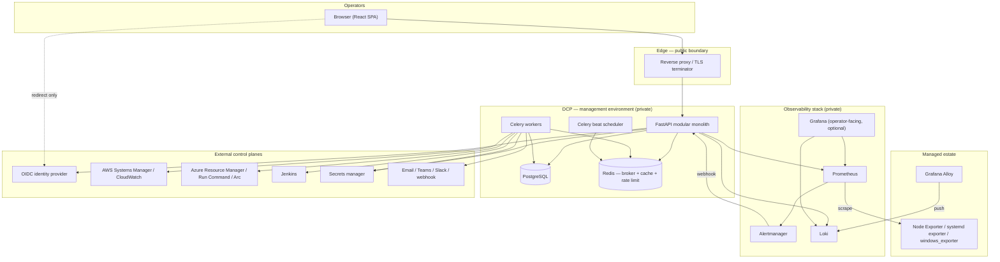

### 1.2 Explicit non-goals for the initial release

Carried verbatim in intent from PRD §14: no interactive terminal, no arbitrary root execution, no custom metrics or log store, no Kubernetes management surface, no autonomous remediation, no unapproved production deploys.

---

## 2. Components and responsibilities

### 2.1 Frontend — React SPA

Single-page application served as static assets through the reverse proxy on the same origin as the API (`/` → SPA, `/api/v1` → backend). Same-origin keeps the session cookie `SameSite=Strict` and removes the need for permissive CORS (AD-02, [SECURITY.md §12](SECURITY.md#12-cors)).

Responsibilities: rendering dashboards/tables/charts/log views, filter and pagination state, optimistic-free async operation progress, confirmation dialogs that restate target + environment + action, accessible loading / empty / **stale** / error states, dark and light themes.

Explicitly **not** responsible for: authorisation decisions (it hides controls for usability only), any credential, any provider-specific branching beyond labels, constructing PromQL or LogQL.

### 2.2 Backend — FastAPI modular monolith (AD-01)

One deployable process, internally partitioned by domain. Proposed module layout (to be created in Phase 1, see [IMPLEMENTATION_PLAN.md](IMPLEMENTATION_PLAN.md)):

```
backend/app/
  main.py                 # app factory, middleware, router mounting
  core/                   # config, logging, correlation IDs, errors, pagination
  auth/                   # OIDC flow, session, current-identity dependency
  authz/                  # permission model, require_permission dependency, scope resolution
  inventory/              # cloud_accounts, servers, applications, services
  metrics/                # Prometheus query builder + client
  logs/                   # Loki LogQL builder + client
  alerts/                 # Alertmanager webhook receiver, ack/assign, notification routing
  operations/             # service-operation lifecycle + state machine
  deployments/            # Jenkins orchestration + lifecycle
  approvals/              # approval policy evaluation + decisions
  audit/                  # append-only audit writer + query API
  providers/              # adapter interface + aws/, azure/, agent/, demo/
  admin/                  # users, roles, settings
  workers/                # Celery app, tasks, beat schedule
```

**Module dependency rule:** `core` ← `auth`/`authz` ← domain modules ← `providers`. Domain modules may not import each other's internals; they interact through each other's service-layer functions. `audit` and `authz` are importable by everything (cross-cutting). This rule is what keeps the monolith splittable later without becoming a distributed system now.

### 2.3 Background workers — Celery

Separate OS processes, same codebase and image as the API. Queues separated by blast radius and latency class so a throttled cloud API cannot starve notifications:

| Queue | Work | Concurrency profile |
|---|---|---|
| `operations` | service start/stop/restart + verification | low concurrency, long timeout |
| `deployments` | Jenkins trigger, poll, post-deploy health checks | low concurrency, long timeout |
| `integrations` | inventory sync, connectivity checks | moderate |
| `notifications` | email/Teams/Slack/webhook delivery | high concurrency, short timeout |
| `maintenance` | retention, stale sweeps, export | serialised |

`celery beat` owns scheduled work: inventory synchronisation, management-connectivity probes, application health checks, stale-data sweep, retention/partition maintenance, notification retry drain.

### 2.4 PostgreSQL

Durable record for inventory, identity/permissions, operation and deployment state, approvals, alert lifecycle, and audit. See [DATABASE.md](DATABASE.md). Never stores raw metric samples or log lines (PRD §6).

### 2.5 Redis

Celery broker and result backend, session store (AD-02; OPEN-04 resolved in M1.3 as Redis-only), rate-limit counters, short-TTL caches for dashboard aggregates and provider metadata.

**Constraint (PRD §5.4):** Redis is never the only durable record of a privileged operation. Every operation and deployment row is written to PostgreSQL **before** a task is enqueued, and the task carries only the row id.

### 2.6 Monitoring and logging components

- **Prometheus** — scrapes exporters, evaluates alert rules, serves `/api/v1/query` and `/api/v1/query_range` to DCP.
- **Node Exporter** (Linux host), **systemd exporter / restricted agent** (unit state), **windows_exporter** (Windows hosts) — on each managed server.
- **Alertmanager** — dedupes/groups/routes; posts to DCP's webhook receiver.
- **Grafana Alloy** — on each managed server: tails journald, Nginx, PHP-FPM, application and Docker logs; applies redaction and label limits; pushes to Loki.
- **Loki** — log store, queried by DCP via LogQL.
- **Grafana** — optional operator-facing deep-dive UI; not a dependency of DCP's own pages.

---

## 3. Request and response data flows

### 3.1 Read path — a dashboard page load

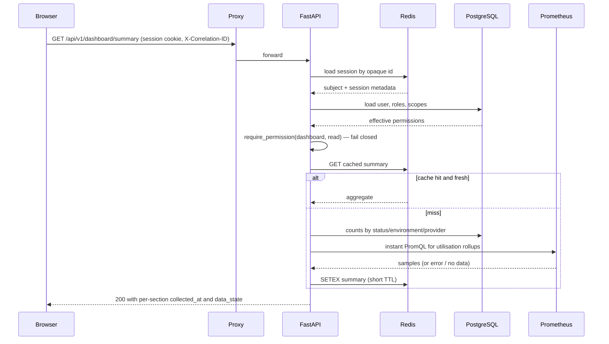

**Hard rule (PRD §4.2):** each section of the response carries `data_state` ∈ `ok | stale | unavailable` plus `collected_at`. A Prometheus failure yields `unavailable` for that section and HTTP 200 for the rest — never `0`, never a whole-page 500. This shape is specified in [API_CONTRACTS.md §4](API_CONTRACTS.md#4-partial-data-and-data_state).

### 3.2 Write path — a privileged service operation

```mermaid
sequenceDiagram
    participant B as Browser
    participant A as FastAPI
    participant D as PostgreSQL
    participant Q as Redis queue
    participant W as Celery worker
    participant S as Provider (SSM / Run Command / agent)

    B->>A: POST .../operations {action: restart} + Idempotency-Key
    A->>A: authn, authz, allowlist check (server, service, action)
    A->>D: SELECT existing op by idempotency_key
    alt replay
        D-->>A: existing operation
        A-->>B: 200 original operation (no re-execution)
    else new
        A->>D: BEGIN; INSERT operation (PENDING|AWAITING_APPROVAL); INSERT audit_event; COMMIT
        A->>Q: enqueue execute_operation(operation_id) only if PENDING
        A-->>B: 202 Accepted {operation_id, status}
    end
    W->>D: claim row (PENDING -> RUNNING, guarded UPDATE)
    W->>S: invoke allowlisted operation
    S-->>W: provider execution id
    W->>S: poll until terminal or timeout
    W->>S: verify resulting service state
    W->>D: terminal status + sanitized_result + audit_event
    B->>A: GET /operations/{id} (poll)
    A-->>B: current status / terminal result
```

**Hard rule (PRD §4.6, §9):** `SUCCEEDED` is written only after the *verification* read confirms the intended end state. A provider returning "command sent" is `RUNNING`, not success.

---

## 4. Metrics collection architecture

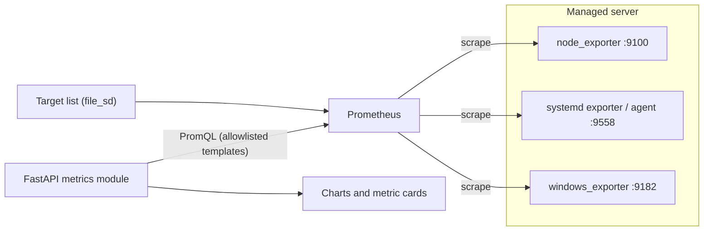

**Design points**

1. **Identity join (AD-04).** Every `servers` row carries a `metrics_instance` value that must equal the Prometheus `instance` label for that host. Without it, metrics cannot be attributed to a server (PRD §4.4 acceptance: "Metrics are associated with the correct server"). **Amended in M2.3 (2026-10-16):** registration does *not* validate this synchronously. A newly registered target reaches Prometheus only after the target file is rewritten and one scrape completes (roughly 15–30 s), so a synchronous check would fail every time. The verification is **asynchronous**: registration leaves `agent_status` `UNKNOWN`, and the agent probe (`app/metrics/agents.py`) moves it to `HEALTHY` or `UNREACHABLE` once Prometheus has a series. Because DCP now writes `targets: [metrics_instance]`, the `instance` label *is* the stored value and cannot mismatch for a discovered target; "no series" therefore means "not loaded yet" or "Prometheus is unavailable", never "wrong label".
2. **No raw PromQL from clients (AD-04).** The backend exposes a fixed set of named metric templates (`cpu_utilisation`, `memory_utilisation`, `memory_available_bytes`, `disk_utilisation`, `disk_available_bytes`, `disk_io`, `network_throughput`, `load_average`, `uptime_seconds`, `agent_up`). The client picks a template id, server id(s), time range and step; the backend renders the PromQL. This closes a PromQL-injection and cardinality-abuse hole in one decision.
3. **Target discovery (OPEN-14) — RESOLVED 2026-10-16 (M2.3): DCP-generated `file_sd`.** A worker task writes `node.json` from inventory onto a volume Prometheus mounts **read-only**; Prometheus watches the file itself (`refresh_interval: 15s` as the fallback for filesystems without change events), so **no reload call exists** and the lifecycle API (`--web.enable-lifecycle`, which also exposes an unauthenticated `/-/quit`) is not enabled. The file holds `host:port`, an environment name and the server id — no secret and no free text. Targets are selected by one predicate (`discovery.select_targets`: monitored, not retired or deleted, Linux, and permitted by the target policy in [SECURITY.md §19](SECURITY.md#19-ssrf)) shared with the agent probe. Rejected: `http_sd` (a new authenticated internal endpoint and a new secret to rotate) and native cloud discovery (needs cloud credentials and does not cover on-premises hosts; revisit with M4.1). **Limitation:** a shared volume is a single-host arrangement; a multi-host topology (`OPEN-12`) needs another delivery mechanism.
4. **Range guards.** Every range query is bounded by max points (`range / step ≤ 11 000`), a server-count cap for comparisons, and an upstream timeout (default 10 s). Exceeding a guard returns a structured 422, never an unbounded query.
5. **Stale vs zero (AD-14).** Health classification combines `servers.last_seen_at`, exporter `up`, and sample recency against per-environment thresholds (defaults: `warning` 2×scrape interval, `stale` 5 min, `unreachable` 15 min). Absent samples map to `unavailable`.

   **As built (M2.5, 2026-10-17).**
   - *Inputs.* The classifier (`app/monitoring/health.py`) reads `last_seen_at` only. `up` and sample recency enter through the agent probe, which sets `last_seen_at` to the **scrape timestamp of the latest successful scrape** and never moves it backwards, so "exporter down" and "sample too old" are the same age. `agent_status` is not an input.
   - *Thresholds.* `DCP_HEALTH_THRESHOLDS`, JSON: a `default` and per-environment overrides (`development|staging|production|other`), each any subset of `warning_after_seconds` / `stale_after_seconds` / `unreachable_after_seconds` (defaults 30 / 300 / 900), strictly increasing after merging, 1–86400, validated at startup. A state begins **strictly after** its line (`age > N`), the rule the earlier `stale` flag already followed.
   - *The reference (D2).* Age is measured against the last time **Prometheus answered**, a Redis marker (`dcp:monitoring:prometheus_answered_at`) the agent probe writes, not the wall clock. The sweep judges nothing without it; the read path uses it only while fresh (3 probe intervals) and otherwise reports "not evaluated" (`state: null`) dated by the marker. A Prometheus outage therefore ages nothing (PROGRESS issue 67).
   - *Two owners of `servers.status` (`OPEN-30`).* Administrators: `PENDING`→`MANAGED`, `RETIRED`. The sweep (`dcp.monitoring.sweep_status`, beat, 60 s): `MANAGED`/`STALE`/`UNREACHABLE` for scraped servers only, audited as `SERVER_STATUS_CHANGED`, conditional on the status it read. `warning` is a health state with no `status` and stays `MANAGED`.
   - *Gates.* A retired, unsupported-OS, monitoring-off or instance-less server is `unknown` however old its `last_seen_at`; a never-scraped one is `unknown`, not stale.
   - *Read path.* `evaluate()` (Python) and `health_state_expr()` (SQL `CASE`) are one rule in two languages, held together by a parity test. `critical` is never produced (`OPEN-28`).

---

## 5. Centralized logging architecture

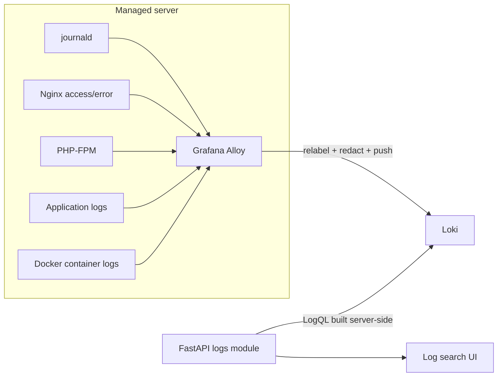

**Design points**

1. **Label contract (bounded cardinality, PRD §4.7).** Allowed stream labels only: `environment`, `server_id`, `hostname`, `application_id`, `service`, `source_type`, `level`. Request ids, user ids, trace ids, paths and container ids stay in the log *line*, never in labels. **Values are closed too (AD-21, built in M3.1):** `source_type` ∈ `journald | syslog | nginx | php_fpm | docker | application`; `level` ∈ `debug | info | warn | error | critical | unknown` (a source's own spelling is mapped — `err`→`error`, `warning`→`warn`, `fatal`/`crit`/`emerg`→`critical` — and anything else, including an absent level and `trace`, is `unknown`, never guessed from the message or the status code); `service` is a plain name (`[A-Za-z0-9][A-Za-z0-9_.-]{0,62}`) or the fixed `other`; `application_id` is present only on application-source streams. The pipeline is `infra/alloy/config.alloy` (+ `journal.alloy` on a host with a persistent journal).
2. **Server-side query construction (AD-05).** `POST /api/v1/logs/query` accepts structured filters (server ids, application id, service, level, free-text `contains`, regex-free by default, time range, limit, direction). The backend renders the LogQL selector and line filters, scoped to the servers/environments the caller may read. **Raw LogQL from a client is never accepted** — it would bypass scope filtering and allow cross-tenant reads.
3. **Redaction at two layers (PRD §4.7, §9).** Alloy applies regex redaction before push (defence in depth, best-effort); DCP applies an outbound redaction pass on every log line it returns, so a secret already in Loki is not re-exposed through the portal. Neither layer is claimed to be complete — see [SECURITY.md §17](SECURITY.md#17-sensitive-log-redaction).
4. **Bounds.** Default `limit` 200, max 1 000; max range 7 days per query; upstream timeout 15 s; cursor pagination on `(timestamp, line_hash)`. Retention and per-tenant limits are configured in Loki (OPEN-08).
5. **Authorisation is a filter, not a check.** The caller's readable environment/server set is intersected into the selector *before* the query is issued, so an over-broad filter silently narrows rather than erroring — and never leaks the existence of unreadable servers.

---

## 6. systemd service monitoring and management flow

### 6.1 Monitoring (read)

Unit state arrives as metrics, not as shell output: the systemd exporter (or restricted agent) exposes per-unit `load_state`/`active_state`/`sub_state`, restart counts and timestamps. Prometheus scrapes it; DCP reads it per server and **normalises** into the PRD §4.5 state set.

Normalisation table (single implementation, unit-tested — PRD §12):

| Source condition | Normalised state |
|---|---|
| `active_state=active`, `sub_state=running` | `ACTIVE` |
| `active_state=inactive` | `INACTIVE` |
| `active_state=failed` or `sub_state=failed` | `FAILED` |
| `active_state=activating` | `ACTIVATING` |
| `active_state=deactivating` | `DEACTIVATING` |
| Exporter series absent but host `up` — including `node_scrape_collector_success{collector="systemd"}=0`, and an allowlisted unit missing from a *successful* collection | `UNCOLLECTED` |
| Host unreachable / stale | `UNKNOWN` (host-level stale wins) |
| Platform has no systemd (Windows) | `UNSUPPORTED` |

**Acceptance-critical (PRD §4.5):** an unreachable host must not render as "all services inactive". Host staleness is evaluated *first* and overrides unit state for the whole server; `UNCOLLECTED`, `UNSUPPORTED` and `FAILED` are distinct states, never collapsed.

### 6.2 Management (write)

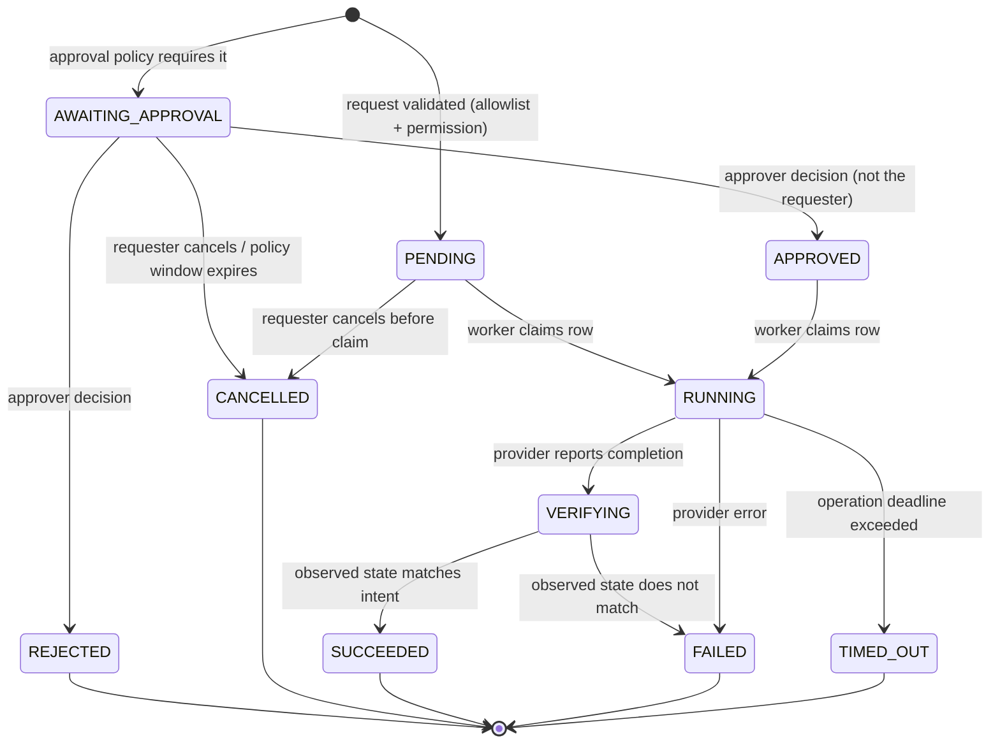

`VERIFYING` is an internal step added to the PRD §4.6 state list so that "verify the resulting service state" is a *representable* state rather than an implicit gap. It is surfaced to the API as `RUNNING` to keep the public enum identical to the PRD's (see [API_CONTRACTS.md §9](API_CONTRACTS.md#9-enums)); this is AD-09 and is flagged for review.

Allowlist gate, evaluated in order, all server-side:

1. Session valid → else 401 (fail closed).
2. Server exists, is `MANAGED`, not soft-deleted → else 404.
3. Service row exists for that server and `monitoring_enabled`/manageable → else 404. Arbitrary unit names are never passed through.
4. Action ∈ `{start, stop, restart}` ∩ the service's action policy allowlist → else 403.
5. Caller holds `service:{action}` on that server's environment scope → else 403.
6. Rate limit and concurrent-operation-per-target guard → else 429.
7. Approval policy evaluated → `PENDING` or `AWAITING_APPROVAL`.

---

## 7. Cloud-provider adapter architecture

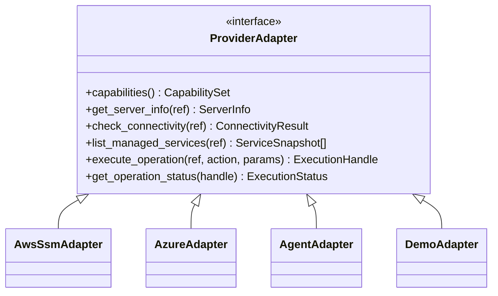

All adapters return a common result envelope and raise a common error taxonomy; **no provider branching above the adapter layer**, and none at all in the frontend (PRD §4.11).

### 7.1 Error taxonomy

`AuthenticationError`, `AuthorizationError`, `NotFound`, `Throttled(retry_after)`, `Timeout`, `UnsupportedOperation`, `PartialFailure`, `ProviderUnavailable`, `NotConfigured`. Each maps to a documented API error code ([API_CONTRACTS.md §3](API_CONTRACTS.md#3-error-format)) and a retry policy ([§10](#10-error-handling-retries-timeouts-and-idempotency)).

### 7.2 Capability matrix — providers are **not** interchangeable

| Capability | AWS (SSM) | Azure (ARM / Run Command / Arc) | Registered Linux (agent) | Demo |
|---|---|---|---|---|
| Inventory sync | Yes | Yes | No (manual registration) | Synthetic |
| Connectivity check | `DescribeInstanceInformation` ping state | Agent/Arc status | Agent heartbeat | Always ok |
| Allowlisted service control | Yes, via registered SSM document | Yes, via registered Run Command script | Yes, fixed RPC verbs | Simulated |
| Async handle + polling | Yes (`CommandId`) | Yes (async operation) | Yes (job id) | Immediate |
| Concurrent invocation limits | Account/region throttles | Per-VM Run Command serialisation | Agent-defined | None |
| Typical latency | seconds | seconds to tens of seconds | sub-second | none |
| Windows unit control | n/a for systemd | n/a for systemd | n/a | n/a |

The UI must render `UnsupportedOperation` explicitly ("not supported for this provider"), never as a generic failure (PRD §4.11 acceptance). Azure Run Command's per-VM serialisation and AWS's account-level throttling are different failure modes and must not share one retry constant.

### 7.3 Execution model — allowlisted operations, never shell (AD-07)

The adapters invoke **pre-registered, parameter-constrained** provider artifacts:

- **AWS:** a custom SSM document (e.g. `DCP-ServiceControl`) whose parameters are a closed enum of actions and a service name validated against the DB allowlist before invocation. The execution IAM role is scoped by resource tag and document name, so even a compromised backend cannot run `AWS-RunShellScript`. See [SECURITY.md §8](SECURITY.md#8-cloud-credentials-and-execution-identity).
- **Azure:** a registered Run Command script with the same closed parameter set, under a managed identity holding only the specific action on a scoped resource group.
- **Registered Linux:** a restricted agent exposing fixed verbs (`status`, `start`, `stop`, `restart`, `logs_tail`) with no free-form command field (OPEN-05: build vs adopt SSM hybrid activations / Azure Arc).
- **Demo:** returns `NotConfigured` for writes and synthetic data for reads, always flagged in responses (AD-15).

String interpolation of user input into any command body is prohibited; parameters are passed as typed provider parameters.

---

## 8. Jenkins deployment integration

```mermaid
sequenceDiagram
    participant U as Requester
    participant A as FastAPI
    participant D as PostgreSQL
    participant AP as Approver
    participant W as Worker
    participant J as Jenkins

    U->>A: POST /deployments {application_id, environment, ref} + Idempotency-Key
    A->>D: resolve registered deployment_target (pipeline + allowed refs)
    A->>A: validate ref against target policy; evaluate approval policy
    A->>D: INSERT deployment (REQUESTED | AWAITING_APPROVAL) + audit_event
    A-->>U: 202 {deployment_id, status}
    opt production
        AP->>A: POST /deployments/{id}/approve
        A->>D: approval row + status APPROVED + audit_event
    end
    W->>J: build with parameters (from target config only)
    J-->>W: queue item -> build number
    W->>D: QUEUED -> RUNNING, external_execution_id
    loop poll with backoff
        W->>J: build status + console tail
        W->>D: progress
    end
    W->>W: run configured post-deployment health checks
    W->>D: SUCCEEDED only if pipeline success AND health checks pass
```

### 8.1 Deployment state machine

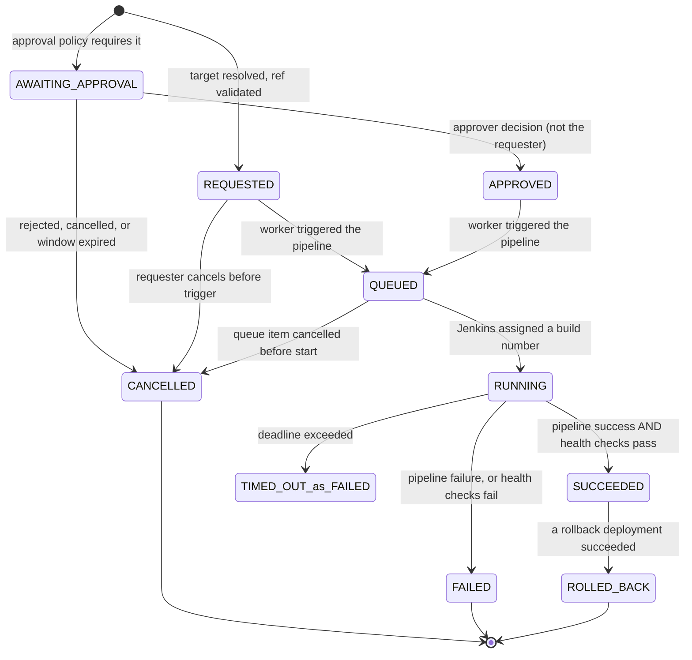

Two notes on this diagram. `TIMED_OUT_as_FAILED` is a diagram label, not a status: the public `DeploymentStatus` enum has no `TIMED_OUT` member (PRD §4.10 does not list one), so a deadline breach is recorded as `FAILED` with `failure_reason = DEPLOYMENT_TIMED_OUT`. And `ROLLED_BACK` is reached only *after* a separate rollback deployment succeeds — it is never set optimistically when a rollback is merely requested.

**Design points**

1. **Registered targets only (PRD §4.10).** `deployment_targets` holds the Jenkins job path, parameter template, allowed ref patterns, approval policy and health-check config. The API accepts `application_id + environment + ref` — never a Jenkins URL, never arbitrary build parameters.
2. **Success is conjunctive (AD-10).** Pipeline success alone is `RUNNING`→ health-check phase. Failing health checks produce `FAILED` with the pipeline result preserved, satisfying "never report deployment success until the pipeline and configured health checks satisfy the success policy".
3. **Health checks are SSRF-controlled.** Only pre-registered health-check URLs from the target config are fetched, resolved against a host allowlist, with no redirect following ([SECURITY.md §19](SECURITY.md#19-ssrf)).
4. **Jenkins outage degrades, not breaks.** `ProviderUnavailable` leaves the deployment in its current state with `last_poll_error` recorded; the poller retries with backoff until a deadline, then `FAILED` with `failure_reason = DEPLOYMENT_TIMED_OUT`. Deployment pages render the staleness.
5. **Build logs** are streamed through the backend with the same redaction pass as application logs, gated on deployment-read permission for that environment.
6. **Rollback** is modelled as a *new* deployment with `kind=rollback` referencing the prior deployment, only where the registered target declares rollback support (PRD §4.10 "when the deployment system provides one"). DCP does not invent a rollback mechanism.

---

## 9. Authentication and authorization flow

### 9.1 Authentication — OIDC authorization code + PKCE, backend-for-frontend (AD-02)

```mermaid
sequenceDiagram
    participant B as Browser
    participant A as FastAPI
    participant I as OIDC provider
    participant R as Redis
    participant D as PostgreSQL

    B->>A: GET /api/v1/auth/login?next=/servers
    A->>R: store state + PKCE verifier + next (short TTL)
    A-->>B: 302 to IdP authorize
    B->>I: authenticate (MFA per IdP policy)
    I-->>B: 302 /api/v1/auth/callback?code&state
    B->>A: callback
    A->>R: validate + consume state, load verifier
    A->>I: token exchange (confidential client secret from secrets manager)
    I-->>A: id_token (+ access_token)
    A->>A: verify signature (JWKS), iss, aud, exp, nonce
    A->>D: upsert user by identity_provider_subject; INSERT audit_event(LOGIN_SUCCEEDED)
    A->>R: create session (opaque id -> user_id, issued_at, absolute/idle deadlines)
    A-->>B: Set-Cookie dcp_session (HttpOnly, Secure, SameSite=Strict, Path=/); 302 next
```

No token is readable by JavaScript; the SPA holds no token at all. Logout deletes the server-side session, clears the cookie, and audits. Failed authentication is audited without credential material (PRD §4.1).

### 9.2 Authorization — RBAC with scope, evaluated per request (AD-03)

Permissions are **never** read from token claims. On every request the identity's roles and scopes are resolved from PostgreSQL — one indexed join on `user_roles`, with **no cache** — so revocation takes effect immediately with no release (PRD §4.1 acceptance).

> **Amended in M1.4 (2026-10-14), with product-owner agreement.** This section and `AD-03` previously specified a short-TTL cache keyed by `user_id` + a `permissions_version` counter bumped on any role, permission or scope change. Neither is built. The correctness requirement in PRD §4.1 is per-request resolution; the cache was an optimisation with no measured need, and a wrong invalidation can only ever make revocation *less* immediate than no cache at all. `permissions_version` does not exist in the schema and nothing bumps it. Revisit only if a measurement shows per-request resolution is too slow — the counter is an additive change whenever that happens.

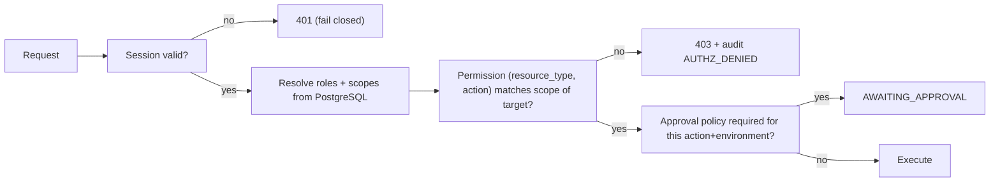

Scope is a conjunction of `environment`, `cloud_account`, `server`, `application` and `*`. The matcher is one function, unit-tested with a table of allow/deny cases, and defaults to **deny** on any unresolvable scope, missing target, or evaluation error. Role definitions and the full permission matrix live in [SECURITY.md §3–§4](SECURITY.md#3-roles).

---

## 10. Error handling, retries, timeouts, and idempotency

### 10.1 Layered timeouts

| Hop | Default | Notes |
|---|---|---|
| Proxy → API | 30 s | Long work never happens inline |
| API → PostgreSQL statement | 5 s | `statement_timeout` per session |
| API → Prometheus | 10 s | Returns `data_state=unavailable` |
| API → Loki | 15 s | Query bounds enforced before dispatch |
| API → provider (sync calls) | 10 s | Inventory/connectivity reads only |
| Worker → provider invoke | 30 s | Submission, not completion |
| Operation wall clock | 300 s (configurable per action) | Exceeded ⇒ `TIMED_OUT` |
| Deployment wall clock | 3 600 s (configurable per target) | Exceeded ⇒ `FAILED` / `DEPLOYMENT_TIMED_OUT` (the enum has no `TIMED_OUT`) |
| Health check (single) | 10 s, 3 attempts | Per registered check |

Each inner timeout is strictly less than its caller's. Any operation lacking a deadline is a bug.

### 10.2 Retry policy by error class

| Error class | Retry? | Policy |
|---|---|---|
| `Throttled` | Yes | Honour `retry_after`, else exponential backoff + full jitter, cap 5 |
| `Timeout` on a **read** | Yes | 2 retries, backoff |
| `Timeout` on a **write/invoke** | **No** | Reconcile instead — see §10.3 |
| `ProviderUnavailable` | Yes | Backoff, cap 5, then terminal with diagnostics |
| `AuthenticationError` | Once after forced credential refresh | Then terminal; raise integration alert |
| `AuthorizationError` | No | Terminal; audit; surface as configuration problem |
| `UnsupportedOperation` | No | Terminal; surfaced explicitly in UI |
| `PartialFailure` | No | Terminal `FAILED`, per-target detail retained |

### 10.3 Idempotency and duplicate suppression (AD-08)

Three independent mechanisms, because retries exist at three layers:

1. **Client → API.** `Idempotency-Key` is required on `POST` endpoints that create operations or deployments. `(requested_by, endpoint, idempotency_key)` is unique; a replay returns the original resource with `200` and does not re-execute (PRD §4.6, §4.10).
2. **API → worker.** Tasks are idempotent by row id. The worker claims work with a guarded transition (`UPDATE ... WHERE id=? AND status='PENDING'`); a duplicate delivery loses the race and exits. Celery `acks_late` + a visibility timeout longer than the operation deadline prevents double delivery from a slow task.
3. **Worker → provider.** The provider execution id is persisted *before* polling begins. On worker restart, reconciliation looks up the stored handle and resumes polling rather than re-invoking. If the id was never recorded, the operation goes to `FAILED` with `reconciliation_required` — **DCP never blind-retries a state-changing provider call** (PRD §10 "Retries must avoid unintended duplicate actions").

Additionally, at most one in-flight operation per `(server, service)` is permitted; a second request returns `409 operation_in_progress`.

### 10.4 Failure containment

One provider's outage must not degrade unrelated pages (PRD §4.11, §10). Mechanisms: per-integration circuit breaker with half-open probes; per-integration connection pools and worker queues; section-level `data_state` instead of whole-response failure; an `/api/v1/integrations/status` page that names the degraded dependency; and self-monitoring of DCP's own API, workers and queue depth.

---

## 11. Network and trust boundaries

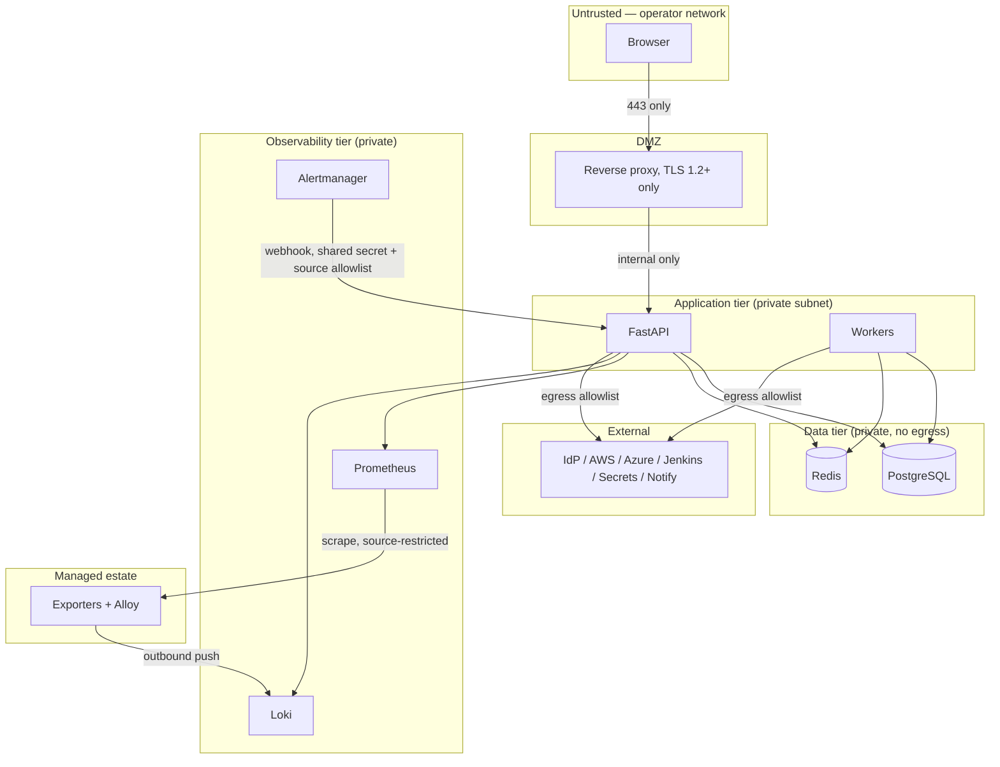

Trust-boundary rules:

- **T0→T1** is the only public ingress; HTTPS only, HSTS, no direct API exposure.
- **T2** holds all authorisation decisions. Nothing in T0 is trusted, including "is this user an admin".
- **T3** is reachable only from T2 and has no outbound internet route.
- **T4→T2** (the Alertmanager webhook) is an *inbound* path from a lower-trust component: authenticated with a shared secret, source-IP restricted, schema-validated, rate-limited, and treated as untrusted input ([SECURITY.md §21](SECURITY.md#21-alert-webhook-ingress)).
- **T5** exposes no inbound management port to DCP. Exporter ports are restricted to the Prometheus source; Alloy pushes outbound. Public SSH to managed servers is not required anywhere in this design (PRD §9).
- **T6** egress is a host allowlist from T2 only; no user-supplied destination is ever fetched.

---

## 12. Local development architecture (Docker Compose)

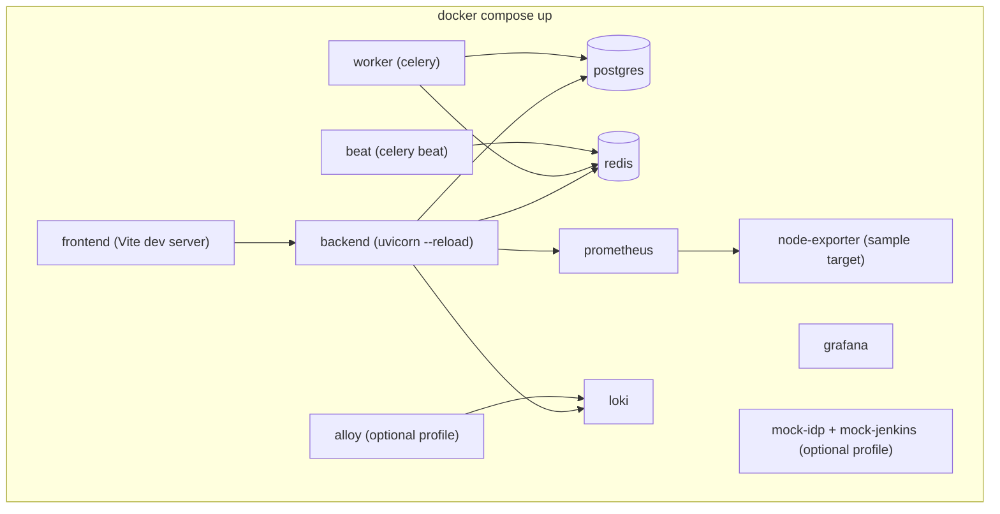

Requirements from PRD §11: cloud integrations are optional locally and the app must start without production credentials.

- **Demonstration mode (AD-15).** `DCP_DEMO_MODE=true` selects `DemoAdapter`, a mock OIDC provider and a mock Jenkins. Every affected API response carries `"demo_mode": true` and the UI shows a persistent banner. Demo data is clearly synthetic and is never presented as a live integration.
- Compose **profiles** keep the default `up` light: `core` (frontend, backend, worker, beat, postgres, redis), `observability` (prometheus, grafana, loki, node-exporter), `logs` (alloy), `mocks` (mock-idp, mock-jenkins).
- `.env.example` contains placeholders only; no real credential ever enters the repository.
- A `compose` smoke test asserts: all core services healthy, migrations applied, `/healthz` and `/readyz` green, one seeded server visible, demo banner present ([TESTING.md §11](TESTING.md#11-docker-compose-smoke-tests)).

---

## 13. Initial deployment topology

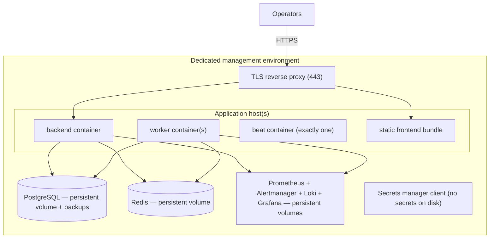

Initial topology is Docker Compose on a dedicated management host (PRD §11, "use Docker Compose for the initial proof of concept if suitable"), with:

- Single `beat` instance (a second scheduler double-fires jobs).
- Horizontally scalable `worker` count per queue.
- Resource limits on every container; read-only root filesystems; non-root users.
- Database backups with a *tested* restore ([TESTING.md §14](TESTING.md#14-backup-and-recovery-tests)).
- Container images pinned by digest and scanned before deploy.

**This topology is a single-host single point of failure and is not highly available.** That is an accepted, documented trade-off for the proof of concept (PRD §14 defers HA) and is OPEN-12.

### 13.1 Future scaling considerations (not in scope now)

Documented so the schema and module boundaries do not block them: move containers to ECS/AKS behind a managed load balancer; PostgreSQL to a managed instance with a read replica for dashboard aggregates; split the `operations`/`deployments` workers into their own autoscaling group; promote a module to a service only if an independent scaling or failure-isolation need is *measured*; Prometheus federation or remote-write if cardinality outgrows one instance; Loki to object storage with per-tenant limits. Partition `audit_events` and `alert_events` by month from day one so growth never requires a rewrite.

---

## 14. Background job execution and operation lifecycle

Lifecycle invariants (enforced in code, covered by tests in [TESTING.md §7](TESTING.md#7-background-worker-tests)):

1. **DB first.** The row exists and is committed before enqueue. A lost queue message is recoverable; a lost row is not.
2. **Guarded transitions.** Every status change is a conditional `UPDATE` asserting the expected current status, so concurrent workers cannot both advance one row. Illegal transitions raise rather than silently pass.
3. **Terminal is terminal.** `SUCCEEDED | FAILED | TIMED_OUT | CANCELLED | REJECTED` are never left. A retry creates a new row linked by `parent_operation_id`.
4. **Deadline carried on the row.** `deadline_at` is set at creation, so a worker that restarts can still time the operation out correctly.
5. **Reaper.** A beat job moves rows past `deadline_at` to `TIMED_OUT` with a reason, catching crashed workers (PRD §12 failure scenario "worker crashes during an operation").
6. **Sanitized results only.** `sanitized_result` passes through redaction before persistence; raw provider output is never stored verbatim.
7. **Every transition audits.** Create, approve/reject, claim, terminal — each writes an `audit_event` with the same `correlation_id`.

---

## 15. Observability of DCP itself

DCP is monitored by the same stack it operates (PRD §10): its own `/metrics` endpoint (request latency/error rates by route, queue depth, task duration and failure counts by queue, provider call latency/error rates by provider and error class, circuit-breaker state, session count), structured JSON logs with `correlation_id` shipped to Loki, and alert rules on API 5xx rate, queue backlog, beat liveness, operation timeout rate, migration failure, and integration circuit-breaker open. Monitoring and log-collection failures must themselves be visible, not silent.

---

## 16. Data flow summary by feature

| Feature | Read path | Write path | Durable record |
|---|---|---|---|
| Dashboard | PG aggregates + PromQL | — | — |
| Server inventory | PG | API → PG | PG |
| Server metrics | PromQL templates | — | Prometheus |
| systemd services | PromQL (exporter) + PG last-observed | — | Prometheus + PG snapshot |
| Service operations | PG | API → PG → Celery → provider → verify → PG | PG `operations` |
| Logs | LogQL built server-side | — | Loki |
| Alerts | PG | Alertmanager webhook → PG; ack via API | PG `alert_events` |
| Deployments | PG + Jenkins poll | API → PG → Celery → Jenkins → health checks → PG | PG `deployments` |
| Approvals | PG | API → PG | PG `approvals` |
| Audit | PG (append-only) | Every privileged action | PG `audit_events` (+ export) |

---

## 17. Trade-offs accepted

| Decision | Benefit | Cost | Revisit when |
|---|---|---|---|
| Modular monolith | One deploy, one transaction boundary, fast iteration | Whole app redeploys together | A module needs independent scaling or isolation, measured |
| Server-side PromQL/LogQL construction | Closes injection and scope-bypass holes | Operators cannot write ad-hoc queries in DCP | Grafana link-out proves insufficient |
| Opaque cookie session + per-request DB authz | Immediate revocation, no token in JS | A DB/cache read per request | Request volume makes it hot (then cache harder, do not move to claims) |
| Allowlisted provider documents only | No arbitrary execution path exists | New operations need a registered artifact | Never — this is a hard security boundary |
| Polling for operation/deployment progress | Simple, no socket infrastructure | Up to one poll interval of latency | UX demands live streaming |
| Alert rules in Prometheus, not DB | Reuses a proven evaluator; rules are reviewable in git | No in-app rule editor initially | Admin self-service rule editing is required (OPEN-03) |
| Single-host Compose production | Fast to stand up, matches PRD | No HA; host loss is an outage | Availability requirements are set (OPEN-07, OPEN-12) |

---

## 18. Architecture decisions

| ID | Decision | Rationale |
|---|---|---|
| AD-01 | Modular monolith (FastAPI) + separate Celery workers | PRD §5.2; avoids distributed complexity before it is needed |
| AD-02 | OIDC auth code + PKCE, backend-for-frontend, opaque HttpOnly session cookie | No token in the browser; enables instant revocation; PRD §9 cookie/CSRF language implies cookie sessions |
| AD-03 | RBAC + scope rows, resolved per request from PostgreSQL, fail closed, **no cache** (amended M1.4 — see [§9.2](#92-authorization--rbac-with-scope-evaluated-per-request-ad-03)) | PRD §4.1 "revoked permissions take effect without a new release" |
| AD-04 | Metrics stay in Prometheus; backend renders allowlisted PromQL templates; `servers.metrics_instance` is the join key | PRD §6 forbids duplicating metrics; closes injection/cardinality abuse |
| AD-05 | Logs stay in Loki; backend builds LogQL from structured filters; raw LogQL from clients is rejected | Prevents scope bypass and cross-environment reads |
| AD-06 | Alert rules authored as Prometheus rule files in version control; Alertmanager posts to a DCP webhook; DCP owns lifecycle only | Reuses a proven evaluator; keeps rules reviewable |
| AD-07 | Provider writes go through pre-registered, parameter-constrained documents/scripts/RPC verbs; no shell | PRD §4.6, §9 mandatory rules |
| AD-08 | `Idempotency-Key` on state-creating POSTs; guarded worker claims; provider handle persisted before polling | PRD §4.6, §4.10, §10 |
| AD-09 | Operation state machine owned by the DB; verification precedes `SUCCEEDED`; internal `VERIFYING` surfaced as `RUNNING` | PRD §4.6; keeps the public enum exactly as specified |
| AD-10 | Deployment success = pipeline success **and** configured health checks pass | PRD §4.10 |
| AD-11 | `audit_events` append-only: app DB role has `INSERT`/`SELECT` only; monthly partitions; retention by export-then-drop | PRD §4.12 |
| AD-12 | `applications` are environment-agnostic; environment lives on `servers`, `deployment_targets`, `deployments` | Resolves PRD §4.9 vs §6 conflict. **Confirmed by the product owner 2026-10-14 (~~OPEN-02~~ closed)** |
| AD-13 | Soft delete only on inventory/identity tables; never on operations, deployments, approvals, audit, alerts | Operational history must not be erasable |
| AD-14 | Health/staleness computed from `last_seen_at` + exporter `up` + sample recency against per-environment thresholds; absent data ⇒ `unavailable`. **Amended M2.5:** aged against the last time Prometheus answered, not the wall clock, so an outage ages nothing; no fresh reference ⇒ not evaluated; see [§4 point 5](#4-metrics-collection-architecture) | PRD §4.2, §4.4 "must not silently replace unavailable data with zero" |
| AD-15 | `DCP_DEMO_MODE` with per-response `demo_mode` flag and a persistent UI banner | PRD §11; prevents mock data from masquerading as a live integration |
| AD-16 | Exact pins in lockfiles, ranges in manifests, container images pinned by digest | PRD §10 maintainability |
| AD-17 | `/api/v1`; additive-only within a major version; breaking changes ⇒ `/api/v2` | PRD §7 |
| AD-18 | `X-Correlation-ID` accepted or generated at the edge, propagated to tasks, logs and audit rows | PRD §7, §10 |
| AD-19 | Rate limits in Redis, per identity and per endpoint class, fail-closed on privileged classes | PRD §9 |
| AD-20 | All outbound HTTP destinations come from registered configuration and are checked against a host allowlist; no redirect following | PRD §9 SSRF |
| AD-21 | **Log stream labels are a closed set with closed values, enforced at the shipper (M3.1).** Only the seven labels of [§5 point 1](#5-centralized-logging-architecture) leave Alloy; `source_type` and `level` take values from fixed enums, and a source value outside its enum collapses to a fixed `other` (`service`) or `unknown` (`level`) — it is never passed through as a label. A line whose `environment` or `server_id` is missing or malformed is **dropped**, not stored unlabelled (fail closed). Loki's own limits are the backstop, not the control | PRD §4.7 "avoid unbounded, high-cardinality labels"; CLAUDE.md §4 rule 6 |
| AD-22 | **Docker container logs are read from the `json-file` driver's files, read-only; the Docker socket is never mounted into the log shipper (M3.1).** A container is named by a `service` container label that the operator exposes with the driver's `labels` log option (which the driver writes into each line's `attrs`), not discovered through the API. (`tag` is not a `json-file` option; an earlier draft of this row said it was.) **Verified against a real Docker daemon (M3.1 commit 5), with a cost:** the daemon writes `/var/lib/docker/containers` as `root:root` `0710` and each log `0640`, so a shipper must read as **uid 0**; a non-root `alloy` (even with gid 0, which can enter the directory but not list it) matches **no files and logs no error**. On a host with Docker sources the shipper therefore runs as root with `--cap-drop ALL`, `no-new-privileges` and a read-only mount — still no socket, no write, no exec — or the operator grants a non-root user list/read by ACL (untested here). That is a documented exception to [SECURITY.md §23](SECURITY.md#23-container-security)'s non-root rule, for that one source | [SECURITY.md §23](SECURITY.md#23-container-security): the socket is root on the host, and a log shipper that parses untrusted input is the wrong holder of it |

---

## 19. Open decisions

Recorded rather than silently resolved. Each has a working default so Phase 1 is not blocked.

| ID | Question | Working default | Blocks |
|---|---|---|---|
| OPEN-01 | Which OIDC provider, and how do IdP groups map to DCP roles? | Generic OIDC discovery; roles assigned in DCP, not from claims | Phase 1 hardening |
| ~~OPEN-02~~ | PRD §4.9 lists `environment` as an application attribute, but §6 `applications` has no such column while `deployments` does. Is an application per-environment or environment-agnostic? | **RESOLVED 2026-10-14 by the product owner: environment-agnostic**, confirming `AD-12`. `applications` keeps no `environment` column; environment lives on `servers`, `deployment_targets` and `deployments`. One application spans environments, which is what PRD §4.9 needs when it says one application spans many servers | Closed. No migration; §18 response shapes stand as written |
| ~~OPEN-03~~ | Are alert rules file-managed or editable in-app? | **RESOLVED 2026-10-17 (before M3.1): file-managed in git (AD-06).** In-app rule editing is not built in v1 and is reopened only by an explicit requirement. The numbers in the utilisation rules are not hand-written: see `OPEN-28` in [API_CONTRACTS.md §30](API_CONTRACTS.md#30-open-decisions) | ~~Phase 3 scope~~ — closed |
| ~~OPEN-04~~ | Session store: Redis-only, or a durable `user_sessions` table? | **RESOLVED 2026-10-13 (M1.3): Redis-only.** No `user_sessions` table. Login, logout and denial are still audited in PostgreSQL, so the authentication record survives a flushed Redis even though live sessions do not. Accepted cost: a Redis restart logs everyone out. | ~~Phase 1~~ — closed |
| OPEN-05 | Restricted agent for non-cloud Linux: adopt SSM hybrid activations / Azure Arc, or build one? | Prefer adopt; defer build | Phase 4 |
| OPEN-06 | Which secret store is canonical in a multi-cloud portal? | Pluggable interface; one configured backend per deployment. **M3.4 built the interface and one development backend (`env://`, `OPEN-48`); the choice of a production store is still open** | Phase 1 config; M4.3 / M4.4 |
| OPEN-07 | RPO/RTO targets | Undefined; backups daily + WAL archiving as a starting point | Phase 6 |
| ~~OPEN-08~~ | Metric and log retention durations and storage budget | **RESOLVED 2026-10-17 (before M3.1), as v1 values rather than measured sizing:** Prometheus 30 d (already in force), **Loki 14 d** (`retention_period: 336h`, compactor retention on), alerts 180 d, audit 400 d online. **No disk quota in v1**; growth is bounded by Loki's ingestion-rate, line-size and stream-count limits plus the retention period, and the byte budget is sized from measured volume in Phase 6 (`OPEN-07`, `OPEN-12`). DCP's 7-day cap is on a query's *span*, not on how far back it may start, so the two numbers do not conflict. Changing a duration is a configuration edit, not a code change | ~~Phase 2/3 sizing~~ — closed |
| OPEN-09 | Windows hosts: metrics only, or Windows **service** management too? systemd is Linux-only. | Metrics only; service control is Linux/systemd only | Phase 2/4 scope |
| OPEN-10 | Approval policy granularity, and is self-approval ever permitted? | Per environment + action; self-approval denied by default (PRD §3.6) | Phase 4 |
| OPEN-11 | Is `owner_team` free text or a first-class `teams` table with scoping? | Free text initially; dashboard filter only | Phase 1/6 |
| OPEN-12 | Production topology and HA expectations | Single-host Compose in a dedicated management environment | Phase 6 |
| ~~OPEN-13~~ | Notification channel configuration: DB-managed or environment config? | **RESOLVED 2026-10-17 (before M3.1): DB tables** (`notification_channels`, `notification_deliveries`, M3.4). A channel stores a *reference* to its secret in the configured secret store, never the secret; the destination is registered configuration and is SSRF-checked (AD-20) | ~~Phase 3~~ — closed |
| ~~OPEN-14~~ | Prometheus target discovery: DCP-generated `file_sd` or native cloud SD? | **RESOLVED 2026-10-16 (M2.3): DCP-generated `file_sd`, no reload call** — see [§4 point 3](#4-metrics-collection-architecture) | Phase 2 |
| OPEN-29 | **New with `TS-02` (2026-10-17).** §6.1 and PRD §4.5 name `sub_state`, `load_state`, enabled state and main PID, but neither `node_exporter`'s systemd collector nor `systemd_exporter` exposes them (tested, [TECH_STACK.md §5.3](TECH_STACK.md#53-systemd-metrics-integration)). Only a restricted agent could. | **Agreed with the product owner 2026-10-17:** M2.4 returns all four as `null` (unknown — never `0`, `""` or a guessed value), the `ACTIVE` row reads `active_state=active` alone (so `active/exited` is `ACTIVE`; the distinction is lost, not wrong), and the UI says "not collected by this source". The agent (`OPEN-05`) fills them later with no API change | Agent milestone (M6.1) |
| OPEN-30 | **Raised by M2.5 (2026-10-17).** Who owns `servers.status`? [DATABASE.md §4.2](DATABASE.md) said the system owns `MANAGED`/`STALE`/`UNREACHABLE`, yet the M1.5 API lets an administrator set `MANAGED`. | **Decided with the product owner 2026-10-17 (D1):** administrators own `PENDING`→`MANAGED` and `RETIRED`; the sweep owns only the three-way `MANAGED`/`STALE`/`UNREACHABLE`, for scraped servers, and writes conditionally so a person's change wins. An administrator's `STALE`→`MANAGED` is permitted and is reverted by the next sweep if the host is still quiet | Resolved; M2.5 |
| OPEN-31 | **Raised by M3.1 (2026-10-17).** Who may push logs claiming to be a given `server_id` / `environment`? Loki runs single-tenant (`auth_enabled: false`) and the identity labels are set by the *shipper's* configuration, so a compromised managed host could push lines labelled as another server or environment, and DCP's scope filter (which keys on those labels) would then show them to readers of that scope | **Accepted for v1, written down rather than left implicit:** Loki is reachable only from the management and managed-server networks ([SECURITY.md §7](SECURITY.md#7-network-isolation)), shippers push outbound only, and the label values are validated at the shipper. The control that closes it is a per-environment Loki tenant behind a gateway that authenticates each shipper — **Phase 6 hardening, required before production rollout**, alongside `OPEN-15` | Phase 6 (M6.x) |
| ~~OPEN-32~~ | **Raised and closed for M3.2 (2026-10-18, owner's instruction to take the recommended option).** Which spelling do the log permissions have? The M1.2 seed has `logs:read` and `logs:query`; the contracts name `logs:read:application` and `logs:read:system` (PROGRESS issue 39, log half) | **RESOLVED: the contract names win.** Migration 0007 renames by `UPDATE` (so the role grants follow the permission id): `(logs, read)` becomes `(logs, read:application)`, `(logs, query)` becomes `(logs, read:system)`. §19.1's route dependency is `logs:read:application` (every role that holds `read:system` also holds `read:application`); `read:system` is checked per server and per source type inside the query | ~~M3.2~~ — closed |
| ~~OPEN-33~~ | **Raised and closed for M3.2 (2026-10-18).** What is the `application_id` label value? [DATABASE.md §4.3](DATABASE.md) and the `Application` model say it is the application's **slug**; `infra/alloy/config.alloy` (M3.1, tested) **drops any value that is not a UUID**, the sample stack ships a UUID, and §19.1 filters on `application_id` as a UUID | **RESOLVED: the application's UUID (`applications.id`).** No lookup is needed to build a selector, the Alloy validator and its drop tests stand unchanged, and the slug stays a display identifier. DATABASE.md and the model comment are amended in M3.2 (they were wrong about the label, not the pipeline) | ~~M3.2~~ — closed |
| ~~OPEN-34~~ | **Raised by M3.1 as PROGRESS issue 93, closed for M3.2 (2026-10-18).** How does the UI tell a quiet host from a shipper that sends nothing? | **RESOLVED: a per-server ingestion state computed from Loki at query time.** Two bounded count queries over the resolved server set (last 15 minutes, last 24 hours) give each server `receiving` (lines in 15 min), `quiet` (none in 15 min, some in 24 h), `silent` (none in 24 h) or `unknown` (Loki could not answer). Returned on the first page of §19.1 as `ingestion`. An empty result is rendered as "no matching lines" **only when every selected server is `receiving`**; otherwise the page names the servers that are not. Module constants, not settings, until a deployment asks to tune them (the circuit-breaker precedent) | ~~M3.2~~ — closed |
| ~~OPEN-35~~ | **Raised and closed for M3.2 (2026-10-18).** What is in the `pattern_preset` catalogue? PRD §4.7 says "common error patterns" and nothing else | **RESOLVED, as an assumption to review: a closed server-side catalogue of eight presets**: `http_5xx`, `oom_killed`, `connection_refused`, `timeout`, `permission_denied`, `auth_failure`, `segfault`, `disk_full`. Each is one RE2 expression, case-insensitive, applied as a line filter and ANDed with `contains`; the catalogue is returned by §19.2 so the UI hard-codes none of it. A preset narrows a query, never selects a target. The contents are the engineering team's, not the PRD's | ~~M3.2~~ — closed |
| ~~OPEN-36~~ | **Raised and closed for M3.2 (2026-10-18).** How are Loki results paged, given Loki has no offset and a caller may hold two different source-type permissions across the servers they selected? | **RESOLVED: a signed cursor over `(timestamp in ns, line hash)`** using `app/core/pagination` (the filter fingerprint goes in the field that pins the sort, so a cursor cannot be replayed against another filter or scope), over-fetching by one line to compute `has_more`. A caller whose servers split into two permission groups (application-only and all-sources) costs **at most three selectors** (application-only, system-only, both), queried concurrently and merged in one total order (time, then stream labels, then position in the stream), so one global cursor stays exact. The boundary behaviour of Loki's `end` is **measured against the real Loki before it is relied on** | ~~M3.2~~ — closed |
| ~~OPEN-37~~ | **Raised and closed for M3.2 (2026-10-18).** PRD §4.7: "queries respect configured limits and retention". Where does the backend learn the retention? | **RESOLVED: `DCP_LOG_RETENTION_DAYS` (default 14, matching `infra/loki/loki-config.yaml`)**; a `from` older than it is `422 query_limit_exceeded`, because an empty answer for a range Loki no longer holds would read as "no logs". The smoke test asserts the setting equals the retention Loki reports on `/config`, so the two numbers cannot drift silently | ~~M3.2~~ — closed |
| ~~OPEN-38~~ | **Raised and closed for M3.2 (2026-10-18).** How does "failed service to logs" navigation carry its filter, given `OPEN-20` keeps filters out of URLs? And what of "deployment to logs"? | **RESOLVED: the link carries the prefill in the router's history `state`, not the URL** (a reload loses it, which is accepted). **Deployment log navigation and §19.3 are deferred to M5**: they need Jenkins and a deployments page, neither of which exists, and a link to nothing would be a mocked integration (CLAUDE.md §7) | ~~M3.2~~ — closed |
| ~~OPEN-39~~ | **Raised by `OPEN-28`, closed for M3.3 (2026-10-18, owner's instruction to take the recommended option).** Does utilisation move the host `warning`/`critical` *health* state? | **RESOLVED: no — they stay two separate things.** Host `health` (AD-14) means *collected on time* and nothing wider; utilisation pressure is already on every reading as `threshold_level` (§15) and escalates through **alerts**. `critical` stays reserved and unproduced; the enum is not narrowed (a client-contract change for no gain). What changes: the dashboard's `active_alerts` section, `not_configured` until now, reads `alert_events` | ~~M3.3~~ — closed |
| ~~OPEN-40~~ | **Raised and closed for M3.3 (2026-10-18).** PRD §4.8 lists eight conditions; three of them (failed health check, failed deployment, operation timeout/failure) have no producer — no health-check runner, no deployments (M5), no operations (M4) | **RESOLVED: M3.3 produces the five that have a real source and ships none for the other three.** Real: server stopped reporting, CPU, memory, disk, failed systemd unit (Prometheus rules). The three without a producer ship **with the milestone that creates the thing that fails** (M4 operations, M5 deployments and health checks); the schema already carries their `source` values, and M3.3's UI, status row and PROGRESS say plainly that they are *not produced yet* — a condition that cannot fire is not listed as monitored (CLAUDE.md §7). **One internal producer is built now because the code already promises it:** `db/partitions.py` says "M3.3 wires the runway monitor to alerting", so the maintenance task raises an alert through the shared ingestion function. That needs an honest `source`: **`DCP_SYSTEM` is added to the `alert_events.source` CHECK** (DATABASE.md §9.1 amended). Nothing else is added speculatively | ~~M3.3~~ — closed |
| ~~OPEN-41~~ | **Raised and closed for M3.3 (2026-10-18).** What is `dedup_key`, and how do warning and critical for one condition relate? Alertmanager's own `fingerprint` hashes *every* label (so a changed annotation-like label opens a new row) and a `warning`→`critical` move would be a new fingerprint | **RESOLVED: DCP computes its own key and does not use Alertmanager's.** `dedup_key = sha256(source, rule_name, resolved target id, the rule's closed discriminator labels)`; the discriminators are a fixed per-rule list (`name`, the exporter's own unit label, for the failed-unit rule; none for the host rules), so no other label can multiply rows. **Severity is part of the rule name** (`HostCpuWarning`, `HostCpuCritical`), the generated warning expression is `>= warning and < critical`, so the two are **mutually exclusive and one condition is never two open rows**; an escalation is a resolved warning row and a new critical row. This avoids the race that a single row with a changing severity would have (a `resolved` for the warning and a `firing` for the critical in one webhook batch, in no promised order). No Alertmanager inhibit rules | ~~M3.3~~ — closed |
| ~~OPEN-42~~ | **Found while reading DATABASE.md §9.1 for M3.3 (2026-10-18), closed.** `alert_events` is partitioned by `first_seen_at`, and PostgreSQL requires a unique index on a partitioned table to contain the partition key. The documented `UNIQUE (dedup_key, first_seen_at) WHERE status IN ('FIRING','ACKNOWLEDGED')` is therefore satisfiable by two open rows with different `first_seen_at` — **it does not enforce "one open row per key"**, and `INSERT … ON CONFLICT` on it never conflicts | **RESOLVED: a small unpartitioned `alert_open_keys(dedup_key PRIMARY KEY, alert_id, first_seen_at)` table is the arbiter.** The ingestion transaction inserts the key with `ON CONFLICT (dedup_key) DO NOTHING`: a row inserted means "new alert, insert the event"; a conflict means "update the open event it points at". Resolve and expire delete the key **in the same transaction** that closes the event. The invariant is a database constraint, not a lock convention, and a test runs concurrent ingestion of one key and asserts one open row. The non-unique partial index on `alert_events` stays for reads. *Rejected:* an advisory lock (a code path that forgets it silently duplicates), and un-partitioning (the 180-day drop is the reason for partitioning) | ~~M3.3~~ — closed |
| ~~OPEN-43~~ | **Raised and closed for M3.3 (2026-10-18).** The webhook is the first inbound path from a lower-trust component (SECURITY.md §21): what exactly is checked? | **RESOLVED.** (1) **`Authorization: Bearer <secret>`**, `DCP_ALERT_WEBHOOK_SECRET` (`SecretStr`, at least 32 characters; **unset means the endpoint answers `503 not_configured`**, never "open"), compared with `hmac.compare_digest`; Alertmanager reads it from `credentials_file`, so it is not in the config file. (2) **Source address is the TCP peer only** — `X-Forwarded-For` is never read — against `DCP_ALERT_WEBHOOK_ALLOWED_CIDRS`; **empty denies everything** (fail closed), and `.env.example` ships the Compose network. (3) Its own rate-limit class, keyed on the peer. (4) Body ≤ 256 KiB, ≤ 100 alerts per request, `extra="forbid"`, label values ≤ 200 and annotation values ≤ 1 000 characters, closed `status` enum. (5) **Overflow is explicit**: alerts past the cap are returned `rejected: overflow`, counted and logged at WARNING; a request over the rate limit is `429` with `Retry-After`. (6) The CSRF exemption is exactly `/api/v1/webhooks/alerts`, and a test fails if any other path is exempt. (7) **Measured against a real Alertmanager 0.27 in the M3.3 spike, not assumed:** a `429` or `422` is *not* retried within one notify attempt ("unrecoverable"), **but the group is re-sent every `group_interval` until it is accepted**, so a refusal is a retry loop at that cadence; a `503` is retried with backoff *and* re-sent at `group_interval`. Consequences: an individually bad alert is `202` with a per-alert rejection (a `4xx` for it would loop forever), a wholly invalid body or wrong secret is a `4xx` that loops harmlessly at one request a minute and is counted, and the rate limit's `429` is a delay, not a loss. Alertmanager's `max_alerts` **silently drops** the excess and says so only in the payload's `truncatedAlerts`, which DCP therefore accepts, logs and counts. Secret rotation (two live secrets) is not built; the ceiling is "restart both ends" | ~~M3.3~~ — closed |
| ~~OPEN-44~~ | **Raised and closed for M3.3 (2026-10-18).** Lifecycle edges the contract leaves open: who resolves, what if a `resolved` never arrives, who may be assigned | **RESOLVED.** Only the source resolves; **there is no manual resolve in v1** (§20 has none, and an acknowledged alert must not look closed). Acknowledge is legal only from `FIRING` (`409 invalid_state_transition` otherwise) and never touches `resolved_at`. Assign is legal on `FIRING` and `ACKNOWLEDGED`, not on `RESOLVED` or `EXPIRED`; the assignee is validated server-side as an **active user holding `alert:acknowledge`** (null unassigns). **`EXPIRED`** is for an open alert not refreshed for 3 × Alertmanager's `repeat_interval` (1 h, so 3 h; module constants): a worker task on the `maintenance` queue marks it, deletes its open key, and the UI says "not confirmed either way", never "resolved" — without it a lost `resolved` (DCP down past Alertmanager's retry window) leaves a false alarm open forever. **The UI offers "assign to me" and "unassign" only;** a picker needs a user directory an operator may not read (`admin:users` is Administrator-only) and that is a product decision, not an M3.3 default. `GET /alerts/{id}` returns the row's own timeline, the audit entries for it, and the last 10 closed occurrences of the same `dedup_key` | ~~M3.3~~ — closed |
| ~~OPEN-45~~ | **Raised and closed for M3.3 (2026-10-18).** How are alert reads scoped, and how does a payload's labels become a target, given the payload is untrusted? | **RESOLVED.** A target is resolved only by lookup: `server_id` label → a live `servers` row; `unit` label → the registered `services` row on that server, else the alert is **about the server** with the unit name in `details`. **`environment` is taken from the resolved server's row, never from the payload**; an unresolved alert has `target = null` and `environment = NULL`. Reads use the existing scope matcher over the resolved server's dimensions (the same `readable_servers` predicate §14/§19 use). **An alert with no resolved target is visible only to a grant that constrains no dimension** — a scoped reader never sees an unlinked alert (fail closed; the alternative, showing it by claimed environment, would let a payload place itself in a scope). Counts on the dashboard use the same predicate | ~~M3.3~~ — closed |
| ~~OPEN-46~~ | **Raised and closed for M3.3 (2026-10-18).** How are the rule files produced and kept honest, given `OPEN-28` decided the numbers' home but built nothing (`DCP_UTILISATION_THRESHOLDS` does not exist in `core/config.py`)? | **RESOLVED: one committed, generated file.** Commit 1 adds `DCP_UTILISATION_THRESHOLDS` (shaped and validated exactly like `DCP_HEALTH_THRESHOLDS`, the catalogue defaults as `default`) and `scripts/gen_alert_rules.py`, which writes `infra/prometheus/rules/dcp-alerts.yml` — one rule per (condition, severity, environment) — **using the PromQL of the `app/metrics/templates.py` catalogue**, so an alert and the chart beside it cannot disagree about what "CPU" is. `check-all.sh` fails when the committed file is stale. **Server stopped reporting** is one `CRITICAL` rule per environment with `for:` equal to that environment's `DCP_HEALTH_THRESHOLDS.stale_after_seconds`, so it fires when the dashboard stops calling the host current — one meaning, one number. Other `for:` durations (CPU 10 m, memory 5 m, disk 5 m, failed unit 1 m) are **working defaults named as such, not measurements**, module constants in the generator. `promtool check rules` and `promtool test rules` run on the generated file against seeded series | ~~M3.3~~ — closed |
| ~~OPEN-47~~ | **Raised and closed for M3.3 (2026-10-18).** How does Alertmanager run, and how does DCP tell "nothing is wrong" from "the alerting pipeline is dead"? (PRD §3 success metrics: "must not report a server as healthy merely because no alert has been received") | **RESOLVED.** `alertmanager` joins the `observability` profile, pinned like its neighbours, **unpublished** (no host port), config committed at `infra/alertmanager/alertmanager.yml`: one receiver (DCP's webhook, `send_resolved: true`, `max_alerts: 100`), `group_by: [alertname, server_id]`, `group_wait` 10 s, `group_interval` 1 m, `repeat_interval` 1 h, no inhibit rules, **no external receivers** (delivery to email/Teams/Slack is DCP's own `notifications` queue in M3.4, from the channel tables of `OPEN-13`). Prometheus gains the `alerting:` block and the `rule_files` glob. **A `DcpWatchdog` rule (`vector(1)`, always firing) is routed to the webhook, which records only "last seen" in Redis and stores no row**; §26.1's Alertmanager row is `ok` only when the probe (`/-/ready`) answers **and** a Watchdog was seen within two repeat intervals, and otherwise says which of the two failed. *Accepted:* anyone holding the webhook secret can forge a Watchdog; they could forge any alert, so this adds no new trust | ~~M3.3~~ — closed |
| ~~OPEN-48~~ | **Raised and closed for M3.4 (2026-10-19, owner's instruction to take the recommended option).** `destination_reference` is "a secret-store path" and no secret store exists (`OPEN-06`) | **RESOLVED: a small resolver (`app/core/secrets.py`) with closed schemes and one real backend, `env://NAME`**, which reads the process variable **`DCPSECRET_NAME`** (not `DCP_`: an unrecognised `DCP_*` variable is a startup error, found while reading `config.py`). Validated at write time by the API and resolved at send time by the worker, never cached. It is a development / small-deployment backend and is **not** presented as a production secret manager; AWS Secrets Manager and Azure Key Vault arrive with the first cloud credential (M4.3/M4.4) behind the same `resolve()`. `OPEN-06` stays open | ~~M3.4~~ - closed |
| ~~OPEN-49~~ | **Raised and closed for M3.4.** `core/ssrf.py` was only §19's write-time half; M3.4 is the first code that fetches a registered URL | **RESOLVED: the request-time half is built (`resolve_checked`, `post_json`, `core/netpolicy.py`).** The name is resolved once, **every** address must pass, and the connection goes to the checked address (the URL carries the literal IP; `Host` and TLS `sni_hostname` keep the name), so there is no second lookup for a rebind to walk. **Measured against a real TLS server before it was relied on:** the right name verifies through the IP, a wrong `sni_hostname` fails (`ConnectError`), an IP absent from the certificate fails, and a `302` is returned and not followed. Always refused (and never allowlistable): loopback, link-local incl. `169.254.169.254`, unspecified, multicast, reserved, and IPv4-mapped / 6to4 / NAT64 spellings of them. Refused unless inside **`DCP_SSRF_ALLOWED_NETWORKS`** (empty by default): RFC1918, CGNAT, ULA. No redirects, no environment proxy, 10 s / 3 s connect timeout, response body never read or stored | ~~M3.4~~ - closed |
| ~~OPEN-50~~ | **Raised and closed for M3.4.** How does an alert drive a notification, when ingestion is pinned to import nothing that can enqueue or call out (SECURITY.md §21)? | **RESOLVED: a transactional outbox.** `store.fire()` already returns `created` inside the alert's transaction; there a pure-SQL function inserts one `PENDING` `notification_deliveries` row per matching `ACTIVE` channel (`ON CONFLICT (alert_event_id, channel_id) DO NOTHING`). It enqueues and calls nothing. A beat task (every 15 s, `notifications` queue) claims due rows and enqueues `deliver(delivery_id)` - ids only. One mechanism serves first send and retry. Cost: up to ~15 s latency. SECURITY.md §21's "triggers no outbound call" stays true of ingestion; a crafted alert can now cause a message to **registered channels only**, with a fixed, escaped, length-capped template | ~~M3.4~~ - closed |
| ~~OPEN-51~~ | **Raised and closed for M3.4.** What is notified, given `UNIQUE (alert_event_id, channel_id)` allows one delivery per pair? | **RESOLVED: a new alert row only** (an escalation is a new row, `OPEN-41`). Not notified in v1: repeats (that is the deduplication PRD §4.8 asks for), acknowledgement, `RESOLVED`, `EXPIRED`. A channel hears that a problem began, not that it ended; adding resolved notices is one migration (a `kind` in the uniqueness) and is a stated non-goal of M3.4, not half-built | ~~M3.4~~ - closed |
| ~~OPEN-52~~ | **Raised and closed for M3.4.** What do `routing_rules` mean? | **RESOLVED:** `severity`, `environment`, `target_type`, each an optional subset of a closed enum, `extra="forbid"`. An absent or empty dimension restricts nothing; `{}` is a catch-all. A channel that restricts a dimension does **not** receive an alert with no value for it (unlinked and `DCP_SYSTEM` alerts have no environment) - `OPEN-45`'s stance, so a payload cannot place itself in an environment's channel. A stored rule set that does not validate means *do not deliver*. A channel delivers to an external destination regardless of any reader's scope; only an Administrator can register one | ~~M3.4~~ - closed |
| ~~OPEN-53~~ | **Raised and closed for M3.4.** What do the four delivery statuses mean, and how does retry work? | **RESOLVED:** `PENDING` = not yet sent or waiting for a retry; `SENT`; `FAILED` = **permanent** failure; `ABANDONED` = **transient** failures exhausted the budget. The claim is a **lease** (`attempt_count += 1`, `next_attempt_at = now + 120 s`), the send happens with no transaction open, a second transaction records the result: **at-least-once**, so a duplicate message is possible and is documented. Budget `DCP_NOTIFICATION_RETRY_DELAYS_SECONDS` (default 60, 300, 900, 3600 = 5 attempts); `Retry-After` can lengthen a wait (cap 1 h), never shorten it. Transient: timeout, connect/DNS failure, 408, 429, 5xx, SMTP 4xx. Permanent: other 4xx, any 3xx, a refused address, an unresolvable secret, a bad address, SMTP 5xx, a channel disabled at send time. `last_error` is a **closed reason code**, never a URL or the peer's words. A manual retry (only `FAILED` / `ABANDONED`) resets `attempt_count` to 0; `SENT` is never retried by button. Rows are deleted after 90 days | ~~M3.4~~ - closed |
| ~~OPEN-54~~ | **Raised and closed for M3.4.** Email transport | **RESOLVED:** stdlib `smtplib` from the worker, `EmailMessage` (refuses header newlines), one strictly parsed recipient (no display name, list or whitespace; `fullmatch`, because `$` accepts a trailing newline - found by a test). `DCP_SMTP_HOST` must be on the SSRF host allowlist and is resolved and checked like any destination; STARTTLS is required unless the host is also in `DCP_SSRF_INSECURE_HOSTS`. Unset host: an EMAIL channel cannot be registered | ~~M3.4~~ - closed |
| ~~OPEN-55~~ | **Raised and closed for M3.4.** Alert text is untrusted; it is about to be sent to people | **RESOLVED:** every message is a fixed template over the stored, already-redacted row, with control characters stripped and length caps. Slack escapes `& < >` (defusing `<!channel>` and `<url|text>`), Teams escapes Markdown, the generic webhook has a fixed JSON schema, email is `text/plain` only. The link is `DCP_PUBLIC_BASE_URL` + `/alerts/<id>` and is **omitted when unset**. The Slack and Teams shapes come from public documentation and are **not verified against a real workspace or tenant** | ~~M3.4~~ - closed |
| ~~OPEN-56~~ | **Raised and closed for M3.4.** Permissions, audit and endpoints (the contract had none for notifications) | **RESOLVED:** channel admin `admin:integrations`; delivery status on an alert `alert:read` within the alert's scope; manual retry `alert:acknowledge` within scope, blocked in read-only mode. Audit `NOTIFICATION_CHANNEL_CHANGED` (field *names* only, never the reference) and the new `NOTIFICATION_RETRY_REQUESTED`; automatic sends are recorded in `notification_deliveries`, not audited. New: §26.8 - §26.10, §20.6, `notifications[]` on §20.2, `coverage.notification_channels_active` on §20.1, one §26.1 row per channel (the first use of `degraded`: a channel that has never delivered anything is unproven, not `ok`) | ~~M3.4~~ - closed |
| ~~OPEN-57~~ | **Raised and closed for M3.4.** What is deliberately not built | **RESOLVED:** no channel delete (RESTRICT FK; disable instead); **no "send test message" and no verify endpoint** (a delivery needs an alert row, and a synthetic one is the mocked-data pattern CLAUDE.md §7 forbids); no per-channel rate limit or digest; no webhook signing, secret rotation, escalation, quiet hours or per-user email | ~~M3.4~~ - closed |

---

## 20. Assumptions

1. Managed servers either run a cloud agent (SSM/Azure/Arc) or can run a restricted agent; DCP requires no inbound SSH.
2. Prometheus, Loki and Alertmanager are operated as part of this project in the management environment, reachable privately from DCP.
3. Jenkins already exists with the pipelines to be orchestrated; DCP does not create jobs.
4. A single management environment serves all monitored environments; environment separation is enforced by authorisation and provider scoping, not by separate DCP deployments.
5. The initial estate is in the low hundreds of servers, so PostgreSQL aggregates can serve dashboards without a pre-aggregation layer.
6. All operators authenticate through one corporate IdP; no local password authentication exists anywhere in the system.

**Nothing in this document describes an integration that has been built, a credential that exists, or a performance figure that has been measured.** All performance numbers are design budgets from PRD §10, which are explicitly stated there as engineering goals rather than guarantees.
