# Architecture — DevOps Control Plane

**Status:** Draft for review. No implementation has started.
**Source of truth:** [`../PRD.md`](../PRD.md). Where this document adds a decision the PRD does not make, it is recorded as `AD-nn` in [§18](#18-architecture-decisions) and, where unresolved, as `OPEN-nn` in [§19](#19-open-decisions).
**Related:** [TECH_STACK.md](TECH_STACK.md) · [SECURITY.md](SECURITY.md) · [DATABASE.md](DATABASE.md) · [API_CONTRACTS.md](API_CONTRACTS.md) · [IMPLEMENTATION_PLAN.md](IMPLEMENTATION_PLAN.md) · [TESTING.md](TESTING.md)

---

## 1. Product architecture and system boundaries

The DevOps Control Plane (DCP) is an internal web portal that *aggregates and orchestrates* existing infrastructure systems. It does not replace them.

DCP **owns**:

- Server, application, service, and cloud-account inventory (PostgreSQL).
- Identity-to-permission mapping, approval policy, and the audit trail.
- The operation and deployment lifecycle state machines.
- Query construction for metrics and logs on behalf of an authorised user.

DCP **does not own** (and must never reimplement — PRD §14):

| Concern | System of record | DCP's role |
|---|---|---|
| Time-series metrics | Prometheus | Read-only PromQL client |
| Log storage and search | Grafana Loki | Read-only LogQL client (queries built server-side) |
| Alert evaluation | Prometheus rules + Alertmanager | Webhook receiver, lifecycle and acknowledgement store |
| Build and deploy execution | Jenkins | Trigger, poll, record, present |
| Remote command execution | AWS SSM / Azure Run Command / restricted agent | Invoker of **allowlisted, predefined** operations only |
| Secret material | AWS Secrets Manager / Azure Key Vault | Reader at process start / on cache miss; never a store |

### 1.1 System boundary diagram

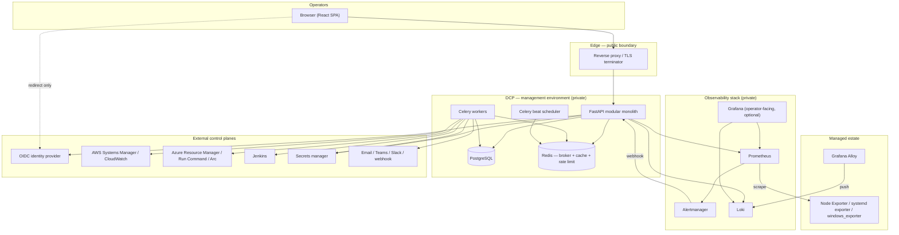

### 1.2 Explicit non-goals for the initial release

Carried verbatim in intent from PRD §14: no interactive terminal, no arbitrary root execution, no custom metrics or log store, no Kubernetes management surface, no autonomous remediation, no unapproved production deploys.

---

## 2. Components and responsibilities

### 2.1 Frontend — React SPA

Single-page application served as static assets through the reverse proxy on the same origin as the API (`/` → SPA, `/api/v1` → backend). Same-origin keeps the session cookie `SameSite=Strict` and removes the need for permissive CORS (AD-02, [SECURITY.md §12](SECURITY.md#12-cors)).

Responsibilities: rendering dashboards/tables/charts/log views, filter and pagination state, optimistic-free async operation progress, confirmation dialogs that restate target + environment + action, accessible loading / empty / **stale** / error states, dark and light themes.

Explicitly **not** responsible for: authorisation decisions (it hides controls for usability only), any credential, any provider-specific branching beyond labels, constructing PromQL or LogQL.

### 2.2 Backend — FastAPI modular monolith (AD-01)

One deployable process, internally partitioned by domain. Proposed module layout (to be created in Phase 1, see [IMPLEMENTATION_PLAN.md](IMPLEMENTATION_PLAN.md)):

```
backend/app/
  main.py                 # app factory, middleware, router mounting
  core/                   # config, logging, correlation IDs, errors, pagination
  auth/                   # OIDC flow, session, current-identity dependency
  authz/                  # permission model, require_permission dependency, scope resolution
  inventory/              # cloud_accounts, servers, applications, services
  metrics/                # Prometheus query builder + client
  logs/                   # Loki LogQL builder + client
  alerts/                 # Alertmanager webhook receiver, ack/assign, notification routing
  operations/             # service-operation lifecycle + state machine
  deployments/            # Jenkins orchestration + lifecycle
  approvals/              # approval policy evaluation + decisions
  audit/                  # append-only audit writer + query API
  providers/              # adapter interface + aws/, azure/, agent/, demo/
  admin/                  # users, roles, settings
  workers/                # Celery app, tasks, beat schedule
```

**Module dependency rule:** `core` ← `auth`/`authz` ← domain modules ← `providers`. Domain modules may not import each other's internals; they interact through each other's service-layer functions. `audit` and `authz` are importable by everything (cross-cutting). This rule is what keeps the monolith splittable later without becoming a distributed system now.

### 2.3 Background workers — Celery

Separate OS processes, same codebase and image as the API. Queues separated by blast radius and latency class so a throttled cloud API cannot starve notifications:

| Queue | Work | Concurrency profile |
|---|---|---|
| `operations` | service start/stop/restart + verification | low concurrency, long timeout |
| `deployments` | Jenkins trigger, poll, post-deploy health checks | low concurrency, long timeout |
| `integrations` | inventory sync, connectivity checks | moderate |
| `notifications` | email/Teams/Slack/webhook delivery | high concurrency, short timeout |
| `maintenance` | retention, stale sweeps, export | serialised |

`celery beat` owns scheduled work: inventory synchronisation, management-connectivity probes, application health checks, stale-data sweep, retention/partition maintenance, notification retry drain.

### 2.4 PostgreSQL

Durable record for inventory, identity/permissions, operation and deployment state, approvals, alert lifecycle, and audit. See [DATABASE.md](DATABASE.md). Never stores raw metric samples or log lines (PRD §6).

### 2.5 Redis

Celery broker and result backend, session store (AD-02; OPEN-04 resolved in M1.3 as Redis-only), rate-limit counters, short-TTL caches for dashboard aggregates and provider metadata.

**Constraint (PRD §5.4):** Redis is never the only durable record of a privileged operation. Every operation and deployment row is written to PostgreSQL **before** a task is enqueued, and the task carries only the row id.

### 2.6 Monitoring and logging components

- **Prometheus** — scrapes exporters, evaluates alert rules, serves `/api/v1/query` and `/api/v1/query_range` to DCP.
- **Node Exporter** (Linux host), **systemd exporter / restricted agent** (unit state), **windows_exporter** (Windows hosts) — on each managed server.
- **Alertmanager** — dedupes/groups/routes; posts to DCP's webhook receiver.
- **Grafana Alloy** — on each managed server: tails journald, Nginx, PHP-FPM, application and Docker logs; applies redaction and label limits; pushes to Loki.
- **Loki** — log store, queried by DCP via LogQL.
- **Grafana** — optional operator-facing deep-dive UI; not a dependency of DCP's own pages.

---

## 3. Request and response data flows

### 3.1 Read path — a dashboard page load

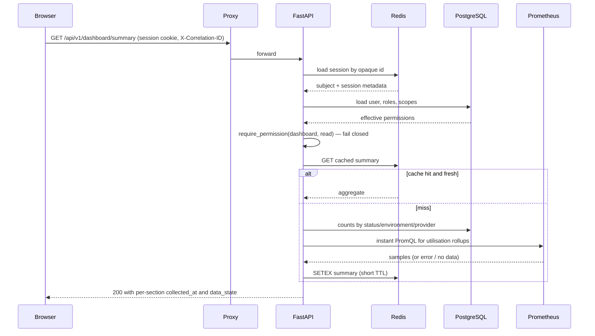

**Hard rule (PRD §4.2):** each section of the response carries `data_state` ∈ `ok | stale | unavailable` plus `collected_at`. A Prometheus failure yields `unavailable` for that section and HTTP 200 for the rest — never `0`, never a whole-page 500. This shape is specified in [API_CONTRACTS.md §4](API_CONTRACTS.md#4-partial-data-and-data_state).

### 3.2 Write path — a privileged service operation

```mermaid
sequenceDiagram
    participant B as Browser
    participant A as FastAPI
    participant D as PostgreSQL
    participant Q as Redis queue
    participant W as Celery worker
    participant S as Provider (SSM / Run Command / agent)

    B->>A: POST .../operations {action: restart} + Idempotency-Key
    A->>A: authn, authz, allowlist check (server, service, action)
    A->>D: SELECT existing op by idempotency_key
    alt replay
        D-->>A: existing operation
        A-->>B: 200 original operation (no re-execution)
    else new
        A->>D: BEGIN; INSERT operation (PENDING|AWAITING_APPROVAL); INSERT audit_event; COMMIT
        A->>Q: enqueue execute_operation(operation_id) only if PENDING
        A-->>B: 202 Accepted {operation_id, status}
    end
    W->>D: claim row (PENDING -> RUNNING, guarded UPDATE)
    W->>S: invoke allowlisted operation
    S-->>W: provider execution id
    W->>S: poll until terminal or timeout
    W->>S: verify resulting service state
    W->>D: terminal status + sanitized_result + audit_event
    B->>A: GET /operations/{id} (poll)
    A-->>B: current status / terminal result
```

**Hard rule (PRD §4.6, §9):** `SUCCEEDED` is written only after the *verification* read confirms the intended end state. A provider returning "command sent" is `RUNNING`, not success.

---

## 4. Metrics collection architecture

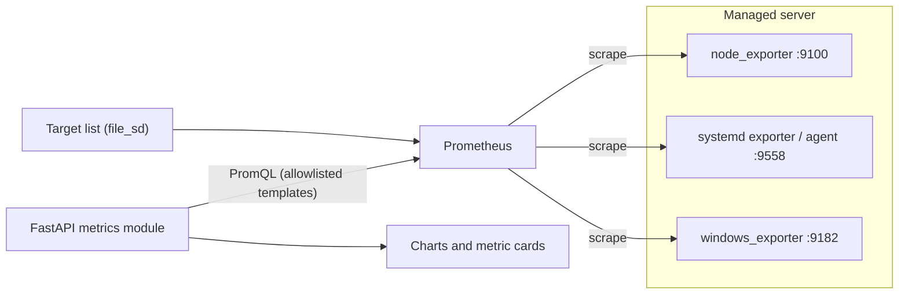

**Design points**

1. **Identity join (AD-04).** Every `servers` row carries a `metrics_instance` value that must equal the Prometheus `instance` label for that host. Without it, metrics cannot be attributed to a server (PRD §4.4 acceptance: "Metrics are associated with the correct server"). Registration validates the label resolves to at least one series before marking monitoring healthy.
2. **No raw PromQL from clients (AD-04).** The backend exposes a fixed set of named metric templates (`cpu_utilisation`, `memory_utilisation`, `memory_available_bytes`, `disk_utilisation`, `disk_available_bytes`, `disk_io`, `network_throughput`, `load_average`, `uptime_seconds`, `agent_up`). The client picks a template id, server id(s), time range and step; the backend renders the PromQL. This closes a PromQL-injection and cardinality-abuse hole in one decision.
3. **Target discovery (OPEN-14).** Default assumption: DCP writes a `file_sd` JSON file (or an equivalent config artifact) from inventory, which Prometheus reloads. Alternative is native cloud SD. Unresolved — affects Phase 2 ordering.
4. **Range guards.** Every range query is bounded by max points (`range / step ≤ 11 000`), a server-count cap for comparisons, and an upstream timeout (default 10 s). Exceeding a guard returns a structured 422, never an unbounded query.
5. **Stale vs zero (AD-14).** Health classification combines `servers.last_seen_at`, exporter `up`, and sample recency against per-environment thresholds (defaults: `warning` 2×scrape interval, `stale` 5 min, `unreachable` 15 min). Absent samples map to `unavailable`.

---

## 5. Centralized logging architecture

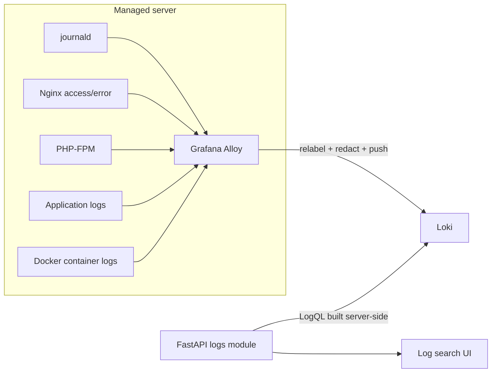

**Design points**

1. **Label contract (bounded cardinality, PRD §4.7).** Allowed stream labels only: `environment`, `server_id`, `hostname`, `application_id`, `service`, `source_type`, `level`. Request ids, user ids, trace ids, paths and container ids stay in the log *line*, never in labels.
2. **Server-side query construction (AD-05).** `POST /api/v1/logs/query` accepts structured filters (server ids, application id, service, level, free-text `contains`, regex-free by default, time range, limit, direction). The backend renders the LogQL selector and line filters, scoped to the servers/environments the caller may read. **Raw LogQL from a client is never accepted** — it would bypass scope filtering and allow cross-tenant reads.
3. **Redaction at two layers (PRD §4.7, §9).** Alloy applies regex redaction before push (defence in depth, best-effort); DCP applies an outbound redaction pass on every log line it returns, so a secret already in Loki is not re-exposed through the portal. Neither layer is claimed to be complete — see [SECURITY.md §17](SECURITY.md#17-sensitive-log-redaction).
4. **Bounds.** Default `limit` 200, max 1 000; max range 7 days per query; upstream timeout 15 s; cursor pagination on `(timestamp, line_hash)`. Retention and per-tenant limits are configured in Loki (OPEN-08).
5. **Authorisation is a filter, not a check.** The caller's readable environment/server set is intersected into the selector *before* the query is issued, so an over-broad filter silently narrows rather than erroring — and never leaks the existence of unreadable servers.

---

## 6. systemd service monitoring and management flow

### 6.1 Monitoring (read)

Unit state arrives as metrics, not as shell output: the systemd exporter (or restricted agent) exposes per-unit `load_state`/`active_state`/`sub_state`, restart counts and timestamps. Prometheus scrapes it; DCP reads it per server and **normalises** into the PRD §4.5 state set.

Normalisation table (single implementation, unit-tested — PRD §12):

| Source condition | Normalised state |
|---|---|
| `active_state=active`, `sub_state=running` | `ACTIVE` |
| `active_state=inactive` | `INACTIVE` |
| `active_state=failed` or `sub_state=failed` | `FAILED` |
| `active_state=activating` | `ACTIVATING` |
| `active_state=deactivating` | `DEACTIVATING` |
| Exporter series absent but host `up` | `UNCOLLECTED` |
| Host unreachable / stale | `UNKNOWN` (host-level stale wins) |
| Platform has no systemd (Windows) | `UNSUPPORTED` |

**Acceptance-critical (PRD §4.5):** an unreachable host must not render as "all services inactive". Host staleness is evaluated *first* and overrides unit state for the whole server; `UNCOLLECTED`, `UNSUPPORTED` and `FAILED` are distinct states, never collapsed.

### 6.2 Management (write)

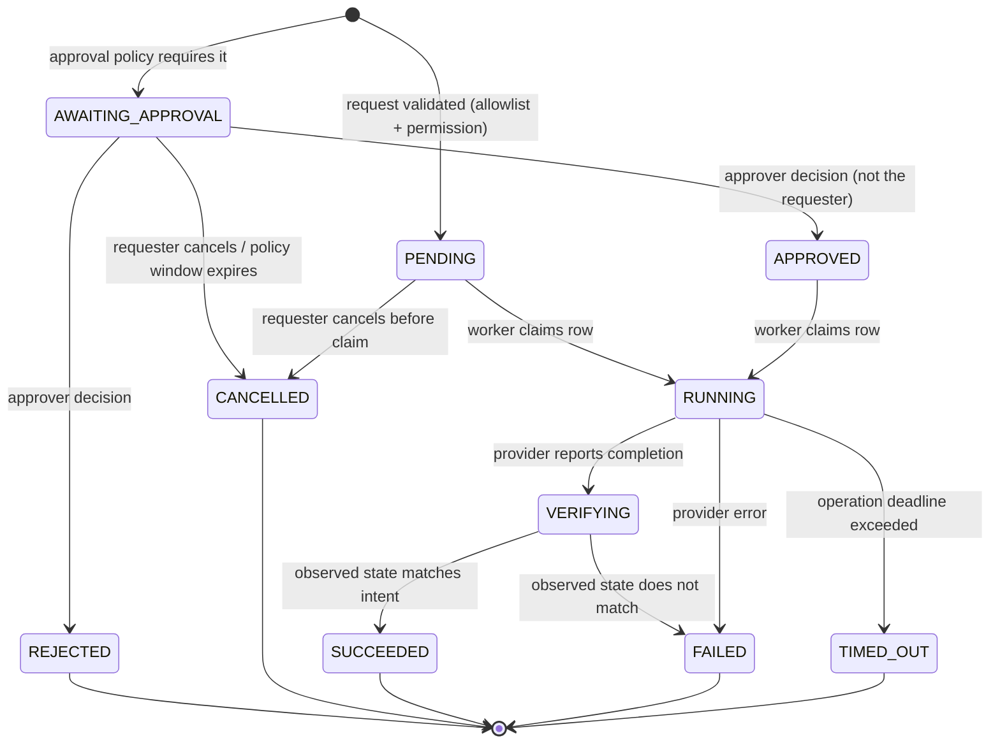

`VERIFYING` is an internal step added to the PRD §4.6 state list so that "verify the resulting service state" is a *representable* state rather than an implicit gap. It is surfaced to the API as `RUNNING` to keep the public enum identical to the PRD's (see [API_CONTRACTS.md §9](API_CONTRACTS.md#9-enums)); this is AD-09 and is flagged for review.

Allowlist gate, evaluated in order, all server-side:

1. Session valid → else 401 (fail closed).
2. Server exists, is `MANAGED`, not soft-deleted → else 404.
3. Service row exists for that server and `monitoring_enabled`/manageable → else 404. Arbitrary unit names are never passed through.
4. Action ∈ `{start, stop, restart}` ∩ the service's action policy allowlist → else 403.
5. Caller holds `service:{action}` on that server's environment scope → else 403.
6. Rate limit and concurrent-operation-per-target guard → else 429.
7. Approval policy evaluated → `PENDING` or `AWAITING_APPROVAL`.

---

## 7. Cloud-provider adapter architecture

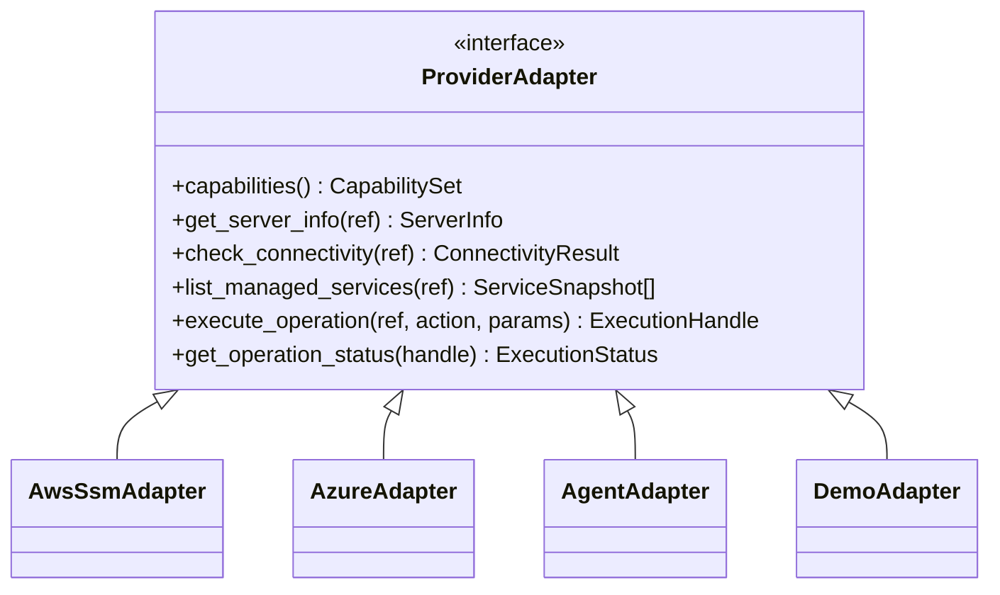

All adapters return a common result envelope and raise a common error taxonomy; **no provider branching above the adapter layer**, and none at all in the frontend (PRD §4.11).

### 7.1 Error taxonomy

`AuthenticationError`, `AuthorizationError`, `NotFound`, `Throttled(retry_after)`, `Timeout`, `UnsupportedOperation`, `PartialFailure`, `ProviderUnavailable`, `NotConfigured`. Each maps to a documented API error code ([API_CONTRACTS.md §3](API_CONTRACTS.md#3-error-format)) and a retry policy ([§10](#10-error-handling-retries-timeouts-and-idempotency)).

### 7.2 Capability matrix — providers are **not** interchangeable

| Capability | AWS (SSM) | Azure (ARM / Run Command / Arc) | Registered Linux (agent) | Demo |
|---|---|---|---|---|
| Inventory sync | Yes | Yes | No (manual registration) | Synthetic |
| Connectivity check | `DescribeInstanceInformation` ping state | Agent/Arc status | Agent heartbeat | Always ok |
| Allowlisted service control | Yes, via registered SSM document | Yes, via registered Run Command script | Yes, fixed RPC verbs | Simulated |
| Async handle + polling | Yes (`CommandId`) | Yes (async operation) | Yes (job id) | Immediate |
| Concurrent invocation limits | Account/region throttles | Per-VM Run Command serialisation | Agent-defined | None |
| Typical latency | seconds | seconds to tens of seconds | sub-second | none |
| Windows unit control | n/a for systemd | n/a for systemd | n/a | n/a |

The UI must render `UnsupportedOperation` explicitly ("not supported for this provider"), never as a generic failure (PRD §4.11 acceptance). Azure Run Command's per-VM serialisation and AWS's account-level throttling are different failure modes and must not share one retry constant.

### 7.3 Execution model — allowlisted operations, never shell (AD-07)

The adapters invoke **pre-registered, parameter-constrained** provider artifacts:

- **AWS:** a custom SSM document (e.g. `DCP-ServiceControl`) whose parameters are a closed enum of actions and a service name validated against the DB allowlist before invocation. The execution IAM role is scoped by resource tag and document name, so even a compromised backend cannot run `AWS-RunShellScript`. See [SECURITY.md §8](SECURITY.md#8-cloud-credentials-and-execution-identity).
- **Azure:** a registered Run Command script with the same closed parameter set, under a managed identity holding only the specific action on a scoped resource group.
- **Registered Linux:** a restricted agent exposing fixed verbs (`status`, `start`, `stop`, `restart`, `logs_tail`) with no free-form command field (OPEN-05: build vs adopt SSM hybrid activations / Azure Arc).
- **Demo:** returns `NotConfigured` for writes and synthetic data for reads, always flagged in responses (AD-15).

String interpolation of user input into any command body is prohibited; parameters are passed as typed provider parameters.

---

## 8. Jenkins deployment integration

```mermaid
sequenceDiagram
    participant U as Requester
    participant A as FastAPI
    participant D as PostgreSQL
    participant AP as Approver
    participant W as Worker
    participant J as Jenkins

    U->>A: POST /deployments {application_id, environment, ref} + Idempotency-Key
    A->>D: resolve registered deployment_target (pipeline + allowed refs)
    A->>A: validate ref against target policy; evaluate approval policy
    A->>D: INSERT deployment (REQUESTED | AWAITING_APPROVAL) + audit_event
    A-->>U: 202 {deployment_id, status}
    opt production
        AP->>A: POST /deployments/{id}/approve
        A->>D: approval row + status APPROVED + audit_event
    end
    W->>J: build with parameters (from target config only)
    J-->>W: queue item -> build number
    W->>D: QUEUED -> RUNNING, external_execution_id
    loop poll with backoff
        W->>J: build status + console tail
        W->>D: progress
    end
    W->>W: run configured post-deployment health checks
    W->>D: SUCCEEDED only if pipeline success AND health checks pass
```

### 8.1 Deployment state machine

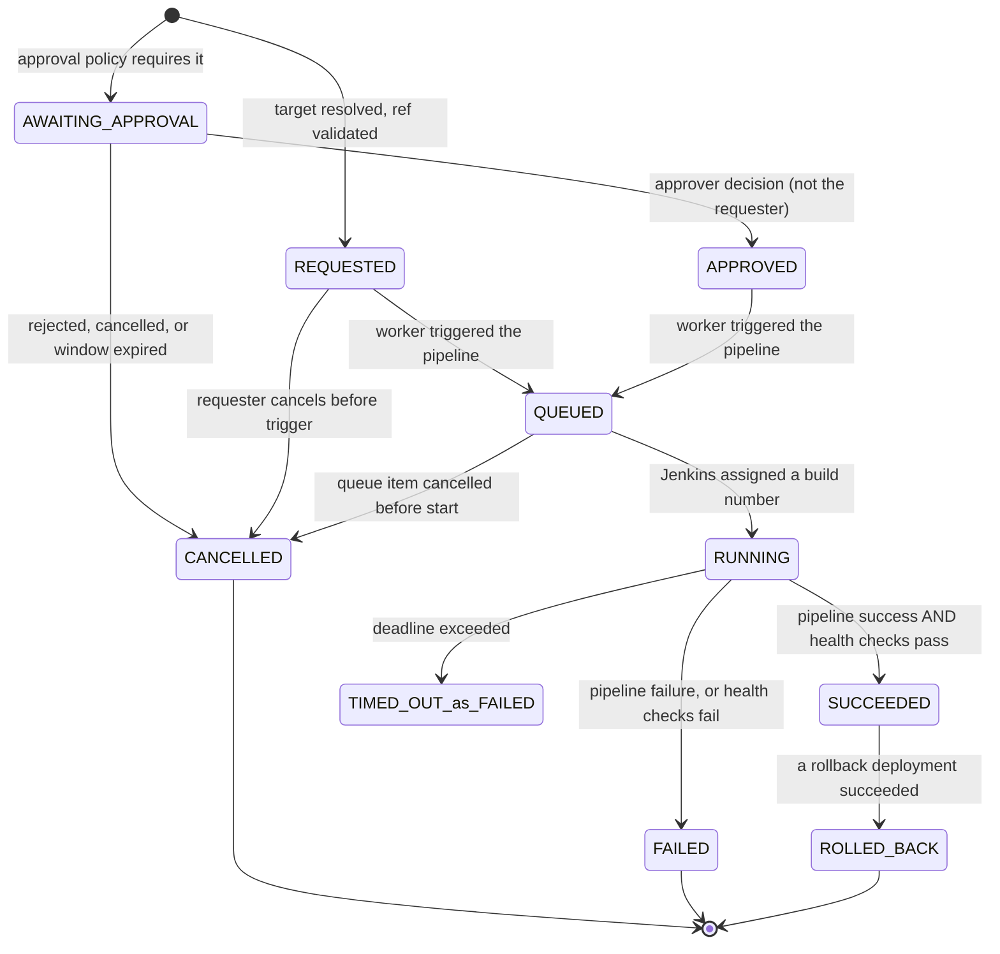

Two notes on this diagram. `TIMED_OUT_as_FAILED` is a diagram label, not a status: the public `DeploymentStatus` enum has no `TIMED_OUT` member (PRD §4.10 does not list one), so a deadline breach is recorded as `FAILED` with `failure_reason = DEPLOYMENT_TIMED_OUT`. And `ROLLED_BACK` is reached only *after* a separate rollback deployment succeeds — it is never set optimistically when a rollback is merely requested.

**Design points**

1. **Registered targets only (PRD §4.10).** `deployment_targets` holds the Jenkins job path, parameter template, allowed ref patterns, approval policy and health-check config. The API accepts `application_id + environment + ref` — never a Jenkins URL, never arbitrary build parameters.
2. **Success is conjunctive (AD-10).** Pipeline success alone is `RUNNING`→ health-check phase. Failing health checks produce `FAILED` with the pipeline result preserved, satisfying "never report deployment success until the pipeline and configured health checks satisfy the success policy".
3. **Health checks are SSRF-controlled.** Only pre-registered health-check URLs from the target config are fetched, resolved against a host allowlist, with no redirect following ([SECURITY.md §19](SECURITY.md#19-ssrf)).
4. **Jenkins outage degrades, not breaks.** `ProviderUnavailable` leaves the deployment in its current state with `last_poll_error` recorded; the poller retries with backoff until a deadline, then `FAILED` with `failure_reason = DEPLOYMENT_TIMED_OUT`. Deployment pages render the staleness.
5. **Build logs** are streamed through the backend with the same redaction pass as application logs, gated on deployment-read permission for that environment.
6. **Rollback** is modelled as a *new* deployment with `kind=rollback` referencing the prior deployment, only where the registered target declares rollback support (PRD §4.10 "when the deployment system provides one"). DCP does not invent a rollback mechanism.

---

## 9. Authentication and authorization flow

### 9.1 Authentication — OIDC authorization code + PKCE, backend-for-frontend (AD-02)

```mermaid
sequenceDiagram
    participant B as Browser
    participant A as FastAPI
    participant I as OIDC provider
    participant R as Redis
    participant D as PostgreSQL

    B->>A: GET /api/v1/auth/login?next=/servers
    A->>R: store state + PKCE verifier + next (short TTL)
    A-->>B: 302 to IdP authorize
    B->>I: authenticate (MFA per IdP policy)
    I-->>B: 302 /api/v1/auth/callback?code&state
    B->>A: callback
    A->>R: validate + consume state, load verifier
    A->>I: token exchange (confidential client secret from secrets manager)
    I-->>A: id_token (+ access_token)
    A->>A: verify signature (JWKS), iss, aud, exp, nonce
    A->>D: upsert user by identity_provider_subject; INSERT audit_event(LOGIN_SUCCEEDED)
    A->>R: create session (opaque id -> user_id, issued_at, absolute/idle deadlines)
    A-->>B: Set-Cookie dcp_session (HttpOnly, Secure, SameSite=Strict, Path=/); 302 next
```

No token is readable by JavaScript; the SPA holds no token at all. Logout deletes the server-side session, clears the cookie, and audits. Failed authentication is audited without credential material (PRD §4.1).

### 9.2 Authorization — RBAC with scope, evaluated per request (AD-03)

Permissions are **never** read from token claims. On every request the identity's roles and scopes are resolved from PostgreSQL — one indexed join on `user_roles`, with **no cache** — so revocation takes effect immediately with no release (PRD §4.1 acceptance).

> **Amended in M1.4 (2026-10-14), with product-owner agreement.** This section and `AD-03` previously specified a short-TTL cache keyed by `user_id` + a `permissions_version` counter bumped on any role, permission or scope change. Neither is built. The correctness requirement in PRD §4.1 is per-request resolution; the cache was an optimisation with no measured need, and a wrong invalidation can only ever make revocation *less* immediate than no cache at all. `permissions_version` does not exist in the schema and nothing bumps it. Revisit only if a measurement shows per-request resolution is too slow — the counter is an additive change whenever that happens.

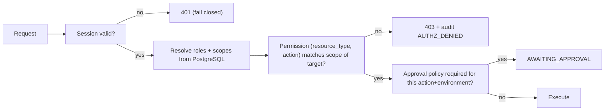

Scope is a conjunction of `environment`, `cloud_account`, `server`, `application` and `*`. The matcher is one function, unit-tested with a table of allow/deny cases, and defaults to **deny** on any unresolvable scope, missing target, or evaluation error. Role definitions and the full permission matrix live in [SECURITY.md §3–§4](SECURITY.md#3-roles).

---

## 10. Error handling, retries, timeouts, and idempotency

### 10.1 Layered timeouts

| Hop | Default | Notes |
|---|---|---|
| Proxy → API | 30 s | Long work never happens inline |
| API → PostgreSQL statement | 5 s | `statement_timeout` per session |
| API → Prometheus | 10 s | Returns `data_state=unavailable` |
| API → Loki | 15 s | Query bounds enforced before dispatch |
| API → provider (sync calls) | 10 s | Inventory/connectivity reads only |
| Worker → provider invoke | 30 s | Submission, not completion |
| Operation wall clock | 300 s (configurable per action) | Exceeded ⇒ `TIMED_OUT` |
| Deployment wall clock | 3 600 s (configurable per target) | Exceeded ⇒ `FAILED` / `DEPLOYMENT_TIMED_OUT` (the enum has no `TIMED_OUT`) |
| Health check (single) | 10 s, 3 attempts | Per registered check |

Each inner timeout is strictly less than its caller's. Any operation lacking a deadline is a bug.

### 10.2 Retry policy by error class

| Error class | Retry? | Policy |
|---|---|---|
| `Throttled` | Yes | Honour `retry_after`, else exponential backoff + full jitter, cap 5 |
| `Timeout` on a **read** | Yes | 2 retries, backoff |
| `Timeout` on a **write/invoke** | **No** | Reconcile instead — see §10.3 |
| `ProviderUnavailable` | Yes | Backoff, cap 5, then terminal with diagnostics |
| `AuthenticationError` | Once after forced credential refresh | Then terminal; raise integration alert |
| `AuthorizationError` | No | Terminal; audit; surface as configuration problem |
| `UnsupportedOperation` | No | Terminal; surfaced explicitly in UI |
| `PartialFailure` | No | Terminal `FAILED`, per-target detail retained |

### 10.3 Idempotency and duplicate suppression (AD-08)

Three independent mechanisms, because retries exist at three layers:

1. **Client → API.** `Idempotency-Key` is required on `POST` endpoints that create operations or deployments. `(requested_by, endpoint, idempotency_key)` is unique; a replay returns the original resource with `200` and does not re-execute (PRD §4.6, §4.10).
2. **API → worker.** Tasks are idempotent by row id. The worker claims work with a guarded transition (`UPDATE ... WHERE id=? AND status='PENDING'`); a duplicate delivery loses the race and exits. Celery `acks_late` + a visibility timeout longer than the operation deadline prevents double delivery from a slow task.
3. **Worker → provider.** The provider execution id is persisted *before* polling begins. On worker restart, reconciliation looks up the stored handle and resumes polling rather than re-invoking. If the id was never recorded, the operation goes to `FAILED` with `reconciliation_required` — **DCP never blind-retries a state-changing provider call** (PRD §10 "Retries must avoid unintended duplicate actions").

Additionally, at most one in-flight operation per `(server, service)` is permitted; a second request returns `409 operation_in_progress`.

### 10.4 Failure containment

One provider's outage must not degrade unrelated pages (PRD §4.11, §10). Mechanisms: per-integration circuit breaker with half-open probes; per-integration connection pools and worker queues; section-level `data_state` instead of whole-response failure; an `/api/v1/integrations/status` page that names the degraded dependency; and self-monitoring of DCP's own API, workers and queue depth.

---

## 11. Network and trust boundaries

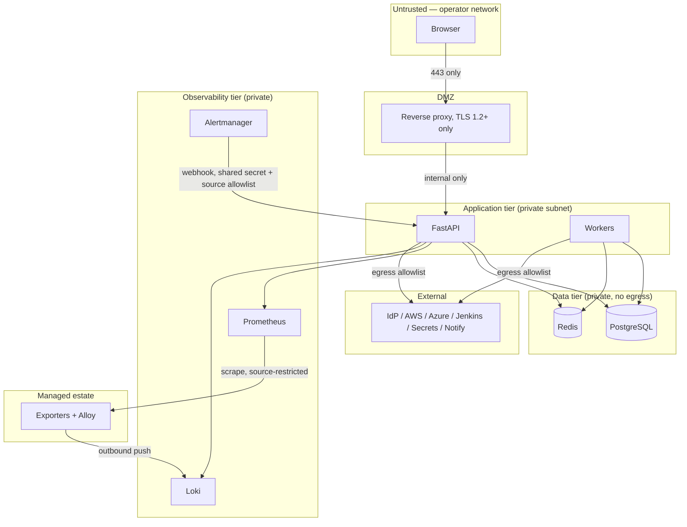

Trust-boundary rules:

- **T0→T1** is the only public ingress; HTTPS only, HSTS, no direct API exposure.
- **T2** holds all authorisation decisions. Nothing in T0 is trusted, including "is this user an admin".
- **T3** is reachable only from T2 and has no outbound internet route.
- **T4→T2** (the Alertmanager webhook) is an *inbound* path from a lower-trust component: authenticated with a shared secret, source-IP restricted, schema-validated, rate-limited, and treated as untrusted input ([SECURITY.md §21](SECURITY.md#21-alert-webhook-ingress)).
- **T5** exposes no inbound management port to DCP. Exporter ports are restricted to the Prometheus source; Alloy pushes outbound. Public SSH to managed servers is not required anywhere in this design (PRD §9).
- **T6** egress is a host allowlist from T2 only; no user-supplied destination is ever fetched.

---

## 12. Local development architecture (Docker Compose)

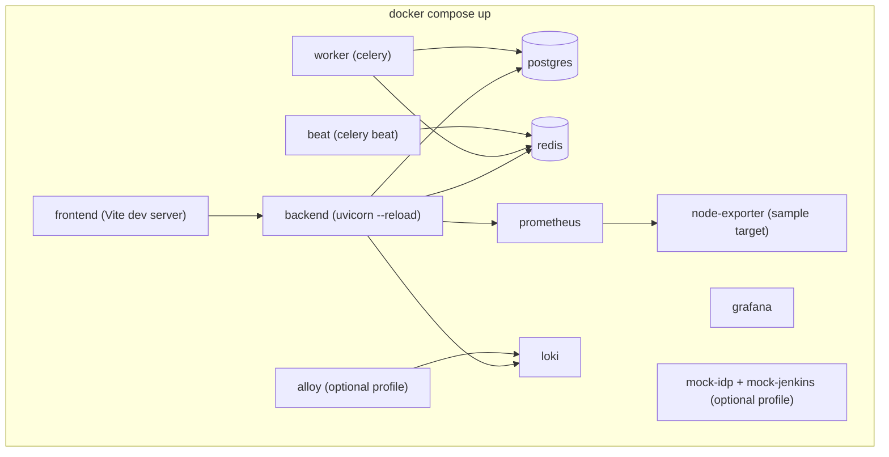

Requirements from PRD §11: cloud integrations are optional locally and the app must start without production credentials.

- **Demonstration mode (AD-15).** `DCP_DEMO_MODE=true` selects `DemoAdapter`, a mock OIDC provider and a mock Jenkins. Every affected API response carries `"demo_mode": true` and the UI shows a persistent banner. Demo data is clearly synthetic and is never presented as a live integration.
- Compose **profiles** keep the default `up` light: `core` (frontend, backend, worker, beat, postgres, redis), `observability` (prometheus, grafana, loki, node-exporter), `logs` (alloy), `mocks` (mock-idp, mock-jenkins).
- `.env.example` contains placeholders only; no real credential ever enters the repository.
- A `compose` smoke test asserts: all core services healthy, migrations applied, `/healthz` and `/readyz` green, one seeded server visible, demo banner present ([TESTING.md §11](TESTING.md#11-docker-compose-smoke-tests)).

---

## 13. Initial deployment topology

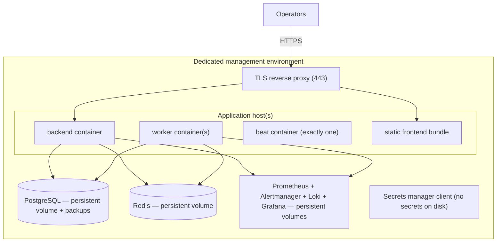

Initial topology is Docker Compose on a dedicated management host (PRD §11, "use Docker Compose for the initial proof of concept if suitable"), with:

- Single `beat` instance (a second scheduler double-fires jobs).
- Horizontally scalable `worker` count per queue.
- Resource limits on every container; read-only root filesystems; non-root users.
- Database backups with a *tested* restore ([TESTING.md §14](TESTING.md#14-backup-and-recovery-tests)).
- Container images pinned by digest and scanned before deploy.

**This topology is a single-host single point of failure and is not highly available.** That is an accepted, documented trade-off for the proof of concept (PRD §14 defers HA) and is OPEN-12.

### 13.1 Future scaling considerations (not in scope now)

Documented so the schema and module boundaries do not block them: move containers to ECS/AKS behind a managed load balancer; PostgreSQL to a managed instance with a read replica for dashboard aggregates; split the `operations`/`deployments` workers into their own autoscaling group; promote a module to a service only if an independent scaling or failure-isolation need is *measured*; Prometheus federation or remote-write if cardinality outgrows one instance; Loki to object storage with per-tenant limits. Partition `audit_events` and `alert_events` by month from day one so growth never requires a rewrite.

---

## 14. Background job execution and operation lifecycle

Lifecycle invariants (enforced in code, covered by tests in [TESTING.md §7](TESTING.md#7-background-worker-tests)):

1. **DB first.** The row exists and is committed before enqueue. A lost queue message is recoverable; a lost row is not.
2. **Guarded transitions.** Every status change is a conditional `UPDATE` asserting the expected current status, so concurrent workers cannot both advance one row. Illegal transitions raise rather than silently pass.
3. **Terminal is terminal.** `SUCCEEDED | FAILED | TIMED_OUT | CANCELLED | REJECTED` are never left. A retry creates a new row linked by `parent_operation_id`.
4. **Deadline carried on the row.** `deadline_at` is set at creation, so a worker that restarts can still time the operation out correctly.
5. **Reaper.** A beat job moves rows past `deadline_at` to `TIMED_OUT` with a reason, catching crashed workers (PRD §12 failure scenario "worker crashes during an operation").
6. **Sanitized results only.** `sanitized_result` passes through redaction before persistence; raw provider output is never stored verbatim.
7. **Every transition audits.** Create, approve/reject, claim, terminal — each writes an `audit_event` with the same `correlation_id`.

---

## 15. Observability of DCP itself

DCP is monitored by the same stack it operates (PRD §10): its own `/metrics` endpoint (request latency/error rates by route, queue depth, task duration and failure counts by queue, provider call latency/error rates by provider and error class, circuit-breaker state, session count), structured JSON logs with `correlation_id` shipped to Loki, and alert rules on API 5xx rate, queue backlog, beat liveness, operation timeout rate, migration failure, and integration circuit-breaker open. Monitoring and log-collection failures must themselves be visible, not silent.

---

## 16. Data flow summary by feature

| Feature | Read path | Write path | Durable record |
|---|---|---|---|
| Dashboard | PG aggregates + PromQL | — | — |
| Server inventory | PG | API → PG | PG |
| Server metrics | PromQL templates | — | Prometheus |
| systemd services | PromQL (exporter) + PG last-observed | — | Prometheus + PG snapshot |
| Service operations | PG | API → PG → Celery → provider → verify → PG | PG `operations` |
| Logs | LogQL built server-side | — | Loki |
| Alerts | PG | Alertmanager webhook → PG; ack via API | PG `alert_events` |
| Deployments | PG + Jenkins poll | API → PG → Celery → Jenkins → health checks → PG | PG `deployments` |
| Approvals | PG | API → PG | PG `approvals` |
| Audit | PG (append-only) | Every privileged action | PG `audit_events` (+ export) |

---

## 17. Trade-offs accepted

| Decision | Benefit | Cost | Revisit when |
|---|---|---|---|
| Modular monolith | One deploy, one transaction boundary, fast iteration | Whole app redeploys together | A module needs independent scaling or isolation, measured |
| Server-side PromQL/LogQL construction | Closes injection and scope-bypass holes | Operators cannot write ad-hoc queries in DCP | Grafana link-out proves insufficient |
| Opaque cookie session + per-request DB authz | Immediate revocation, no token in JS | A DB/cache read per request | Request volume makes it hot (then cache harder, do not move to claims) |
| Allowlisted provider documents only | No arbitrary execution path exists | New operations need a registered artifact | Never — this is a hard security boundary |
| Polling for operation/deployment progress | Simple, no socket infrastructure | Up to one poll interval of latency | UX demands live streaming |
| Alert rules in Prometheus, not DB | Reuses a proven evaluator; rules are reviewable in git | No in-app rule editor initially | Admin self-service rule editing is required (OPEN-03) |
| Single-host Compose production | Fast to stand up, matches PRD | No HA; host loss is an outage | Availability requirements are set (OPEN-07, OPEN-12) |

---

## 18. Architecture decisions

| ID | Decision | Rationale |
|---|---|---|
| AD-01 | Modular monolith (FastAPI) + separate Celery workers | PRD §5.2; avoids distributed complexity before it is needed |
| AD-02 | OIDC auth code + PKCE, backend-for-frontend, opaque HttpOnly session cookie | No token in the browser; enables instant revocation; PRD §9 cookie/CSRF language implies cookie sessions |
| AD-03 | RBAC + scope rows, resolved per request from PostgreSQL, fail closed, **no cache** (amended M1.4 — see [§9.2](#92-authorization--rbac-with-scope-evaluated-per-request-ad-03)) | PRD §4.1 "revoked permissions take effect without a new release" |
| AD-04 | Metrics stay in Prometheus; backend renders allowlisted PromQL templates; `servers.metrics_instance` is the join key | PRD §6 forbids duplicating metrics; closes injection/cardinality abuse |
| AD-05 | Logs stay in Loki; backend builds LogQL from structured filters; raw LogQL from clients is rejected | Prevents scope bypass and cross-environment reads |
| AD-06 | Alert rules authored as Prometheus rule files in version control; Alertmanager posts to a DCP webhook; DCP owns lifecycle only | Reuses a proven evaluator; keeps rules reviewable |
| AD-07 | Provider writes go through pre-registered, parameter-constrained documents/scripts/RPC verbs; no shell | PRD §4.6, §9 mandatory rules |
| AD-08 | `Idempotency-Key` on state-creating POSTs; guarded worker claims; provider handle persisted before polling | PRD §4.6, §4.10, §10 |
| AD-09 | Operation state machine owned by the DB; verification precedes `SUCCEEDED`; internal `VERIFYING` surfaced as `RUNNING` | PRD §4.6; keeps the public enum exactly as specified |
| AD-10 | Deployment success = pipeline success **and** configured health checks pass | PRD §4.10 |
| AD-11 | `audit_events` append-only: app DB role has `INSERT`/`SELECT` only; monthly partitions; retention by export-then-drop | PRD §4.12 |
| AD-12 | `applications` are environment-agnostic; environment lives on `servers`, `deployment_targets`, `deployments` | Resolves PRD §4.9 vs §6 conflict. **Confirmed by the product owner 2026-10-14 (~~OPEN-02~~ closed)** |
| AD-13 | Soft delete only on inventory/identity tables; never on operations, deployments, approvals, audit, alerts | Operational history must not be erasable |
| AD-14 | Health/staleness computed from `last_seen_at` + exporter `up` + sample recency against per-environment thresholds; absent data ⇒ `unavailable` | PRD §4.2, §4.4 "must not silently replace unavailable data with zero" |
| AD-15 | `DCP_DEMO_MODE` with per-response `demo_mode` flag and a persistent UI banner | PRD §11; prevents mock data from masquerading as a live integration |
| AD-16 | Exact pins in lockfiles, ranges in manifests, container images pinned by digest | PRD §10 maintainability |
| AD-17 | `/api/v1`; additive-only within a major version; breaking changes ⇒ `/api/v2` | PRD §7 |
| AD-18 | `X-Correlation-ID` accepted or generated at the edge, propagated to tasks, logs and audit rows | PRD §7, §10 |
| AD-19 | Rate limits in Redis, per identity and per endpoint class, fail-closed on privileged classes | PRD §9 |
| AD-20 | All outbound HTTP destinations come from registered configuration and are checked against a host allowlist; no redirect following | PRD §9 SSRF |

---

## 19. Open decisions

Recorded rather than silently resolved. Each has a working default so Phase 1 is not blocked.

| ID | Question | Working default | Blocks |
|---|---|---|---|
| OPEN-01 | Which OIDC provider, and how do IdP groups map to DCP roles? | Generic OIDC discovery; roles assigned in DCP, not from claims | Phase 1 hardening |
| ~~OPEN-02~~ | PRD §4.9 lists `environment` as an application attribute, but §6 `applications` has no such column while `deployments` does. Is an application per-environment or environment-agnostic? | **RESOLVED 2026-10-14 by the product owner: environment-agnostic**, confirming `AD-12`. `applications` keeps no `environment` column; environment lives on `servers`, `deployment_targets` and `deployments`. One application spans environments, which is what PRD §4.9 needs when it says one application spans many servers | Closed. No migration; §18 response shapes stand as written |
| OPEN-03 | Are alert rules file-managed or editable in-app? | File-managed in git (AD-06) | Phase 3 scope |
| ~~OPEN-04~~ | Session store: Redis-only, or a durable `user_sessions` table? | **RESOLVED 2026-10-13 (M1.3): Redis-only.** No `user_sessions` table. Login, logout and denial are still audited in PostgreSQL, so the authentication record survives a flushed Redis even though live sessions do not. Accepted cost: a Redis restart logs everyone out. | ~~Phase 1~~ — closed |
| OPEN-05 | Restricted agent for non-cloud Linux: adopt SSM hybrid activations / Azure Arc, or build one? | Prefer adopt; defer build | Phase 4 |
| OPEN-06 | Which secret store is canonical in a multi-cloud portal? | Pluggable interface; one configured backend per deployment | Phase 1 config |
| OPEN-07 | RPO/RTO targets | Undefined; backups daily + WAL archiving as a starting point | Phase 6 |
| OPEN-08 | Metric and log retention durations and storage budget | Prometheus 30 d, Loki 14 d as placeholders | Phase 2/3 sizing |
| OPEN-09 | Windows hosts: metrics only, or Windows **service** management too? systemd is Linux-only. | Metrics only; service control is Linux/systemd only | Phase 2/4 scope |
| OPEN-10 | Approval policy granularity, and is self-approval ever permitted? | Per environment + action; self-approval denied by default (PRD §3.6) | Phase 4 |
| OPEN-11 | Is `owner_team` free text or a first-class `teams` table with scoping? | Free text initially; dashboard filter only | Phase 1/6 |
| OPEN-12 | Production topology and HA expectations | Single-host Compose in a dedicated management environment | Phase 6 |
| OPEN-13 | Notification channel configuration: DB-managed or environment config? | DB table added in Phase 3 (see [DATABASE.md](DATABASE.md)) | Phase 3 |
| OPEN-14 | Prometheus target discovery: DCP-generated `file_sd` or native cloud SD? | DCP-generated `file_sd` from inventory | Phase 2 |

---

## 20. Assumptions

1. Managed servers either run a cloud agent (SSM/Azure/Arc) or can run a restricted agent; DCP requires no inbound SSH.
2. Prometheus, Loki and Alertmanager are operated as part of this project in the management environment, reachable privately from DCP.
3. Jenkins already exists with the pipelines to be orchestrated; DCP does not create jobs.
4. A single management environment serves all monitored environments; environment separation is enforced by authorisation and provider scoping, not by separate DCP deployments.
5. The initial estate is in the low hundreds of servers, so PostgreSQL aggregates can serve dashboards without a pre-aggregation layer.
6. All operators authenticate through one corporate IdP; no local password authentication exists anywhere in the system.

**Nothing in this document describes an integration that has been built, a credential that exists, or a performance figure that has been measured.** All performance numbers are design budgets from PRD §10, which are explicitly stated there as engineering goals rather than guarantees.
