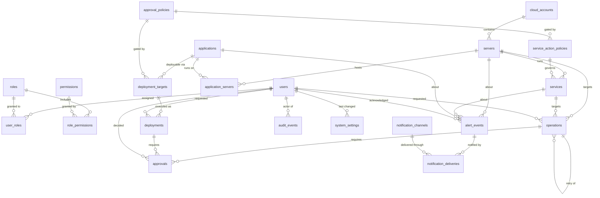

# Database — DevOps Control Plane

**Status:** Draft for review. **No migrations exist and no schema has been created.** This document is the design that Phase 1 migrations must implement.
**Source of truth:** [`../PRD.md`](../PRD.md) §6. **Related:** [ARCHITECTURE.md](ARCHITECTURE.md) · [API_CONTRACTS.md](API_CONTRACTS.md) · [SECURITY.md](SECURITY.md) · [IMPLEMENTATION_PLAN.md](IMPLEMENTATION_PLAN.md)

---

## 1. Scope and principles

PostgreSQL holds application metadata and operational state only (PRD §5.4, §6):

- **Stored here:** identity and permissions, inventory, service registration and policy, operation and deployment lifecycle, approvals, audit events, alert lifecycle, notification configuration and delivery attempts.
- **Never stored here:** raw Prometheus samples, whole log streams, cloud credentials, secret values, session tokens, or raw provider output (only redacted summaries).

Design rules:

1. **Normalised** relational design; JSONB only for genuinely open-shaped, non-queried-by-key data (sanitised results, scope definitions, provider metadata).
2. **UUID primary keys** (time-ordered v7 preferred, v4 acceptable), generated in the application so an id exists before insert for correlation.
3. **`timestamptz` everywhere**, always UTC. Never `timestamp without time zone` — operational timelines spanning regions make a naive timestamp a bug. Server defaults are declared as `text("now()")`, never a bare `"now()"` string: a literal string never compares equal to the reflected `DefaultClause`, which makes the autogenerate drift check fail permanently and therefore get ignored.
4. **`created_at` / `updated_at`** on every mutable table. `updated_at` is maintained by a trigger, not by application discipline.
5. **Enums as `text` + `CHECK` constraint**, not PostgreSQL `ENUM` types. Adding a value to a native enum requires a migration that cannot run inside some transaction contexts; a `CHECK` is editable and diff-reviewable. Values are fixed in [API_CONTRACTS.md §9](API_CONTRACTS.md#9-enums).
6. **Soft delete only where justified** ([§10](#10-soft-deletion)).
7. **Constraints over conventions.** Duplicate registration, duplicate operations and one-in-flight-per-target are enforced by indexes, not by application checks that race.
8. **Money/ordering of truth:** the row is the record. Redis is never the only durable record of a privileged operation (PRD §5.4).

---

## 2. Entity relationship diagram



Relationship notes the diagram cannot express:

- `alert_events.target_type` + `target_id` is a **polymorphic** reference (server, service, application, deployment or operation) and therefore has **no** foreign key; it is validated in application code and may be `NULL` for an unmatched alert. Same for `audit_events.target_type`/`target_id`. This is a deliberate trade-off ([§15](#15-polymorphic-references)).
- `approvals.operation_type` + `operation_id` is likewise polymorphic across `operations` and `deployments`.
- `operations.parent_operation_id` is a self-reference used for retries (terminal states are never re-entered — [ARCHITECTURE.md §14](ARCHITECTURE.md#14-background-job-execution-and-operation-lifecycle)).

---

## 3. Identity and access tables

### 3.1 `users`

Operators known to DCP, created on first successful OIDC login (just-in-time provisioning) or pre-created by an Administrator.

| Column | Type | Constraints | Notes |
|---|---|---|---|
| `id` | `uuid` | PK | |
| `identity_provider_subject` | `text` | **UNIQUE**, NOT NULL | The OIDC `sub`. The stable join to the IdP — never the email, which can be reassigned |
| `identity_provider_issuer` | `text` | NOT NULL | Supports an IdP migration without subject collisions |
| `email` | `citext` | NOT NULL, UNIQUE (partial, see below) | Display and notification routing only, never for authorisation |
| `display_name` | `text` | NOT NULL | |
| `status` | `text` | NOT NULL, CHECK in (`ACTIVE`,`DISABLED`) | `DISABLED` blocks login and terminates sessions |
| `last_login_at` | `timestamptz` | NULL | |
| `created_at` / `updated_at` | `timestamptz` | NOT NULL DEFAULT `now()` | |

- `UNIQUE (identity_provider_issuer, identity_provider_subject)` — the real identity key.
- `UNIQUE (email) WHERE status = 'ACTIVE'` — a retired address may be reused later.
- **No password column of any kind** (PRD §4.1). Authentication is entirely external.
- Users are **never hard-deleted**: audit events and operations reference them. Removal is `status='DISABLED'` ([§10](#10-soft-deletion)).

### 3.2 `roles`

| Column | Type | Constraints |
|---|---|---|
| `id` | `uuid` | PK |
| `name` | `text` | **UNIQUE**, NOT NULL, CHECK in (`VIEWER`,`DEVELOPER`,`DEVOPS_ENGINEER`,`APPROVER`,`ADMINISTRATOR`) |
| `description` | `text` | NOT NULL |
| `is_system` | `boolean` | NOT NULL DEFAULT `true` |
| `created_at` / `updated_at` | `timestamptz` | NOT NULL |

The five PRD §3 roles are seeded by migration. `is_system` rows cannot be renamed or deleted through the API. The `CHECK` is intentionally restrictive for v1; custom roles would relax it in a reviewed migration.

### 3.3 `permissions`

| Column | Type | Constraints | Notes |
|---|---|---|---|
| `id` | `uuid` | PK | |
| `resource_type` | `text` | NOT NULL | `dashboard`,`server`,`metrics`,`service`,`logs`,`alert`,`deployment`,`operation`,`audit`,`admin`,`integration` |
| `action` | `text` | NOT NULL | `read`,`write`,`start`,`stop`,`restart`,`create`,`approve`,`acknowledge`,`query`,`manage` |
| `scope_definition` | `jsonb` | NOT NULL DEFAULT `'{}'` | Constraints inherent to the permission itself (e.g. `{"environment_class":"non_production"}` for a non-prod-only deploy permission) |
| `description` | `text` | NOT NULL | |
| `created_at` | `timestamptz` | NOT NULL | |

- `UNIQUE (resource_type, action, scope_definition)`.
- Seeded by migration; **not** user-editable at runtime — the permission catalogue is code, and its matrix lives in [SECURITY.md §4](SECURITY.md#4-permissions-scope-and-resourceenvironment-restrictions).

### 3.4 `role_permissions` — *added entity*

**Justification:** the PRD defines `roles`, `permissions` and `user_roles` but no link between roles and permissions, so RBAC as specified in PRD §3.6/§4.1 cannot be expressed. This table is required for the model to function.

| Column | Type | Constraints |
|---|---|---|
| `role_id` | `uuid` | PK part, FK → `roles(id)` ON DELETE CASCADE |
| `permission_id` | `uuid` | PK part, FK → `permissions(id)` ON DELETE RESTRICT |
| `effect` | `text` | NOT NULL DEFAULT `'ALLOW'`, CHECK in (`ALLOW`,`DENY`) |
| `created_at` | `timestamptz` | NOT NULL |

PK `(role_id, permission_id)`. `DENY` beats `ALLOW` in the matcher ([SECURITY.md §4](SECURITY.md#4-permissions-scope-and-resourceenvironment-restrictions)).

### 3.5 `user_roles`

| Column | Type | Constraints | Notes |
|---|---|---|---|
| `id` | `uuid` | PK | A surrogate key, because the same role may be granted twice with different scopes |
| `user_id` | `uuid` | NOT NULL, FK → `users(id)` ON DELETE RESTRICT | |
| `role_id` | `uuid` | NOT NULL, FK → `roles(id)` ON DELETE RESTRICT | |
| `scope_definition` | `jsonb` | NOT NULL DEFAULT `'{}'` | `{"environment":["production"],"application":["<uuid>"],"server":["*"]}` |
| `granted_by` | `uuid` | NOT NULL, FK → `users(id)` | Attribution for privilege changes (rule 10) |
| `expires_at` | `timestamptz` | NULL | Supports time-boxed elevation |
| `created_at` / `updated_at` | `timestamptz` | NOT NULL | |

- `UNIQUE (user_id, role_id, scope_definition)` — prevents duplicate identical grants.
- Index `(user_id)` for per-request resolution; GIN on `scope_definition` if scope filtering becomes a hot path (add only when measured).
- Every insert, update and delete writes an `audit_event`. There is **no** `permissions_version` column or counter: grants are resolved per request with no cache, so there is nothing to invalidate (amended in M1.4 — [ARCHITECTURE.md §9.2](ARCHITECTURE.md#92-authorization--rbac-with-scope-evaluated-per-request-ad-03)).

**Scope JSON shape** (validated by Pydantic, not by the database): keys from `{environment, cloud_account, server, application}`, each an array of UUIDs or the literal `"*"`. An empty object means "no scope" and grants nothing. `"*"` on `environment` does **not** include `production` ([SECURITY.md §4](SECURITY.md#4-permissions-scope-and-resourceenvironment-restrictions)). A dimension that is **absent** is unconstrained — except that production is never implicit ([SECURITY.md §4](SECURITY.md#4-permissions-scope-and-resourceenvironment-restrictions) dimension semantics, assumption `A-09`).

### 3.6 `system_settings` — *added entity (M1.4)*

**Justification:** [SECURITY.md §27](SECURITY.md#27-incident-response) requires a read-only mode flag and names it the *first* containment step in an incident involving this portal. It therefore has to survive a restart and a Redis flush (which rules out Redis) and be flippable without a redeploy (which rules out an environment variable). The PRD defines no table for it.

| Column | Type | Constraints | Notes |
|---|---|---|---|
| `key` | `text` | PK, CHECK in (`read_only_mode`) | A closed set: a typo would otherwise create a second, dead row while the real switch stayed off |
| `value` | `jsonb` | NOT NULL | `true`/`false` for `read_only_mode`; compared against the JSON literal, never coerced |
| `updated_by` | `uuid` | NULL, FK → `users(id)` ON DELETE RESTRICT | NULL for the migration-seeded default — no operator set it |
| `updated_at` | `timestamptz` | NOT NULL DEFAULT `now()` | Maintained by the shared `set_updated_at` trigger |

- Seeded by migration `0003` with `read_only_mode = false`. The row's **presence** is part of the contract: the reader fails closed on a missing or non-boolean value, so "no row" means "refuse writes", not "writes allowed".
- Every change writes a `READ_ONLY_MODE_CHANGED` audit event in the same transaction ([API_CONTRACTS.md §25.10](API_CONTRACTS.md#25-user-and-role-administration)).
- No `created_at` and no soft delete: the row set is fixed by the `CHECK`, so there is nothing to create or retire at runtime.

---

## 4. Inventory tables

### 4.1 `cloud_accounts`

A provider account, subscription, or the logical container for non-cloud servers.

| Column | Type | Constraints | Notes |
|---|---|---|---|
| `id` | `uuid` | PK | |
| `provider` | `text` | NOT NULL, CHECK in (`AWS`,`AZURE`,`ON_PREM`,`OTHER`) | Adapter selector |
| `account_reference` | `text` | NOT NULL | AWS account id / Azure subscription id / a site label. **An identifier, never a credential** |
| `display_name` | `text` | NOT NULL | |
| `region_configuration` | `jsonb` | NOT NULL DEFAULT `'{}'` | Allowed regions and defaults; also an authorisation boundary |
| `credential_reference` | `text` | NULL | A **secret-store path or role ARN**, never a secret value ([SECURITY.md §9](SECURITY.md#9-secrets-management)) |
| `status` | `text` | NOT NULL, CHECK in (`ACTIVE`,`DISABLED`,`ERROR`) | `DISABLED` immediately stops all operations for this account — a containment control |
| `last_sync_at` | `timestamptz` | NULL | |
| `last_sync_error` | `text` | NULL | Redacted |
| `deleted_at` | `timestamptz` | NULL | Soft delete |
| `created_at` / `updated_at` | `timestamptz` | NOT NULL | |

- `UNIQUE (provider, account_reference) WHERE deleted_at IS NULL`.
- Migrations seed one `ON_PREM` account so every server can reference an account (see §4.2 note on NULL uniqueness).

### 4.2 `servers`

Central inventory (PRD §4.3). Columns marked **†** are additions that PRD §4.3 lists as required server attributes but PRD §6 omits from the table definition — a documented reconciliation of that gap.

| Column | Type | Constraints | Notes |
|---|---|---|---|
| `id` | `uuid` | PK | |
| `cloud_account_id` | `uuid` | **NOT NULL**, FK → `cloud_accounts(id)` ON DELETE RESTRICT | Mandatory; see uniqueness note |
| `provider_resource_id` | `text` | NOT NULL | EC2 instance id / Azure resource id / agent id |
| `hostname` | `text` | NOT NULL | |
| `display_name` | `text` | NOT NULL | |
| `operating_system` | `text` | NOT NULL, CHECK in (`LINUX`,`WINDOWS`,`OTHER`) | Drives exporter and systemd support |
| `os_version` **†** | `text` | NULL | PRD §4.3 "operating system *and version*" |
| `environment` | `text` | NOT NULL, CHECK in (`development`,`staging`,`production`,`other`) | **The authorisation boundary.** Read from here, never from the request |
| `region` | `text` | NULL | |
| `private_ip` **†** | `inet` | NULL | PRD §4.3 |
| `owner_team` **†** | `text` | NULL | Free text for now (OPEN-11) |
| `management_method` | `text` | NOT NULL, CHECK in (`AWS_SSM`,`AZURE_RUN_COMMAND`,`AZURE_ARC`,`RESTRICTED_AGENT`,`NONE`) | `NONE` = monitoring only, no operations |
| `monitoring_enabled` **†** | `boolean` | NOT NULL DEFAULT `true` | PRD §4.3 "enable or disable monitoring" |
| `metrics_instance` **†** | `text` | NULL | Must equal the Prometheus `instance` label (AD-04). Without it metrics cannot be attributed to this server |
| `agent_status` **†** | `text` | NOT NULL DEFAULT `'UNKNOWN'`, CHECK in (`HEALTHY`,`DEGRADED`,`UNREACHABLE`,`UNKNOWN`,`NOT_INSTALLED`) | PRD §4.3 "monitoring-agent status". **Owned by the agent probe since M2.3** (`app/metrics/agents.py`), which emits only `HEALTHY` (a scrape succeeded within the window), `UNREACHABLE` (every scrape in the window failed) and `UNKNOWN` (no series, or Prometheus could not be asked). `DEGRADED` and `NOT_INSTALLED` are permitted and **not emitted**: nothing can decide them honestly. Never settable through the API |
| `status` | `text` | NOT NULL, CHECK in (`PENDING`,`MANAGED`,`STALE`,`UNREACHABLE`,`RETIRED`) | PRD §4.3 acceptance: managed / pending / stale / unavailable are distinct |
| `last_seen_at` | `timestamptz` | NULL | `NULL` means *never seen*, which is not the same as stale. **Written by the agent probe since M2.3**: the host's latest *successful* scrape, only ever moving forward (`GREATEST`) |
| `registered_at` **†** | `timestamptz` | NOT NULL DEFAULT `now()` | PRD §4.3 "registration timestamp" |
| `provider_metadata` | `jsonb` | NOT NULL DEFAULT `'{}'` | Tags, instance type, zone |
| `idempotency_key` **†** | `text` | NULL | Migration 0004. The `Idempotency-Key` of the request that created the row ([API_CONTRACTS.md §7](API_CONTRACTS.md#7-idempotency)); see [§14](#14-idempotency-at-the-data-layer) |
| `created_by` **†** | `uuid` | NULL, FK → `users(id)` ON DELETE RESTRICT | Migration 0004. The requester the key is scoped to. NULL for seeded or system-created rows |
| `deleted_at` | `timestamptz` | NULL | Soft delete |
| `created_at` / `updated_at` | `timestamptz` | NOT NULL | |

**Uniqueness (PRD §4.3 acceptance: "duplicate provider resource identifiers are detected within their relevant account or subscription"):**

```sql
CREATE UNIQUE INDEX uq_servers_account_resource
  ON servers (cloud_account_id, provider_resource_id)
  WHERE deleted_at IS NULL;
```

`cloud_account_id` is **NOT NULL** specifically so this index works. In PostgreSQL, `NULL`s compare as distinct in a unique index, so a nullable account column would silently permit duplicate registrations of the same on-prem host — the exact bug the acceptance criterion forbids. Non-cloud servers therefore reference a seeded `ON_PREM` account. *(Alternative considered: `NULLS NOT DISTINCT`. Rejected as less explicit and version-dependent.)*

```sql
CREATE UNIQUE INDEX uq_servers_created_by_idempotency_key
  ON servers (created_by, idempotency_key)
  WHERE created_by IS NOT NULL AND idempotency_key IS NOT NULL;
```

The predicate is not optional. Both columns are nullable, and PostgreSQL
compares `NULL`s as distinct in a unique index — so without it the index would
constrain nothing for the rows that have neither value, which is every row
predating migration 0004 and every seeded one.

Other indexes: `(environment, status)` for dashboard counts; `(status) WHERE deleted_at IS NULL`; `(last_seen_at)` for the stale sweep; `(cloud_account_id)`; `UNIQUE (metrics_instance) WHERE metrics_instance IS NOT NULL AND deleted_at IS NULL` (two servers claiming one Prometheus instance would cross-attribute metrics); trigram or `lower(hostname)` index for search.

**`updated_at` does not move for an observation (migration 0005).** `agent_status` and `last_seen_at` are written by a system every 30 s per monitored host, and the generic `updated_at` trigger would bump it each time — making every `If-Unmodified-Since` edit ([API_CONTRACTS.md §14.4](API_CONTRACTS.md#14-server-inventory)) a spurious `409`. `trg_servers_updated_at` therefore uses `set_servers_updated_at()`, which advances `updated_at` only when something other than those two columns changed. It compares the whole row as `to_jsonb` minus those columns, so a column added later is *included* by default: forgetting to update the function makes `updated_at` move too often (a loud `409`), not too rarely (a silent lost update). `status` is deliberately not excluded — administrators edit it too, and the trigger cannot tell who wrote it; M2.5 owns that.

**`status` is derived, not entered.** It is recomputed by the stale sweep from `last_seen_at`, exporter `up` and per-environment thresholds (AD-14). Administrators set `PENDING`/`RETIRED`; the system owns `MANAGED`/`STALE`/`UNREACHABLE`.

### 4.3 `applications`

Logical applications, independent of servers (PRD §4.9).

| Column | Type | Constraints | Notes |
|---|---|---|---|
| `id` | `uuid` | PK | |
| `name` | `text` | NOT NULL | |
| `slug` | `text` | NOT NULL | URL-safe identifier; also the Loki `application_id` label source |
| `description` | `text` | NULL | |
| `owner_team` | `text` | NULL | |
| `repository_reference` | `text` | NULL | A URL or `org/repo`, validated against the host allowlist if fetched |
| `health_check_config` | `jsonb` | NOT NULL DEFAULT `'{}'` | Registered health-check endpoints per environment. **SSRF-controlled** ([SECURITY.md §19](SECURITY.md#19-ssrf)) |
| `status` | `text` | NOT NULL, CHECK in (`ACTIVE`,`ARCHIVED`) | |
| `idempotency_key` | `text` | NULL | Migration 0004, exactly as on `servers` — see [§4.2](#42-servers) and [§14](#14-idempotency-at-the-data-layer) |
| `created_by` | `uuid` | NULL, FK → `users(id)` ON DELETE RESTRICT | Migration 0004 |
| `deleted_at` | `timestamptz` | NULL | |
| `created_at` / `updated_at` | `timestamptz` | NOT NULL | |

- `UNIQUE (slug) WHERE deleted_at IS NULL`, `UNIQUE (name) WHERE deleted_at IS NULL`, and `UNIQUE (created_by, idempotency_key) WHERE created_by IS NOT NULL AND idempotency_key IS NOT NULL`.
- **No `environment` column (AD-12).** PRD §4.9 lists environment as an application attribute, but PRD §6 omits it while putting `environment` on `deployments`, and PRD §4.9 also requires one application to span many servers. An application is therefore environment-agnostic here: environment lives on `servers`, `deployment_targets` and `deployments`, and "application health in production" is a query over its production servers. **This resolves a real PRD contradiction, and the product owner confirmed it on 2026-10-14 (~~OPEN-02~~ closed).** The column stays absent.
- PRD §4.9's "associated systemd services", "CI/CD pipeline reference" and "deployment configuration reference" are modelled as relationships (`services` via `application_servers`, and `deployment_targets`) rather than columns, because each is one-to-many across environments.

### 4.4 `application_servers`

| Column | Type | Constraints |
|---|---|---|
| `application_id` | `uuid` | PK part, FK → `applications(id)` ON DELETE CASCADE |
| `server_id` | `uuid` | PK part, FK → `servers(id)` ON DELETE CASCADE |
| `role_on_server` | `text` | NULL — e.g. `web`, `worker`, `scheduler` |
| `created_at` | `timestamptz` | NOT NULL |

PK `(application_id, server_id)` satisfies PRD §4.9 both ways: one application on many servers, one server hosting many applications. Index `(server_id)` for the reverse lookup. `CASCADE` is safe here because the row is a pure association carrying no history.

### 4.5 `services`

Registered systemd units per server. **This table is the service allowlist** ([SECURITY.md §15](SECURITY.md#15-service-name-and-operation-allowlists)) — a unit not present here can never be targeted.

| Column | Type | Constraints | Notes |
|---|---|---|---|
| `id` | `uuid` | PK | |
| `server_id` | `uuid` | NOT NULL, FK → `servers(id)` ON DELETE CASCADE | |
| `service_name` | `text` | NOT NULL, CHECK `service_name ~ '^[A-Za-z0-9@._\\-]{1,128}\\.(service\|socket\|timer\|target)$'` | Pattern validation is defence in depth, not the control |
| `display_name` | `text` | NULL | |
| `application_id` | `uuid` | NULL, FK → `applications(id)` ON DELETE SET NULL | Links a unit to an application |
| `monitoring_enabled` | `boolean` | NOT NULL DEFAULT `true` | |
| `action_policy_id` | `uuid` | NULL, FK → `service_action_policies(id)` ON DELETE RESTRICT | `NULL` ⇒ **no actions permitted** (fail closed) |
| `last_observed_state` | `text` | NOT NULL DEFAULT `'UNKNOWN'`, CHECK in (`ACTIVE`,`INACTIVE`,`FAILED`,`ACTIVATING`,`DEACTIVATING`,`UNCOLLECTED`,`UNSUPPORTED`,`UNKNOWN`) | A cached snapshot for list views; Prometheus remains authoritative |
| `last_observed_at` | `timestamptz` | NULL | Always rendered with the state (PRD §4.5) |
| `deleted_at` | `timestamptz` | NULL | |
| `created_at` / `updated_at` | `timestamptz` | NOT NULL | |

- `UNIQUE (server_id, service_name) WHERE deleted_at IS NULL`.
- Indexes: `(server_id)`; `(last_observed_state) WHERE last_observed_state = 'FAILED'` for the dashboard's failed-services panel; `(application_id)`.
- `last_observed_state`/`last_observed_at` are a **denormalised cache** of Prometheus, refreshed by the collection job. They exist so list pages do not fan out to Prometheus per row. A stale `last_observed_at` renders as stale — never as the last known good value presented as current (PRD §4.5).

### 4.6 `service_action_policies` — *added entity*

**Justification:** PRD §6 defines `services.action_policy_id` but no table for it to reference, while PRD §4.6 requires "a configurable service allowlist" and "action-specific permissions". This table is required to satisfy both.

| Column | Type | Constraints | Notes |
|---|---|---|---|
| `id` | `uuid` | PK | |
| `name` | `text` | **UNIQUE**, NOT NULL | e.g. `web-tier-standard`, `database-restricted` |
| `allowed_actions` | `text[]` | NOT NULL DEFAULT `'{}'`, CHECK every element in (`start`,`stop`,`restart`,`status`,`logs_tail`) | Empty array ⇒ read-only |
| `approval_policy_id` | `uuid` | NULL, FK → `approval_policies(id)` ON DELETE RESTRICT | `NULL` ⇒ no approval required |
| `max_concurrent_operations` | `integer` | NOT NULL DEFAULT 1, CHECK > 0 | |
| `operation_timeout_seconds` | `integer` | NOT NULL DEFAULT 300, CHECK between 10 and 3600 | Becomes `operations.deadline_at` |
| `created_at` / `updated_at` | `timestamptz` | NOT NULL | |

Policies are seeded with a conservative default and edited only by Administrators, with audit.

### 4.7 `approval_policies` — *added entity*

**Justification:** PRD §4.6, §4.10, §3.6 and mandatory rule 6 all refer to a "configured approval policy", and PRD §9 to "approvals for configured high-risk actions", but PRD §6 defines no table for the policy itself — only `approvals` for the decisions. Without this, "never execute a production action without satisfying its configured approval policy" has nothing to evaluate.

| Column | Type | Constraints | Notes |
|---|---|---|---|
| `id` | `uuid` | PK | |
| `name` | `text` | **UNIQUE**, NOT NULL | |
| `environment` | `text` | NOT NULL, CHECK in (`development`,`staging`,`production`,`other`,`*`) | |
| `applies_to` | `text` | NOT NULL, CHECK in (`SERVICE_OPERATION`,`DEPLOYMENT`) | |
| `required_approvals` | `integer` | NOT NULL DEFAULT 1, CHECK between 1 and 5 | |
| `allow_self_approval` | `boolean` | NOT NULL DEFAULT `false` | PRD §3.6 separation of duties |
| `required_role` | `text` | NOT NULL DEFAULT `'APPROVER'` | |
| `approval_window_seconds` | `integer` | NOT NULL DEFAULT 3600, CHECK > 0 | Unapproved requests expire to `CANCELLED` rather than lingering as live production intent |
| `created_at` / `updated_at` | `timestamptz` | NOT NULL | |

`required_approvals > 1` is supported by the schema from day one but is not exercised in Phase 4 (OPEN-10).

---

## 5. Deployment tables

### 5.1 `deployment_targets` — *added entity*

**Justification:** PRD §4.10 requires that "selectable pipelines and deployment targets" be restricted to **registered configurations** and that arbitrary Jenkins URLs and build parameters never be accepted. A registry is the only way to enforce that; PRD §6's `deployments.pipeline_reference` records what *was* used but cannot constrain what *may* be used.

| Column | Type | Constraints | Notes |
|---|---|---|---|
| `id` | `uuid` | PK | |
| `application_id` | `uuid` | NOT NULL, FK → `applications(id)` ON DELETE RESTRICT | |
| `environment` | `text` | NOT NULL, CHECK in (`development`,`staging`,`production`,`other`) | |
| `pipeline_reference` | `text` | NOT NULL | Jenkins job path. **Never taken from a request** |
| `parameter_template` | `jsonb` | NOT NULL DEFAULT `'{}'` | Fixed parameters plus named slots the API may fill |
| `allowed_ref_patterns` | `text[]` | NOT NULL DEFAULT `'{}'` | e.g. `{"^main$","^release/.+$"}`. Empty ⇒ no ref permitted |
| `approval_policy_id` | `uuid` | NULL, FK → `approval_policies(id)` ON DELETE RESTRICT | |
| `health_check_config` | `jsonb` | NOT NULL DEFAULT `'{}'` | Registered post-deploy checks (AD-10); SSRF-controlled |
| `rollback_supported` | `boolean` | NOT NULL DEFAULT `false` | DCP never invents a rollback mechanism (PRD §4.10) |
| `rollback_pipeline_reference` | `text` | NULL | |
| `status` | `text` | NOT NULL, CHECK in (`ACTIVE`,`DISABLED`) | |
| `deleted_at` | `timestamptz` | NULL | |
| `created_at` / `updated_at` | `timestamptz` | NOT NULL | |

`UNIQUE (application_id, environment) WHERE deleted_at IS NULL` — one registered target per application per environment for v1.

### 5.2 `deployments`

| Column | Type | Constraints | Notes |
|---|---|---|---|
| `id` | `uuid` | PK | |
| `application_id` | `uuid` | NOT NULL, FK → `applications(id)` ON DELETE RESTRICT | |
| `deployment_target_id` | **†** `uuid` | NOT NULL, FK → `deployment_targets(id)` ON DELETE RESTRICT | Proves the deployment used a registered target |
| `environment` | `text` | NOT NULL, CHECK as above | Denormalised from the target for query and scope performance |
| `pipeline_reference` | `text` | NOT NULL | Snapshot of what was actually used; targets change over time |
| `commit_sha` | `text` | NULL, CHECK `commit_sha ~ '^[0-9a-f]{7,40}$'` | Resolved at trigger time where Jenkins reports it |
| `requested_ref` | **†** `text` | NOT NULL | Branch/tag/commit as requested, validated against `allowed_ref_patterns` |
| `kind` | **†** `text` | NOT NULL DEFAULT `'DEPLOY'`, CHECK in (`DEPLOY`,`ROLLBACK`) | |
| `rollback_of_deployment_id` | **†** `uuid` | NULL, FK → `deployments(id)` | Set when `kind='ROLLBACK'` |
| `requested_by` | `uuid` | NOT NULL, FK → `users(id)` ON DELETE RESTRICT | Rule 10 attribution |
| `approval_status` | `text` | NOT NULL, CHECK in (`NOT_REQUIRED`,`PENDING`,`APPROVED`,`REJECTED`) | |
| `execution_status` | `text` | NOT NULL, CHECK in (`REQUESTED`,`AWAITING_APPROVAL`,`APPROVED`,`QUEUED`,`RUNNING`,`SUCCEEDED`,`FAILED`,`CANCELLED`,`ROLLED_BACK`) | Exactly PRD §4.10 |
| `external_execution_id` | `text` | NULL | Jenkins build number/URL. Persisted **before** polling (AD-08) |
| `idempotency_key` | **†** `text` | NOT NULL | PRD §4.10 "prevent duplicate deployment requests" |
| `correlation_id` | **†** `uuid` | NOT NULL | Ties API, worker, logs and audit together |
| `health_check_result` | **†** `jsonb` | NOT NULL DEFAULT `'{}'` | Per-check outcome; required for AD-10 |
| `sanitized_result` | **†** `jsonb` | NOT NULL DEFAULT `'{}'` | Redacted pipeline summary and failure diagnostics |
| `last_poll_error` | **†** `text` | NULL | Redacted; makes a Jenkins outage visible instead of silent |
| `deadline_at` | **†** `timestamptz` | NOT NULL | Enables timeout by the reaper after a worker crash |
| `started_at` / `completed_at` | `timestamptz` | NULL | |
| `created_at` / `updated_at` | `timestamptz` | NOT NULL | |

**† = addition beyond PRD §6**, each one required by a PRD §4.10 feature or security requirement that the listed columns cannot express.

- `UNIQUE (requested_by, idempotency_key)`.
- `CHECK (execution_status <> 'SUCCEEDED' OR health_check_result <> '{}')` — the schema itself refuses a success with no health-check evidence (AD-10, mandatory rule 8). *(Accepted limitation: this enforces presence, not pass/fail; the pass/fail invariant is enforced in the state machine and tested.)*
- `CHECK ((kind = 'ROLLBACK') = (rollback_of_deployment_id IS NOT NULL))`.
- Indexes: `(application_id, created_at DESC)`, `(environment, execution_status)`, `(execution_status) WHERE execution_status IN ('QUEUED','RUNNING')` for the poller, `(requested_by)`, `(correlation_id)`.
- **Never soft-deleted or hard-deleted.** Deployment history is the audit record PRD §4.10 requires.

---

## 6. `operations`

Service operations (PRD §4.6). **† = addition beyond PRD §6.**

| Column | Type | Constraints | Notes |
|---|---|---|---|
| `id` | `uuid` | PK | |
| `target_server_id` | `uuid` | NOT NULL, FK → `servers(id)` ON DELETE RESTRICT | |
| `target_service_id` | `uuid` | NULL, FK → `services(id)` ON DELETE RESTRICT | NULL for future server-level operations |
| `environment` | **†** `text` | NOT NULL | Snapshot of the target's environment at request time — the authorisation and approval basis, and must not shift if the server is later re-labelled |
| `action_type` | `text` | NOT NULL, CHECK in (`start`,`stop`,`restart`,`status`,`logs_tail`) | Closed enum (rule 1) |
| `requested_by` | `uuid` | NOT NULL, FK → `users(id)` ON DELETE RESTRICT | |
| `requested_reason` | **†** `text` | NULL | Required by policy for production actions |
| `approval_status` | `text` | NOT NULL, CHECK in (`NOT_REQUIRED`,`PENDING`,`APPROVED`,`REJECTED`) | |
| `execution_status` | `text` | NOT NULL, CHECK in (`PENDING`,`AWAITING_APPROVAL`,`APPROVED`,`RUNNING`,`SUCCEEDED`,`FAILED`,`TIMED_OUT`,`CANCELLED`,`REJECTED`) | Exactly PRD §4.6 |
| `idempotency_key` | `text` | NOT NULL | |
| `correlation_id` | **†** `uuid` | NOT NULL | |
| `external_execution_id` | `text` | NULL | SSM `CommandId` / Azure operation id / agent job id. Written **before** polling |
| `provider` | **†** `text` | NOT NULL | Which adapter executed it; providers are not interchangeable |
| `observed_state_before` | **†** `text` | NULL | Supports verification and diagnosis |
| `observed_state_after` | **†** `text` | NULL | **The evidence for `SUCCEEDED`** (rule 8) |
| `sanitized_result` | `jsonb` | NOT NULL DEFAULT `'{}'` | Redacted provider output and failure detail |
| `failure_reason` | **†** `text` | NULL | Stable machine code, e.g. `TARGET_VALIDATION_FAILED`, `PROVIDER_THROTTLED`, `VERIFICATION_MISMATCH` |
| `deadline_at` | **†** `timestamptz` | NOT NULL | From the action policy; lets the reaper time out a crashed worker's operation |
| `parent_operation_id` | **†** `uuid` | NULL, FK → `operations(id)` | Retries are new rows; terminal states are never re-entered |
| `started_at` / `completed_at` | `timestamptz` | NULL | |
| `created_at` / `updated_at` | `timestamptz` | NOT NULL | |

### 6.1 Constraints that carry security meaning

```sql
-- Duplicate submission suppression (PRD §4.6 acceptance criterion)
ALTER TABLE operations
  ADD CONSTRAINT uq_operations_idempotency
  UNIQUE (requested_by, idempotency_key);

-- At most one in-flight operation per target. A partial unique index makes the
-- one-in-flight rule a storage guarantee instead of a check that races.
CREATE UNIQUE INDEX uq_operations_single_inflight
  ON operations (target_server_id, target_service_id)
  WHERE execution_status IN ('PENDING','AWAITING_APPROVAL','APPROVED','RUNNING');

-- A success must carry its verification evidence (mandatory rule 8).
ALTER TABLE operations
  ADD CONSTRAINT ck_operations_verified_success
  CHECK (execution_status <> 'SUCCEEDED' OR observed_state_after IS NOT NULL);

-- Terminal rows must have a completion time.
ALTER TABLE operations
  ADD CONSTRAINT ck_operations_terminal_completed
  CHECK (execution_status NOT IN ('SUCCEEDED','FAILED','TIMED_OUT','CANCELLED','REJECTED')
         OR completed_at IS NOT NULL);
```

Indexes: `(target_server_id, created_at DESC)`, `(execution_status) WHERE execution_status IN ('PENDING','APPROVED','RUNNING')`, `(requested_by, created_at DESC)`, `(correlation_id)`, `(deadline_at) WHERE completed_at IS NULL` for the reaper.

`operations` rows are **never deleted** (PRD §4.12: a durable record of every privileged operation).

---

## 7. `approvals`

| Column | Type | Constraints | Notes |
|---|---|---|---|
| `id` | `uuid` | PK | |
| `operation_type` | `text` | NOT NULL, CHECK in (`SERVICE_OPERATION`,`DEPLOYMENT`) | Polymorphic discriminator |
| `operation_id` | `uuid` | NOT NULL | No FK — points at `operations` or `deployments` ([§15](#15-polymorphic-references)) |
| `approval_policy_id` | **†** `uuid` | NULL, FK → `approval_policies(id)` | Which policy was in force; policies change |
| `requested_by` | `uuid` | NOT NULL, FK → `users(id)` ON DELETE RESTRICT | |
| `approved_by` | `uuid` | NULL, FK → `users(id)` ON DELETE RESTRICT | NULL until decided |
| `decision` | `text` | NOT NULL DEFAULT `'PENDING'`, CHECK in (`PENDING`,`APPROVED`,`REJECTED`,`EXPIRED`) | |
| `reason` | `text` | NULL | Required for `REJECTED` by application rule |
| `expires_at` | **†** `timestamptz` | NOT NULL | From `approval_window_seconds`; expiry is a state, not a forgotten row |
| `created_at` | `timestamptz` | NOT NULL | |
| `decided_at` | `timestamptz` | NULL | |

```sql
-- Separation of duties, enforced in storage where the policy forbids self-approval
-- (PRD §3.6). The policy-driven exception is evaluated in application code,
-- which may only ever *relax* this for a policy with allow_self_approval = true.
ALTER TABLE approvals
  ADD CONSTRAINT ck_approvals_decided_consistent
  CHECK ((decision = 'PENDING') = (decided_at IS NULL));

CREATE UNIQUE INDEX uq_approvals_one_decision_per_approver
  ON approvals (operation_type, operation_id, approved_by)
  WHERE approved_by IS NOT NULL;
```

Indexes: `(operation_type, operation_id)`, `(decision) WHERE decision = 'PENDING'` for the approver queue, `(expires_at) WHERE decision = 'PENDING'` for the expiry sweep.

Self-approval is rejected in the approval service by comparing `requested_by` with the acting identity against `approval_policies.allow_self_approval`; a database-level `CHECK` cannot express the policy-dependent exception, so the rule lives in one tested function. Never deleted.

---

## 8. `audit_events`

Append-only (AD-11, [SECURITY.md §18](SECURITY.md#18-audit-logging-and-audit-protection)). **† = addition beyond PRD §6**, each required by PRD §4.12's own list of per-event fields.

| Column | Type | Constraints | Notes |
|---|---|---|---|
| `id` | `uuid` | PK part | |
| `occurred_at` | **†** `timestamptz` | PK part, NOT NULL DEFAULT `now()` | Partition key; part of the PK because PostgreSQL requires the partition key in the PK |
| `actor_type` | **†** `text` | NOT NULL, CHECK in (`USER`,`SYSTEM`,`INTEGRATION`) | PRD §4.12 says "actor **or service identity**"; `actor_id` alone cannot express a non-human actor |
| `actor_id` | `uuid` | NULL, FK → `users(id)` ON DELETE RESTRICT | NULL only when `actor_type <> 'USER'` |
| `actor_label` | **†** `text` | NOT NULL | e.g. `alice@example.com`, `system:scheduler`, `system:alertmanager`. Preserved even if the user row changes |
| `action_type` | `text` | NOT NULL | `LOGIN_SUCCEEDED`, `AUTHZ_DENIED`, `SERVICE_OPERATION_REQUESTED`, `DEPLOYMENT_APPROVED`, `ROLE_GRANTED`, … |
| `target_type` | `text` | NULL | Polymorphic, no FK |
| `target_id` | `uuid` | NULL | |
| `environment` | **†** `text` | NULL | PRD §4.12 requires environment on each event; PRD §6 omits the column |
| `correlation_id` | `uuid` | NOT NULL | |
| `approval_id` | **†** `uuid` | NULL | PRD §4.12 "approval reference, where applicable". No FK, to keep inserts independent of approval row lifecycle |
| `outcome` | `text` | NOT NULL, CHECK in (`SUCCESS`,`FAILURE`,`DENIED`) | |
| `source_ip` | **†** `inet` | NULL | |
| `user_agent` | **†** `text` | NULL | Length-capped |
| `sanitized_metadata` | `jsonb` | NOT NULL DEFAULT `'{}'` | Redacted before insert. **Never raw request bodies, tokens or secrets** |
| `created_at` | `timestamptz` | NOT NULL DEFAULT `now()` | |

- **PK `(id, occurred_at)`**; `PARTITION BY RANGE (occurred_at)`, monthly.
- `CHECK ((actor_type = 'USER') = (actor_id IS NOT NULL))` — rule 10: no unattributable privileged event.
- **No `updated_at` and no `deleted_at`.** The absence is the point: there is no legitimate update to an audit event.
- Grants: the application role has `INSERT, SELECT` only. `UPDATE`/`DELETE` are not granted to it on this table.
- **Triggers, because grants alone were measured to be insufficient.** A `BEFORE UPDATE OR DELETE` row trigger and a `BEFORE TRUNCATE` statement trigger both raise `insufficient_privilege`. This was added after direct measurement against PostgreSQL 17.2: with a single database user, the application role is the table *owner* and often a *superuser*, and a superuser bypasses privilege checks entirely — `information_schema` showed `UPDATE`/`DELETE` revoked while both statements still succeeded. Triggers are enforced for every role. A superuser can still drop them, but a superuser can also drop the table, so that is the limit of any in-database mechanism. The remaining hardening — a non-superuser application role separate from the migration owner, plus export to an independently protected store — is M6.2 (`OPEN-15`).
- Indexes per partition: `(occurred_at DESC)`, `(actor_id, occurred_at DESC)`, `(target_type, target_id, occurred_at DESC)`, `(correlation_id)`, `(action_type, occurred_at DESC)`, `(outcome) WHERE outcome = 'DENIED'`.
- Written in the **same transaction** as the state change it records ([§12](#12-transaction-boundaries)).

---

## 9. Alerting tables

### 9.1 `alert_events`

| Column | Type | Constraints | Notes |
|---|---|---|---|
| `id` | `uuid` | PK part | |
| `first_seen_at` | `timestamptz` | PK part, NOT NULL | Partition key |
| `source` | `text` | NOT NULL, CHECK in (`PROMETHEUS`,`DCP_HEALTH_CHECK`,`DCP_OPERATION`,`DCP_DEPLOYMENT`,`MANUAL`) | |
| `dedup_key` | **†** `text` | NOT NULL | Fingerprint from source + labels. **Required by PRD §4.8 "deduplication and grouping"**, which PRD §6's columns cannot express |
| `rule_name` | **†** `text` | NULL | |
| `target_type` | `text` | NULL | Polymorphic |
| `target_id` | `uuid` | NULL | NULL when the webhook labels matched nothing — an unlinked alert, not a guess ([SECURITY.md §21](SECURITY.md#21-alert-webhook-ingress)) |
| `environment` | **†** `text` | NULL | Needed for scope filtering of alert reads |
| `severity` | `text` | NOT NULL, CHECK in (`INFO`,`WARNING`,`CRITICAL`) | |
| `status` | `text` | NOT NULL, CHECK in (`FIRING`,`ACKNOWLEDGED`,`RESOLVED`,`EXPIRED`) | |
| `summary` | `text` | NOT NULL | Length-capped, treated as untrusted text |
| `details` | **†** `jsonb` | NOT NULL DEFAULT `'{}'` | Validated, length-capped labels/annotations |
| `occurrence_count` | **†** `integer` | NOT NULL DEFAULT 1 | Grouping without unbounded row growth |
| `last_seen_at` | `timestamptz` | NOT NULL | |
| `acknowledged_by` | `uuid` | NULL, FK → `users(id)` ON DELETE RESTRICT | |
| `acknowledged_at` | **†** `timestamptz` | NULL | |
| `assigned_to` | **†** `uuid` | NULL, FK → `users(id)` ON DELETE RESTRICT | PRD §4.8 "acknowledgement **and assignment**" |
| `resolved_at` | `timestamptz` | NULL | |
| `created_at` / `updated_at` | `timestamptz` | NOT NULL | |

- `UNIQUE (dedup_key, first_seen_at) WHERE status IN ('FIRING','ACKNOWLEDGED')` — a repeat occurrence increments `occurrence_count` and `last_seen_at` on the open row instead of inserting a new one.
- `CHECK ((status = 'ACKNOWLEDGED') <= (acknowledged_by IS NOT NULL))` expressed as `CHECK (status <> 'ACKNOWLEDGED' OR acknowledged_by IS NOT NULL)`.
- **Acknowledgement never implies resolution** (PRD §4.8): `status='ACKNOWLEDGED'` leaves `resolved_at` NULL, and only the source (or an explicit resolve action) sets `RESOLVED`. The schema keeps the two independent, and a test asserts it.
- Resolved alerts are retained with their history (PRD §4.8). Partitioned monthly by `first_seen_at`.
- Indexes: `(status, severity, last_seen_at DESC)`, `(target_type, target_id)`, `(environment, status)`, `(dedup_key)`.

### 9.2 `notification_channels` — *added entity (Phase 3)*

**Justification:** PRD §4.8 requires notification routing to email/Teams/Slack/webhook; a destination must be registered somewhere, and [SECURITY.md §19](SECURITY.md#19-ssrf) requires that it never come from a request. OPEN-13 records the alternative (environment configuration only).

| Column | Type | Constraints | Notes |
|---|---|---|---|
| `id` | `uuid` | PK | |
| `name` | `text` | **UNIQUE**, NOT NULL | |
| `channel_type` | `text` | NOT NULL, CHECK in (`EMAIL`,`TEAMS`,`SLACK`,`WEBHOOK`) | |
| `destination_reference` | `text` | NOT NULL | A secret-store path for a webhook URL, or a mail address. **Never a secret value** |
| `routing_rules` | `jsonb` | NOT NULL DEFAULT `'{}'` | Severity / environment / target-type matchers |
| `status` | `text` | NOT NULL, CHECK in (`ACTIVE`,`DISABLED`) | |
| `created_at` / `updated_at` | `timestamptz` | NOT NULL | |

### 9.3 `notification_deliveries` — *added entity (Phase 3)*

**Justification:** PRD §4.8 acceptance criterion — "notification failures are observable and retryable". Observability and retry require a per-attempt record; neither `alert_events` nor Redis can provide a durable one.

| Column | Type | Constraints | Notes |
|---|---|---|---|
| `id` | `uuid` | PK | |
| `alert_event_id` | `uuid` | NOT NULL | Logical reference to a partitioned table; no FK ([§15](#15-polymorphic-references)) |
| `channel_id` | `uuid` | NOT NULL, FK → `notification_channels(id)` ON DELETE RESTRICT | |
| `status` | `text` | NOT NULL, CHECK in (`PENDING`,`SENT`,`FAILED`,`ABANDONED`) | |
| `attempt_count` | `integer` | NOT NULL DEFAULT 0 | |
| `last_error` | `text` | NULL | Redacted |
| `next_attempt_at` | `timestamptz` | NULL | Backoff schedule |
| `sent_at` | `timestamptz` | NULL | |
| `created_at` / `updated_at` | `timestamptz` | NOT NULL | |

`UNIQUE (alert_event_id, channel_id)`; index `(status, next_attempt_at) WHERE status = 'PENDING'`.

---

## 10. Soft deletion

Soft delete is applied **only** where history or references make a hard delete unsafe, and never as a blanket default:

| Table | Deletion | Why |
|---|---|---|
| `servers`, `applications`, `services`, `cloud_accounts`, `deployment_targets` | `deleted_at` soft delete | Referenced by immutable operation, deployment and audit history; a hard delete would orphan or erase that history |
| `users` | `status = 'DISABLED'`, never deleted | Referenced by audit, operations, deployments, approvals (rule 10) |
| `operations`, `deployments`, `approvals`, `audit_events`, `alert_events` | **No deletion at all** | They *are* the operational and audit record (PRD §4.12) |
| `application_servers`, `role_permissions` | Hard delete | Pure associations carrying no history |
| `user_roles` | Hard delete, but every change audited | The grant's history lives in `audit_events`, which is the protected record |
| `notification_deliveries` | Hard delete by retention | Transient delivery bookkeeping |

Rules: every query against a soft-deletable table filters `deleted_at IS NULL` unless explicitly retrieving history; every unique index on those tables is partial on `deleted_at IS NULL` so a name can be reused after deletion; soft-deleted rows are excluded from all authorisation targets — a soft-deleted server can never be operated on.

---

## 11. Data retention

| Data | Default retention | Mechanism | Notes |
|---|---|---|---|
| `audit_events` | 400 days online | Export partition → verify → `DROP PARTITION` | Export destination is [RECOMMENDED] and required before production rollout (OPEN-15). Retention is a policy decision — OPEN-08 |
| `alert_events` | 180 days | Partition drop | Resolved alerts retain history within the window (PRD §4.8) |
| `operations` | Indefinite for v1 | — | Revisit by volume; export before any future trimming |
| `deployments` | Indefinite for v1 | — | PRD §4.10 requires a complete audit record per deployment |
| `notification_deliveries` | 90 days | Scheduled delete | |
| `services.last_observed_*` | Current value only | Overwritten | History lives in Prometheus, not here (PRD §6) |
| Prometheus metrics | 30 days (placeholder) | Prometheus retention | OPEN-08 |
| Loki logs | 14 days (placeholder) | Loki retention | OPEN-08 |
| Sessions | Idle 30 min / absolute 8 h | Redis TTL | [SECURITY.md §5](SECURITY.md#5-session-handling) |

Retention jobs run on the `maintenance` queue, are serialised, and are themselves audited. **Audit retention never deletes without a verified export** when export is configured.

---

## 12. Transaction boundaries

| Unit of work | Boundary | Rationale |
|---|---|---|
| Create an operation or deployment | One transaction: validate → `INSERT` row → `INSERT audit_event` → commit; **then** enqueue | The row must be durable before any task exists, and the audit event must be inseparable from the state change (PRD §5.4) |
| Worker claims work | Single guarded `UPDATE ... WHERE id = ? AND execution_status = 'PENDING'` | Only one worker can win; a loser exits cleanly |
| Record a terminal result | One transaction: status + `completed_at` + `sanitized_result` + `observed_state_after` + `audit_event` | A success is never visible without its verification evidence (rule 8) |
| Approval decision | One transaction: `approvals` row + parent `approval_status`/`execution_status` + `audit_event` | No window where an approval exists but the target is unchanged |
| Server registration | One transaction; duplicate constraint violation → `409` | PRD §4.3 acceptance criterion |
| Role/scope change | One transaction: `user_roles` change + `audit_event` | Revocation must be atomic and immediate (PRD §4.1). No counter to bump — see [§3.5](#35-user_roles) |
| Alert ingestion | One transaction per alert in the batch | One malformed alert in a webhook batch must not reject the batch |
| Read endpoints | Read-only transaction, `statement_timeout` applied | — |
| Migrations | Transactional where PostgreSQL allows; concurrent index builds declared non-transactional | Avoids long locks on large tables |

Rules: a transaction never spans an external call — no provider, Jenkins, Prometheus, Loki or notification call happens with a transaction open; `SELECT ... FOR UPDATE` only on short, single-row paths; no application-level distributed transaction anywhere.

---

## 13. Concurrency handling

| Race | Mechanism |
|---|---|
| Two users submit the same operation | `UNIQUE (requested_by, idempotency_key)` + the one-in-flight partial unique index |
| Two operations target one service | `uq_operations_single_inflight` → second request gets `409 operation_in_progress` |
| Two workers claim one row | Guarded conditional `UPDATE`; loser exits |
| Two approvers decide simultaneously | `uq_approvals_one_decision_per_approver` + guarded parent update; the first decision wins, the second gets `409` |
| Duplicate server registration | `uq_servers_account_resource` |
| Concurrent alert occurrences | Open-row unique index + `INSERT ... ON CONFLICT DO UPDATE` incrementing `occurrence_count` |
| Concurrent inventory sync runs | Advisory lock per `cloud_account_id`; a second run skips with a log line |
| Concurrent edits to the same row | Optimistic concurrency via `updated_at` precondition on `PATCH`; mismatch ⇒ `409 conflict` |
| Retention and partition maintenance | Serialised `maintenance` queue + advisory lock |

Pessimistic row locks are deliberately rare; unique constraints and guarded updates carry the load because they cannot be forgotten by a future code path.

---

## 14. Idempotency at the data layer

1. `operations.idempotency_key` and `deployments.idempotency_key`, unique per requester. A replay is detected by lookup and the original row is returned — the request is never re-executed (PRD §4.6, §4.10).
1a. **`servers` and `applications` carry the same pair** — `idempotency_key` plus `created_by`, unique per requester — added by migration 0004 (2026-10-14). [API_CONTRACTS.md §7](API_CONTRACTS.md#7-idempotency) requires an `Idempotency-Key` on `POST /servers` and `POST /applications` with a replay returning the original resource, and this is how inventory creates are deduplicated. Retention is the row's lifetime, which satisfies §7's "at least 24 hours" for inventory creates. *Rejected:* a shared `idempotency_keys` table — a second place idempotency lives, plus a retention sweep — and answering the replay from the duplicate-detection unique index, which would return `409` where §7 specifies `200`. **Known limit:** the request body is not stored, so "replay with an identical body" is decided by comparing the request against the stored row's current columns. A key replayed after the resource was edited therefore reads as a different body and is refused with `409`, which is the safe direction but is stricter than §7 describes.
2. `external_execution_id` is written **before** polling starts, so a worker restart resumes polling instead of re-invoking a provider (AD-08). If it was never written, the row becomes `FAILED` with `failure_reason='RECONCILIATION_REQUIRED'` rather than being retried blind.
3. Terminal states are never re-entered; a retry is a new row with `parent_operation_id` set.
4. Alert ingestion is idempotent on `dedup_key`.
5. `deadline_at` lives on the row, so timeout is correct even if every worker restarts.
6. Migrations are idempotent in effect: Alembic revision ids make re-application a no-op.

---

## 15. Polymorphic references

`audit_events`, `alert_events`, `approvals` and `notification_deliveries` reference targets across several tables. They use `(target_type, target_id)` **without** a foreign key.

**Why, and what it costs.** Alternatives were an exclusive-arc (one nullable FK per target type) or a per-target-type child table. Both were rejected: audit and alert events must be insertable for target types that do not exist yet (and must survive a target's soft delete), and an audit insert must never fail because of a referential constraint — losing the audit event is worse than losing referential integrity. `notification_deliveries` and `approvals` also point at partitioned or multi-table parents, where FKs are awkward.

**The cost, accepted explicitly:** the database cannot guarantee the target exists. Mitigations: `target_type` is a `CHECK`-constrained closed enum; resolution is one tested function; the API returns a resolved target where available and an explicit `"target": null` with the raw identifiers where not; a scheduled consistency report counts unresolvable references (expected to be non-zero for hard-deleted association rows, and reported rather than hidden).

Where a true FK is affordable, it is used — `operations.target_server_id`, `deployments.application_id`, `services.server_id` are all real foreign keys with `ON DELETE RESTRICT`.

---

## 16. Migration strategy (Alembic)

1. **Every schema change is a migration.** No manual DDL in any environment, including local.
2. Autogenerated revisions are **always** reviewed and hand-edited — autogenerate misses `CHECK` constraints, partial indexes, partitions, grants and triggers, all of which carry meaning here.
3. One logical change per revision, with a descriptive slug and a docstring stating intent.
4. `downgrade()` is implemented, or carries a comment explaining why the change is irreversible (a dropped column's data is gone). A downgrade must also drop anything that would block it — the `audit_events` immutability triggers prevent dropping their own table otherwise.
5. Data migrations are separate revisions from schema migrations and are batched and restartable.
6. **Zero-downtime discipline:** add nullable → backfill → add constraint; expand before contract; never rename a column in one step (add, dual-write, migrate readers, drop); `CREATE INDEX CONCURRENTLY` on populated tables in a non-transactional revision; avoid table rewrites.
7. **Partitioned tables:** initial partitions created by migration; future partitions created by a maintenance job that pre-creates ahead of time (a missing partition is an insert failure, which for `audit_events` means a failed privileged operation). A monitor alerts when the pre-created runway falls short.
8. **Grants are migrations too:** the `audit_events` `INSERT, SELECT`-only grant is applied by migration so immutability travels with the schema (AD-11).
9. Migrations run as an explicit deploy step before the application starts — **never** from application startup code, where concurrent instances would race.
10. A production migration is preceded by a backup and a tested rollback plan ([TESTING.md §4](TESTING.md#4-database-and-migration-tests)).
11. Seed data (roles, permissions, the `ON_PREM` cloud account, default policies) is applied by idempotent migrations.
12. Tests run `upgrade head` from empty, then `downgrade` one step and back up, on real PostgreSQL.

---

## 17. Reconciliation of PRD §6 against this design

| Item | PRD §6 | Here | Reason |
|---|---|---|---|
| `role_permissions` | Absent | **Added** | Without it roles cannot carry permissions; PRD §3.6/§4.1 require RBAC |
| `service_action_policies` | Referenced by `services.action_policy_id`, undefined | **Added** | PRD §4.6 configurable allowlist and action permissions |
| `approval_policies` | Absent (only `approvals`) | **Added** | Mandatory rule 6 needs a policy to evaluate |
| `deployment_targets` | Absent | **Added** | PRD §4.10 requires registered pipelines and targets |
| `notification_channels`, `notification_deliveries` | Absent | **Added (Phase 3)** | PRD §4.8 routing + "failures observable and retryable" |
| `servers` extra columns | 14 columns | +7 (`os_version`, `private_ip`, `owner_team`, `monitoring_enabled`, `metrics_instance`, `agent_status`, `registered_at`) | PRD §4.3 lists these as required server attributes |
| `audit_events.environment`, `approval_id`, `actor_type`, `actor_label`, `source_ip`, `user_agent` | Absent | **Added** | PRD §4.12 explicitly lists environment, approval reference and "actor **or service identity**" as per-event content |
| `alert_events.dedup_key`, `environment`, `assigned_to`, `occurrence_count`, `details`, `acknowledged_at` | Absent | **Added** | PRD §4.8 dedup/grouping, assignment, scope filtering |
| `deployments.idempotency_key`, `health_check_result`, `requested_ref`, `kind`, `deadline_at`, … | Absent | **Added** | PRD §4.10 idempotency, health-check-gated success, ref validation, rollback |
| `operations.environment`, `observed_state_after`, `deadline_at`, `failure_reason`, `provider` | Absent | **Added** | PRD §4.6 verification, timeouts, diagnostics |
| `applications.environment` | Listed in §4.9, absent from §6 | **Omitted** (AD-12) | A genuine PRD contradiction — **~~OPEN-02~~ resolved 2026-10-14: environment-agnostic confirmed** |
| Raw metrics / log tables | Prohibited | None | PRD §6 |

Every addition traces to a PRD requirement that the listed columns cannot satisfy. No entity was added for convenience.

---

## 18. Open decisions

| ID | Question | Working default |
|---|---|---|
| ~~OPEN-02~~ | Is an application per-environment (PRD §4.9) or environment-agnostic (PRD §6 implication)? | **RESOLVED 2026-10-14: environment-agnostic**, confirming `AD-12` — which is what M1.2 already built, so no migration and no API change. Closed before M1.5, as required |
| ~~OPEN-04~~ | Durable `user_sessions` table, or Redis-only? | **RESOLVED 2026-10-13 (M1.3): Redis-only.** No `user_sessions` table. Login, logout and denial are still audited in PostgreSQL, so the authentication record survives a flushed Redis even though live sessions do not. Accepted cost: a Redis restart logs everyone out. |
| OPEN-08 | Retention durations for audit, alerts, metrics, logs | 400 d / 180 d / 30 d / 14 d placeholders |
| OPEN-10 | `required_approvals > 1`, and self-approval policy | 1 approval; self-approval denied |
| OPEN-11 | `owner_team` free text vs a `teams` table with scoping | Free text |
| OPEN-13 | Notification channel config in DB or environment | DB (tables above), Phase 3 |
| OPEN-15 | Is audit export to an independent store required for v1? | Phase 6, before production rollout |
| OPEN-17 | Do service state transitions need a history table, or is Prometheus sufficient? | Prometheus only; PRD §4.5 says "where collection is supported" |
| OPEN-18 | Multiple `deployment_targets` per application+environment (e.g. canary vs full) | One per pair for v1 |
| OPEN-26 | **New in M1.4.** How is a user *pre-created* ([API_CONTRACTS.md §25.2](API_CONTRACTS.md#25-user-and-role-administration)) when `identity_provider_subject` is `NOT NULL`? Keying the row on email instead would need a nullable subject **and** an adoption-at-first-login rule, which is the identity merge assumption `A-05` deliberately refuses. | The administrator supplies the subject from the IdP; the issuer defaults to the configured one. Implemented that way in M1.4 |

---

## 19. Assumptions

1. One PostgreSQL database, one schema, one application role plus a separate maintenance role for retention and partition work.
2. Estate size in the low hundreds of servers and thousands of operations per month — well within single-instance capability. Partitioning `audit_events` and `alert_events` from day one is the only growth concession made now.
3. All timestamps are UTC; the UI localises for display.
4. `citext` (or a functional lower-case index) is available for case-insensitive email uniqueness.
5. UUID v7 generation happens in the application; no database extension is required.

## 20. Implementation status

**Created in M1.2** (verified against PostgreSQL 17.2): `users`, `roles`, `permissions`, `role_permissions`, `user_roles`, `cloud_accounts`, `servers`, `applications`, `application_servers`, `services`, `service_action_policies`, `approval_policies`, `audit_events` (partitioned, with four monthly partitions), plus the `updated_at` trigger on all nine timestamped tables and the audit immutability triggers.

**Created in M1.4** (migration `0003`, applied to the development database on 2026-10-14 with its existing rows preserved): `system_settings` ([§3.6](#36-system_settings--added-entity-m14)), with its `updated_at` trigger and its seeded `read_only_mode = false` row. The same revision added the `admin:users` and `admin:roles` permissions the contracts name per endpoint, which the M1.2 seed had collapsed into `admin:manage`.

**Not yet created** — each arrives with the milestone that writes to it: `deployment_targets`, `deployments`, `operations`, `approvals` (M4–M5), `alert_events`, `notification_channels`, `notification_deliveries` (M3).

`OPEN-02` is **resolved** (2026-10-14): applications are environment-agnostic, confirming `AD-12`. `applications` was created without an `environment` column and stays that way, so the decision cost nothing to settle.
