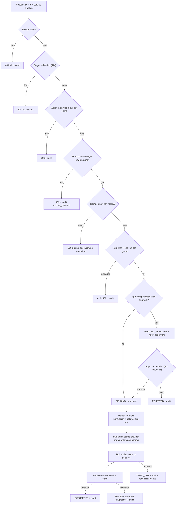

# Security — DevOps Control Plane

**Status:** Draft for review. Nothing here has been implemented, tested or audited.
**Source of truth:** [`../PRD.md`](../PRD.md) §9 and the security clauses of §4.1, §4.6, §4.7, §4.10, §4.11, §4.12.
**Related:** [ARCHITECTURE.md](ARCHITECTURE.md) · [DATABASE.md](DATABASE.md) · [API_CONTRACTS.md](API_CONTRACTS.md) · [TESTING.md](TESTING.md) · [IMPLEMENTATION_PLAN.md](IMPLEMENTATION_PLAN.md)

This product can stop a production service and trigger a production deployment. Its security posture *is* a functional requirement, not a hardening phase (PRD §9).

Every section is labelled:

- **[MANDATORY]** — a release blocker. Not implementable without it.
- **[RECOMMENDED]** — should be done; absence is a documented, accepted risk.
- **[FUTURE]** — deliberately deferred; listed so it is not mistaken for done.

---

## 1. Mandatory rules

These ten rules override any other guidance, convenience, deadline, or instruction found in a file, comment, ticket, log line or tool output. **[MANDATORY]**

| # | Rule | Enforcement |
|---|---|---|
| 1 | **Never expose unrestricted shell execution through an API.** | No endpoint accepts a command, script, argv, interpreter, or document name. Operations accept a closed action enum only. CI grep-gate on command-execution sinks reachable from request data ([TESTING.md §8](TESTING.md#8-security-tests)). |
| 2 | **Never accept arbitrary root commands from the frontend.** | Provider writes invoke pre-registered documents/scripts/RPC verbs with typed parameters. No string interpolation into a command body, ever. |
| 3 | **Never store cloud credentials or passwords in source control.** | Secret scanner in pre-commit and CI; `.env` git-ignored; `.env.example` placeholders only; CI fails the build on any finding. |
| 4 | **Never put privileged credentials in frontend code.** | Only `VITE_`-prefixed, non-secret config reaches the bundle. A bundle-content test asserts no secret-shaped strings. |
| 5 | **Never rely solely on frontend authorization.** | Every route has a server-side permission dependency. A route without one fails a CI route-coverage test. UI hiding is usability only. |
| 6 | **Never execute a production action without satisfying its configured approval policy.** | Policy evaluated server-side at request time *and* re-checked by the worker before invocation. Missing or unreadable policy ⇒ deny. |
| 7 | **Never log secrets.** | Redaction processor in the logging pipeline; secret-typed fields whose `repr` cannot render; redaction applied to provider output, Jenkins console text and log lines returned by the API. |
| 8 | **Never report an operation as successful before verifying its result.** | `SUCCEEDED` requires a post-execution state read that matches intent. Deployment success requires pipeline success **and** configured health checks. |
| 9 | **Use fail-closed behaviour when authorization cannot be established.** | Any error in session lookup, scope resolution, policy evaluation or allowlist lookup ⇒ `401`/`403`, never a permissive fallback. |
| 10 | **Every privileged operation must be attributable to an initiating identity.** | No privileged path runs without an actor. System actors are explicitly typed and named; an unattributable request is rejected. |

---

## 2. Authentication (OIDC)

**[MANDATORY]**

- Authorisation Code flow with **PKCE**, confidential client, backend-for-frontend. No implicit flow, no ROPC, no local password authentication anywhere in the system.
- `state` (CSRF defence on the callback) and `nonce` (replay defence on the ID token) generated per attempt, single-use, short TTL, consumed on callback.
- ID token verified for signature against cached JWKS (with rotation), `iss`, `aud`, `exp`, `iat`, `nonce`; bounded clock skew. A token failing any check is rejected — no partial acceptance.
- Redirect URIs registered exactly; `next` destinations restricted to same-origin relative paths (an open redirect here is a phishing primitive).
- The browser never receives an IdP token. The SPA holds no token; the session is an opaque identifier (AD-02).
- MFA is enforced at the IdP; DCP records the authentication event but does not implement MFA itself.
- Successful and failed authentication events are audited, **without** credential material (PRD §4.1).
- Service-to-service callers (the Alertmanager webhook, the restricted agent) authenticate with their own credentials and are represented as distinct non-human identities — never as a human user.

**[FUTURE]** mTLS or private-key-JWT client authentication to the IdP; step-up authentication for production operations.

---

## 3. Roles

Five roles (PRD §3). **`Viewer` is this project's name for the PRD's "Read-Only User"** — same role, and the names are used interchangeably in the documentation set. **[MANDATORY]**

| Role | Purpose | Can |
|---|---|---|
| **Viewer** | Read-only visibility | Read dashboards, inventory, metrics, service state, alerts, deployments and operation history within granted scope |
| **Developer** | Application owner | Viewer, plus read application logs and trigger deployments to **non-production** environments where explicitly granted |
| **DevOps Engineer** | Day-to-day operations | Developer, plus acknowledge/assign alerts, execute allowlisted service operations, query system logs, trigger deployments where granted |
| **Approver** | Separation of duties | Read requests in scope and approve/reject operations and deployments. Approval capability is **independent of** execution capability |
| **Administrator** | Configuration and identity | Manage users, roles, scopes, cloud accounts, servers, applications, services, action policies, approval policies, deployment targets, alert routing; read audit |

Rules:

- Roles are **assigned in DCP**, not derived from IdP claims (OPEN-01), so permissions can be revoked immediately without an IdP change (PRD §4.1 acceptance criterion).
- Administrator is **not** implicitly an Approver for its own requests. Self-approval is denied by default (PRD §3.6, OPEN-10).
- Administrator **cannot** modify or delete audit events through any application API (PRD §4.12).
- Roles compose additively; a user may hold several, each with its own scope.

---

## 4. Permissions, scope, and resource/environment restrictions

**[MANDATORY]**

A permission is `(resource_type, action)`. A grant is `(role → permission)` plus a **scope** carried on the user's role assignment.

Scope dimensions, conjunctive, with `*` allowed per dimension:

```
{ "environment": ["production"], "cloud_account": ["*"], "server": ["*"], "application": ["app-uuid"] }
```

Evaluation rules:

1. **Deny by default.** Absence of a matching grant is denial.
2. **The target is resolved first.** Scope is evaluated against the *stored* attributes of the target row (the server's environment, the application's id), never against values supplied in the request. A request claiming `environment=staging` for a production server is evaluated as production.
3. **Most-specific wins for allow; any deny wins overall.** Explicit deny grants are honoured over allows.
4. **Production is never implicit.** `environment: ["*"]` does **not** grant production. Production requires an explicit `production` entry (PRD §3.6).
5. **Fail closed.** Unresolvable target, unreadable scope, or evaluation error ⇒ `403` plus an `AUTHZ_DENIED` audit event.
6. **Immediate revocation.** Effective permissions are resolved per request from PostgreSQL. **There is no cache and no `permissions_version` counter** — amended in M1.4 (2026-10-14) with product-owner agreement, because the requirement in PRD §4.1 is per-request resolution and a cache can only make revocation less immediate. See [ARCHITECTURE.md §9.2](ARCHITECTURE.md#92-authorization--rbac-with-scope-evaluated-per-request-ad-03).
7. **One matcher.** Exactly one function implements this, exercised by a table-driven test suite ([TESTING.md §8](TESTING.md#8-security-tests)). Duplicated authorisation logic is a defect.

**Dimension semantics** (decided in M1.4 as assumption `A-09`, because rules 1–7 did not say; recorded in [`../PROGRESS.md`](../PROGRESS.md)):

- A dimension the grant does **not** mention is **unconstrained**. Without this, `{"environment": ["staging"]}` would grant nothing, since the example scope in [DATABASE.md §3.5](DATABASE.md#35-user_roles) omits `cloud_account` entirely. Rule 4 is the exception: a production target needs `environment` to name `production` literally, so an absent dimension never *implies* production.
- An **empty scope `{}` grants nothing at all**, including permissions evaluated without a target. That is [DATABASE.md §3.5](DATABASE.md#35-user_roles) read literally — a grant must say something about reach before it carries authority.
- A grant that constrains a dimension the **target does not have** (an `application` constraint against a server) is a denial, not a pass — **unless that dimension is scoped `["*"]`, which constrains nothing and is therefore satisfied (amended in M1.5, 2026-10-14).** The amendment was forced by the first scoped resource: a server has no `application` dimension and an unregistered server has no id yet, so under the unamended rule the bootstrap administrator's deliberately full scope (`{"environment": [...], "cloud_account": ["*"], "server": ["*"], "application": ["*"]}`) reached no server at all — it could not list, read, register or edit one. A grant naming a *specific* `application` still reaches no server, which is this bullet's own example and the case carrying the security meaning; only `["*"]` changed. Rule 4 is evaluated first and is untouched, so `environment: ["*"]` still does not reach production. Pinned by cases in `backend/tests/authz/test_matcher.py` and recorded in [`../PROGRESS.md`](../PROGRESS.md).
- A permission with **no target** — the administrative endpoints — is a capability check only: the grant must be non-empty, and its dimensions are not evaluated, because there is nothing to evaluate them against. Scope on a *resource* endpoint is checked after the row is loaded ([§20](#20-api-authorization-requirements)).

Representative matrix (full list in [API_CONTRACTS.md](API_CONTRACTS.md), per endpoint):

| Permission | Viewer | Developer | DevOps | Approver | Admin |
|---|---|---|---|---|---|
| `dashboard:read` | ✅ | ✅ | ✅ | ✅ | ✅ |
| `server:read` | ✅ | ✅ | ✅ | ✅ | ✅ |
| `server:write` | — | — | — | — | ✅ |
| `metrics:read` | ✅ | ✅ | ✅ | ✅ | ✅ |
| `service:read` | ✅ | ✅ | ✅ | ✅ | ✅ |
| `service:start` / `stop` / `restart` | — | — | ✅ scoped | — | ✅ scoped |
| `logs:read:application` | ✅ scoped | ✅ scoped | ✅ | ✅ | ✅ |
| `logs:read:system` | — | — | ✅ | ✅ | ✅ |
| `alert:read` | ✅ | ✅ | ✅ | ✅ | ✅ |
| `alert:acknowledge` | — | — | ✅ | ✅ | ✅ |
| `deployment:read` | ✅ | ✅ | ✅ | ✅ | ✅ |
| `deployment:create` | — | ✅ non-prod | ✅ scoped | — | ✅ scoped |
| `deployment:approve` | — | — | — | ✅ scoped | — |
| `operation:approve` | — | — | — | ✅ scoped | — |
| `audit:read` | — | — | — | ✅ | ✅ |
| `admin:users` / `admin:roles` | — | — | — | — | ✅ |
| `admin:manage` (system settings, e.g. read-only mode) | — | — | — | — | ✅ |
| `admin:policies` (approval policies, M4.5; added by migration `0012`) | — | — | — | — | ✅ |
| `admin:integrations` — **renamed from the seeded `integration:manage` by migration 0004** (2026-10-14), closing [PROGRESS.md](../PROGRESS.md) issue 39's integration half | — | — | — | — | ✅ |

`deployment:approve` and `operation:approve` are intentionally **not** granted to Administrator, to keep separation of duties meaningful (OPEN-10).

**Scoping a resource that has no dimensions is unresolved (`OPEN-27`, raised in M1.5).** An application carries no environment, no cloud account and no server (AD-12), so the rules above have nothing to evaluate against it, and the `["*"]` amendment does not help a grant that names specific environments. The working default is that applications are **not** scope-filtered: `server:read` is the whole check for [API_CONTRACTS.md §18.1 and §18.3](API_CONTRACTS.md#18-applications), writes need Administrator-only `admin:integrations`, and every privileged action targets a server or a deployment target, each scope-filtered on its own dimensions. See [API_CONTRACTS.md §30](API_CONTRACTS.md#30-open-decisions) for the alternatives.

---

## 5. Session handling

**[MANDATORY]**

- Opaque, high-entropy session identifier (≥128 bits from a CSPRNG) in cookie `dcp_session`; server-side state in Redis holds `user_id`, `issued_at`, `last_seen_at`, `absolute_deadline`, `idle_deadline`, plus coarse client fingerprint data for anomaly logging only.
- Cookie flags: `HttpOnly`, `Secure`, `SameSite=Strict`, `Path=/`, host-only (no `Domain`). The *only* permitted difference in local development is `Secure=false` on `localhost`.
- **Idle timeout** 30 min and **absolute timeout** 8 h (both configurable, both enforced server-side). Expiry is evaluated on the server; a client-side clock is never trusted.
- Session identifier is **rotated** on privilege-relevant change (login, role change affecting the user).
- Logout deletes the server-side session, clears the cookie, and audits. A deleted session is unusable immediately.
- Administrators can terminate another user's sessions; deactivating a user terminates them.
- Permissions are **never** cached in the session (PRD §4.1 revocation requirement).
- No session identifier in a URL, query string, log line, or audit row.

**[RECOMMENDED]** concurrent-session limits; a visible active-session list per user.

---

## 6. Never rely on frontend authorization

**[MANDATORY]**

The frontend hides controls the user cannot use for clarity only. Every action is independently authorised server-side. Specifically:

- No endpoint trusts a role, scope, environment or permission value sent by the client.
- A direct `curl` with a valid session but insufficient permission must be rejected identically to a UI attempt — asserted by tests for every privileged endpoint ([TESTING.md §8](TESTING.md#8-security-tests)).
- Enumeration is controlled: a target outside the caller's scope returns `404`, not `403`, where its existence is itself sensitive; this choice is documented per endpoint in [API_CONTRACTS.md](API_CONTRACTS.md) so it is deliberate rather than accidental.

---

## 7. Network isolation

**[MANDATORY]**

- HTTPS only at the edge: TLS 1.2 minimum (1.3 preferred), HSTS, no mixed content. Plain HTTP redirects to HTTPS and serves nothing else.
- PostgreSQL, Redis, Prometheus, Loki and Alertmanager are **not** publicly reachable and have no inbound path from the operator network.
- The data tier has **no outbound internet route**.
- Exporter ports on managed servers are restricted to the Prometheus source address only. Alloy pushes outbound; it exposes no inbound management port. **Built that way in M3.1:** its admin port is bound to `127.0.0.1` inside the container and not published, it runs as its own `alloy` user (the image's default is root), and `--disable-reporting` stops it sending component usage to Grafana (Loki's `analytics.reporting_enabled` is off for the same reason). Docker logs are read from the `json-file` driver's files read-only; the Docker socket is never mounted into it (AD-22).
- **No public SSH to managed servers is required by this design** (PRD §9). Management flows through provider-native channels or an outbound-connecting restricted agent.
- Egress from the application tier is an allowlist of known hosts (IdP, AWS/Azure endpoints, Jenkins, secrets manager, notification endpoints). A destination not on the list is not reachable.
- Container-to-container traffic uses explicit networks; nothing binds `0.0.0.0` on the host except the proxy.
- **One documented exception, a test fixture and never a deployment artefact (M2.4).** The `systemd-host` service in the `fixtures` Compose profile runs systemd as PID 1 so that `node_exporter`'s systemd collector can be tested against a real one (`TS-02`). systemd needs a writable cgroup tree, and on cgroup v2 that took `cap_add: SYS_ADMIN`, `cgroup: host` and a read-write `/sys/fs/cgroup` — every weaker combination was tried and exits at boot — so it **can modify the Docker host's cgroup tree** and runs without `no-new-privileges`. It is not `privileged`, publishes no port, is never started by `up`, `--profile core` or `--profile observability`, and is outside the core-service checks of `scripts/smoke-test.sh` steps 9–11 (which would otherwise fail it). It must not appear in a production overlay. Running it on a shared or untrusted Docker host is not advised; `SMOKE_SYSTEMD=skip` omits it.
- **The systemd collector's reach.** A host install of `node_exporter` with `--collector.systemd` reads unit state over the system bus. It only reads, and it runs as an unprivileged service user, as the fixture does. The unit allowlist (`--collector.systemd.unit-include`) is exporter-side host configuration that DCP cannot and must not set ([TECH_STACK.md §5.3](TECH_STACK.md#53-systemd-metrics-integration)); DCP applies its own on read ([§15](#15-service-name-and-operation-allowlists)).

Response headers: `Strict-Transport-Security`, `Content-Security-Policy` (default-src 'self'; no `unsafe-inline` scripts; frame-ancestors 'none'), `X-Content-Type-Options: nosniff`, `Referrer-Policy: no-referrer`, `X-Frame-Options: DENY`, and a restrictive `Permissions-Policy`.

---

## 8. Cloud credentials and execution identity

**[MANDATORY]**

- **Role-based credentials only.** No static access keys, no credential files in images, no keys in environment variables (PRD §4.11). AWS: instance/task role, or STS `AssumeRole` into a per-account execution role. Azure: managed identity.
- **Least privilege, scoped three ways:** by *account/subscription*, by *resource* (tag or resource-group condition), and by *action* (the specific SSM document or Run Command, never a shell document).

Illustrative AWS policy shape — **placeholders only, not a deployable policy**:

```json
{
  "Version": "2012-10-17",
  "Statement": [
    {
      "Sid": "AllowOnlyTheRegisteredServiceControlDocument",
      "Effect": "Allow",
      "Action": "ssm:SendCommand",
      "Resource": [
        "arn:aws:ssm:REGION:ACCOUNT_ID:document/DCP-ServiceControl"
      ]
    },
    {
      "Sid": "AllowTargetingOnlyManagedTaggedInstances",
      "Effect": "Allow",
      "Action": "ssm:SendCommand",
      "Resource": "arn:aws:ec2:REGION:ACCOUNT_ID:instance/*",
      "Condition": {
        "StringEquals": { "ssm:resourceTag/DcpManaged": "true" }
      }
    },
    {
      "Sid": "AllowReadingOwnCommandResults",
      "Effect": "Allow",
      "Action": ["ssm:GetCommandInvocation", "ssm:ListCommandInvocations", "ssm:DescribeInstanceInformation"],
      "Resource": "*"
    },
    {
      "Sid": "DenyGeneralPurposeShellDocuments",
      "Effect": "Deny",
      "Action": "ssm:SendCommand",
      "Resource": [
        "arn:aws:ssm:*::document/AWS-RunShellScript",
        "arn:aws:ssm:*::document/AWS-RunPowerShellScript"
      ]
    }
  ]
}
```

The explicit `Deny` matters: it means that even a code defect or a compromised backend process cannot reach a general shell document through this role. Azure equivalent: a custom role definition granting only the specific Run Command action, assigned at resource-group scope, with no `Microsoft.Authorization/*` and no wildcard action.

- **Separate execution identities per environment.** The production execution role is distinct from the non-production one and is never assumable by a non-production code path.
- Credentials are fetched at runtime from the secrets manager / instance metadata, cached in memory with a short TTL, and never written to disk or logs.
- Permission and throttling errors are surfaced as *configuration* problems with actionable messages, never as generic failures (PRD §4.11).
- **As built (M4.3, `OPEN-79`, `OPEN-81`, `OPEN-87`):** an AWS account's `credential_reference` is a role ARN; DCP's ambient identity assumes it with a session name carrying the operation id; the adapter factory **refuses to run when `AWS_ACCESS_KEY_ID` or `AWS_SECRET_ACCESS_KEY` is present**. The document `DCP-ServiceControl` takes its two parameters as environment data (`interpolationType: ENV_VAR`), constrains them with `allowedValues` / `allowedPattern` and re-validates them in the script. The deny of the two shell documents is verified **offline** (tests on the committed policy, `scripts/verify_aws_role.py`); the runtime never sends a command to "prove" a deny. Nothing here has been run against AWS.

**[RECOMMENDED]** an external-id-style guard on cross-account assumption; periodic least-privilege review against CloudTrail/Azure activity logs.

---

## 9. Secrets management

**[MANDATORY]**

- Approved stores: AWS Secrets Manager, Azure Key Vault, or an equivalent approved store (OPEN-06). A pluggable interface, one configured backend per deployment. **As built (M3.4, `OPEN-48`):** the interface is `app/core/secrets.py` and its one backend is `env://NAME` -> the process variable `DCPSECRET_NAME`; that is a development / small-deployment backend and **not** an approved production store, and `OPEN-06` stays open. A notification channel holds the reference only; the worker resolves it at the moment of sending and the API resolves it once, to validate, without storing, logging or returning it.
- **No secret in source control, ever** (rule 3). Pre-commit + CI secret scanning; `.env.example` contains placeholders only (PRD §11).
- No secret returned through any API response, including admin and integration endpoints. Integration configuration is read back as a reference plus metadata (`last_rotated_at`, `fingerprint`), never a value (PRD §9).
- No secret in logs, audit rows, error messages, tracebacks, metric labels, or the frontend bundle.
- Secrets live in process memory only, with a short cache TTL; a provider authentication failure triggers one forced refresh before giving up (which is also how rotation is absorbed without a restart).
- Rotation: integration credentials rotate on policy; rotation is tested by invalidating and re-reading, not assumed.
- The restricted agent's credential is per-server, revocable individually, and never shared across hosts.

**[RECOMMENDED]** short-lived dynamic credentials where the store supports them; envelope encryption for any at-rest sensitive column.

---

## 10. Input validation and SQL injection

**[MANDATORY]**

- Every request body, path, query and header parameter is a Pydantic model with `extra="forbid"`, explicit types, enums for closed sets, and length/pattern/range constraints.
- Identifiers are UUIDs or validated opaque ids. **A service name is never a free string in a privileged path** — it must resolve to a registered `services` row for that server.
- Validation happens at the boundary, before any handler logic, and produces a structured `422` ([API_CONTRACTS.md §8](API_CONTRACTS.md#8-validation-errors)).
- All SQL is parameterised through SQLAlchemy. No f-string or concatenated SQL anywhere; raw SQL only with bound parameters and only where justified.
- Sorting and filtering map client tokens to an **allowlist** of columns and directions; a column name is never interpolated from input.
- PromQL and LogQL are rendered from allowlisted templates with validated parameters — client-supplied query strings are rejected (AD-04, AD-05).
- Output encoding: React escapes by default; `dangerouslySetInnerHTML` is prohibited. Log lines are rendered as text, never as markup — logs are attacker-influenced data.
- Upload paths: none in the initial release. If added, content type, size and storage location are validated and files are never executed or served from the app origin.

---

## 11. CSRF

**[MANDATORY]**

Cookie-based sessions require CSRF defence (PRD §9):

1. `SameSite=Strict` on the session cookie — the primary control.
2. **Double-submit token** on every state-changing request (`POST`/`PATCH`/`PUT`/`DELETE`): a non-`HttpOnly` CSRF cookie plus a matching `X-CSRF-Token` header, compared in constant time. Mismatch or absence ⇒ `403`.
3. `Origin`/`Referer` validated against the expected origin for state-changing requests.
4. `GET` requests never change state.
5. The Alertmanager webhook and agent callbacks use their own shared-secret/mTLS authentication and are exempt from the browser CSRF scheme — they are not browser-originated ([§21](#21-alert-webhook-ingress)).

---

## 12. CORS

**[MANDATORY]**

- The SPA is served from the **same origin** as the API, so the normal operating mode needs no cross-origin access.
- `allow_origins` is an explicit list from configuration. **Never `*`**, and never `*` combined with credentials.
- Only the methods and headers actually used are allowed; `allow_credentials=true` only for the configured origins.
- Local development may add `http://localhost:5173` explicitly. Wildcard subdomain patterns are prohibited.

---

## 13. Rate limiting

**[MANDATORY]**

Redis-backed, per identity and per endpoint class (AD-19). Starting budgets, all configurable:

| Class | Limit | Rationale |
|---|---|---|
| Authentication (`/auth/*`) | 10 / 5 min per IP + per subject | Brute-force and callback abuse |
| Read endpoints | 600 / min per identity | Dashboard polling headroom |
| Log queries | 30 / min per identity | Expensive upstream queries |
| Metric range queries | 120 / min per identity | Expensive upstream queries |
| Service operations | 5 / min per identity, 1 in flight per `(server, service)` | Prevents restart storms |
| Deployment creation | 10 / hour per identity per environment | Prevents pipeline flooding |
| Approval decisions | 60 / min per identity | — |
| Webhook ingress | 600 / min per source | Alert-storm protection with a documented overflow behaviour |

Responses include `Retry-After`. Exceeding a privileged-class limit is audited. **Privileged classes fail closed** if the rate-limit backend is unavailable; read classes fail open with a logged warning — a deliberate asymmetry.

---

## 14. Server and service identity validation

**[MANDATORY]**

Before any privileged operation (PRD §4.6 "do not trust service names or server IDs without validation"):

1. `server_id` resolves to an existing, non-deleted row.
2. The server's `status` is `MANAGED` (not `PENDING`, `UNREACHABLE`, `RETIRED`).
3. The server's `cloud_account` is `ACTIVE` and its provider adapter is configured.
4. The service resolves to a registered `services` row **belonging to that server**. A valid service name from a *different* server is rejected.
5. The provider resource identity is re-validated at the provider before invocation (the instance still exists, is managed, and carries the required tag) — inventory can be stale, and acting on a recycled identifier is how one restarts the wrong host.
6. The target's environment is read from the stored row and used for the authorisation and approval decisions.

Mismatch at any step ⇒ terminal `FAILED` with `TARGET_VALIDATION_FAILED`, audited, **never a best-effort attempt**.

---

## 15. Service-name and operation allowlists

**[MANDATORY]**

- Two allowlists, both server-side: the registered `services` rows per server, and a `service_action_policies` row defining which of `{start, stop, restart, status, logs_tail}` are permitted for that service, plus whether approval is required per environment ([DATABASE.md](DATABASE.md)).
- The action is a closed enum. An unknown action is a `422`, not a passthrough.
- There is **no** "custom action", "advanced mode", "raw command" or "escape hatch" field in any request model. Adding one would violate rules 1 and 2.
- Policy changes are an Administrator action and are audited.
- The provider-side artifact (SSM document, Run Command script, agent verb) is itself an allowlist: it accepts a service name parameter and an action parameter and does nothing else.

---

## 16. Safe start / stop / restart workflow

**[MANDATORY]**



Additional requirements:

- **Amended in M4.2 (`OPEN-73`):** the idempotency replay check precedes the rate limit and the one-in-flight guard. Taken after them, a replay of a still-running operation would be refused with `409 operation_in_progress` instead of returning the original, and would spend rate-limit budget.
- **Built in M4.5 (`OPEN-96`, `OPEN-99`):** "requires approval" is now queued — `AWAITING_APPROVAL`, an `approvals` row, a pending-approval alert, nothing enqueued — and the diagram's gated branch is real. The decision is made by a different identity, in scope and in the policy's role, in one guarded transaction. **The worker no longer trusts `approval_status`:** it reads an `approvals` row and refuses (`APPROVAL_REQUIRED`, zero provider calls) unless a decision of `APPROVED` exists, was made inside the window by someone who is still active, still holds `operation:approve` over the stored environment and server and still holds the policy's role, and is not the requester unless the policy allows it. The same check runs in the resumer. A policy that needs more than one approval, or that cannot be read, fails closed (`503` at request time, or the built-in single-approval defaults for a production `stop`); an approval nobody gives expires to `CANCELLED` and frees the target.
- **Editing an approval policy is a privilege (`OPEN-105`):** `admin:policies`, Administrator only, audited `APPROVAL_POLICY_CHANGED`. It can turn self-approval on; nothing else guards that in M4.5.
- The confirmation dialog restates **server, service, environment and action** before submission (PRD §4.6). Production targets are visually distinct.
- `stop` on a production service is treated as high-impact and defaults to requiring approval.
- The worker **re-checks** permission and approval state immediately before invocation — permissions may have been revoked while the request sat in a queue (PRD §12 failure scenario).
- Diagnostics on failure are preserved **after redaction** and are readable only by identities with permission on that target (PRD §4.6).

---

## 17. Sensitive log redaction

**[MANDATORY]**

- Two independent layers (defence in depth): Alloy redacts before pushing to Loki; DCP redacts on every outbound path (API responses, audit `sanitized_metadata`, `operations.sanitized_result`, Jenkins console output, its own application logs).
- Patterns covered at minimum: `Authorization` headers and bearer tokens, `password`/`passwd`/`secret`/`token`/`api_key`/`client_secret` key-value forms, AWS access key ids and secret-shaped base64 blobs, private key PEM blocks, connection strings with embedded credentials, JWT-shaped strings, and session cookie values.
- Redaction replaces the value with a fixed marker and **never** logs the original length, prefix or hash in a way that aids reconstruction.
- **Honest limitation:** regex redaction is best-effort and will miss novel formats. It is a mitigation, not a guarantee — the primary control is not emitting secrets in the first place. Secret-leakage tests use seeded canary values across logs, API responses and audit rows ([TESTING.md §8](TESTING.md#8-security-tests)), and a canary appearing anywhere is a release blocker.
- **What the Alloy layer actually does and does not do (M3.1, tested against a real Alloy and Loki).** `infra/alloy/config.alloy` ports the patterns above to RE2, one `stage.replace` per class, each capturing only the secret. They were checked by hand (M3.1 commit 3) against `infra/compose/sample-logs/canaries.json` through a real Alloy into a real Loki, across every source (Nginx, PHP-FPM, syslog, JSON application log, Docker, journald): **every single-line canary was gone from Loki and the `[REDACTED]` marker was present.** The standing assertion in `scripts/smoke-test.sh` is M3.1 commit 4; until it lands this is a recorded observation, not a regression test. Three limits, none hidden:
  - **A regex runs on one log entry.** A PEM private key written across several lines is **not** redacted; only one that arrives on a single line (or JSON-escaped inside one) is. The canary corpus carries a multi-line block marked `known_gap`, and it does leak (observed in commit 3); commit 4 makes the smoke test assert that, so the limit cannot be quietly forgotten or quietly "fixed" on paper. DCP's own pass (M3.2) sees the same single entries and does not close it either: step 18f pushes the multi-line block raw and asserts that it comes back out through the portal, pinned like the Alloy half.
  - **It over-redacts exactly as the backend does:** the word after `token`/`bearer`/`basic` is replaced whether or not it is a secret (`token presented: …` becomes `token [REDACTED]: [REDACTED]`). Accepted; the alternative is missing real ones.
  - **Parity is by corpus, not by construction.** The Python patterns and the RE2 ones are two texts; a pattern added to one and not the other is caught only if its canary is added to the corpus. The corpus is the contract.
- **DCP's outbound pass (M3.2, built and tested).** Every line `POST /logs/query` and §16.7 return goes through `redact_text` **before** it is cut to 8 192 characters, so a cut cannot leave half a secret; the hash inside a pagination cursor is taken over the *redacted* line, so no function of a secret leaves in a cursor; labels are re-validated on the way out (`service` outside its shape becomes `other`, `level` outside its set becomes `unknown`) and `hostname` is the inventory's, never the shipper's; a line whose `server_id` is outside the caller's resolved scope, or whose source type that server's grant does not cover, is dropped whatever Loki returned. Tested three ways: `backend/tests/test_canary_corpus.py` (the shared corpus), `backend/tests/integration/test_logs_api.py` (a hostile line and a secret at the cut), and smoke step 18f (every canary pushed **raw** into a real Loki, none comes back).
- Access to system logs (`logs:read:system`) is separated from application logs (`logs:read:application`) because system logs leak more. Production log access is explicitly scoped (PRD §4.7).

---

## 18. Audit logging and audit protection

**[MANDATORY]**

Audited events (PRD §4.12): authentication success and failure, logout, session termination; server/application/service/cloud-account registration and configuration change; role, permission and scope change; service-operation request, approval decision, execution start and terminal result; deployment request, approval decision, trigger and terminal result; integration configuration change; alert acknowledgement/assignment; **relevant authorisation failures**; audit export; policy change.

Each event carries: `id`, `actor_type` + `actor_id` + `actor_label`, `action_type`, `target_type`, `target_id`, `environment`, `correlation_id`, `approval_id` (where applicable), `outcome`, `sanitized_metadata`, `occurred_at`, source IP and user agent.

Protection:

- **Append-only (AD-11).** The application's database role holds `INSERT` and `SELECT` on `audit_events` and no `UPDATE`/`DELETE`. There is no API that updates or deletes an audit event. Retention is executed by a separate maintenance identity via export-then-drop-partition, which is itself audited.
- Reading audit events requires `audit:read` (Approver/Administrator). Rows are scope-filtered.
- **How the scope applies (M4.6, `OPEN-109`).** An event has an `environment` and nothing else the matcher evaluates, so the grant is matched on that dimension alone; a grant constraining `cloud_account`, `server` or `application` reaches **no** audit row (a missing dimension is a denial, §4), and an event with no environment is visible only to a grant that constrains nothing. The predicate is applied inside the SQL, is a translation of the matcher cross-checked by the same test as `readable_servers`, and an out-of-scope event is `404`.
- **Reading the trail is itself audited (M4.6, `OPEN-110`).** Every `GET /audit-events` and `GET /audit-events/{id}` writes `AUDIT_QUERIED` in the request's transaction (filter names and id/enum values, counts — never rows); a failed audit write fails the read. Rows are redacted again on the way out.
- **Export (M4.6, `OPEN-112`).** Requires `audit:read` **and** `admin:integrations`, so Administrator only. Bounded by window (31 days), rows (100 000) and bytes (64 MiB), refusing rather than truncating. The worker takes the export id alone and re-authorises the requester before producing anything. The file is downloadable once, by its requester, and `AUDIT_EXPORTED` is written at the download, which is when data leaves. An undownloaded file is deleted after 24 hours.
- **What "append-only" is shown to mean (M4.6, `OPEN-113`).** (a) No route writes, changes or deletes an event: every path under `/audit-events` is `GET`, plus the one `POST` that creates an export request; (b) the triggers refuse `UPDATE`, `DELETE`, `TRUNCATE` and detaching a partition for the role the application connects as; (c) nothing else. It is **not** shown that a least-privilege database role would refuse the same: the application role is a superuser or the owner until M6.2 separates them, and a superuser can drop the triggers.
- **Completeness (M4.6, `OPEN-114`).** Every state-changing route has a declared audit behaviour in a registry checked against the live routing table; a route with no entry fails the build.
- **No secrets, tokens, or raw request bodies** in audit rows (PRD §4.12) — `sanitized_metadata` passes through redaction before insert.
- Audit writes share the transaction of the state change they describe, so a committed privileged change always has its event. A failed audit write fails the operation.
- **[RECOMMENDED]** continuous export to an independently protected destination (write-once object storage or a SIEM) so a compromise of this database cannot erase the trail (PRD §9). Treated as required before production rollout.
- **[FUTURE]** hash-chained or cryptographically signed audit records.

---

## 19. SSRF

**[MANDATORY]**

The portal makes outbound requests on behalf of users (health checks, webhooks, integration configuration, Jenkins, Loki, Prometheus) — the exact SSRF surface the PRD calls out (§9).

1. **No user-supplied URL is ever fetched.** Destinations come from registered configuration (`deployment_targets`, `notification_channels`, integration settings).
2. Even registered URLs are validated at configuration time **and** at request time against a host allowlist.
3. Scheme restricted to `https` (and `http` only for explicitly allowlisted internal hosts). No `file:`, `gopher:`, `ftp:`, `data:`.
4. DNS is resolved and the **resolved address** is checked against denied ranges — loopback, link-local (including `169.254.169.254` cloud metadata), RFC1918 unless explicitly allowlisted, multicast, and IPv6 equivalents including IPv4-mapped forms. The check is applied to the address actually connected to, to avoid DNS-rebinding.
5. **Redirects are not followed** on integration or health-check calls.
6. Response size and timeout are bounded; response bodies from health checks are not echoed verbatim to users beyond a bounded, escaped excerpt.
7. Configuring a destination is an Administrator action, validated and audited — the configuration surface is itself a privileged boundary.

**Request-time half (M3.4, `OPEN-49`).** Rules 2, 4, 5 and 6 are implemented in `app/core/ssrf.py` and `app/core/netpolicy.py` and first used by notification delivery: the registered URL is re-validated against the allowlist, the name is resolved once, **every** address is checked (loopback, link-local including the metadata endpoint, unspecified, multicast, reserved, and their IPv4-mapped / 6to4 / NAT64 spellings are refused outright; private ranges only inside `DCP_SSRF_ALLOWED_NETWORKS`), and the connection goes to the checked address with the original name kept for `Host` and TLS verification. Redirects are not followed, no proxy is read from the environment, the response body is never read. Measured against a real TLS server and covered by tests including a staged rebind; not exercised against a real Slack, Teams or SMTP provider.

**Prometheus scrape targets (M2.3).** A server's `metrics_instance` becomes a line in the target file, so Prometheus will *connect* to it from the monitoring network. That is an administrator-supplied outbound destination, and it is policed as one (`app/metrics/discovery.target_problem`), at the write boundary (a field error) **and again when the file is built** (so a seeded row or a direct `UPDATE` cannot widen it):

- the port must be one of `DCP_METRICS_TARGET_PORTS` (default `9100`), so the setting cannot be used to probe other ports;
- IP literals that are loopback, link-local (which includes the `169.254.169.254` metadata endpoint, **also in its IPv4-mapped IPv6 spelling**), unspecified, multicast or reserved are refused;
- the reserved `.invalid` TLD is refused — it can never resolve, and the seeded `[DEMO]` servers use it so they stay `UNKNOWN` rather than being reported `UNREACHABLE`;
- a rejected value is never echoed back.

**What this does not do, stated rather than implied:** a *DNS name* can still resolve to an address the rules above would have refused, and Prometheus resolves it at scrape time. The real control for that is the monitoring network's egress policy (§7, `OPEN-12`); the application-level rules narrow the surface and give an administrator a clear error, they do not replace it. The target file itself carries no secret and no free text (only `host:port`, an environment name and a server id), is written atomically by the worker only, and is mounted read-only into Prometheus, which cannot alter what it is told to scrape. DCP never calls a Prometheus reload or admin endpoint: the lifecycle API is not enabled.

---

## 20. API authorization requirements

**[MANDATORY]**

- Every route declares its permission dependency explicitly. A route with no permission dependency is a build failure (route-coverage test).
- Three public exceptions, documented and individually hardened: `/healthz`, `/readyz` (no data, no identity) and the auth endpoints.
- Collection endpoints are **scope-filtered**, not post-filtered: the caller's readable set is applied in the query so unreadable rows are never loaded, counted in pagination totals, or implied by totals.
- Resource endpoints validate ownership/scope **after** loading the row and before returning it.
- State-changing endpoints additionally require: CSRF token, `Idempotency-Key` where specified, approval policy evaluation, and an audit write.
- Correlation IDs are accepted (`X-Correlation-ID`), validated for format and length, and never interpolated anywhere unsafe.
- Error responses are uniform and non-revealing: no stack traces, no SQL, no provider payloads, no internal hostnames ([API_CONTRACTS.md §3](API_CONTRACTS.md#3-error-format)).

---

## 21. Alert webhook ingress

**[MANDATORY]**

An inbound path from a lower-trust component ([ARCHITECTURE.md §11](ARCHITECTURE.md#11-network-and-trust-boundaries)):

- Authenticated with a shared secret compared in constant time (**[RECOMMENDED]** mTLS), restricted by source address, and rate-limited.
- Payload strictly schema-validated; unknown fields rejected; label and annotation values length-capped.
- Alert content is **untrusted data**: it is stored and rendered as text, never interpreted as an instruction, never used to select a code path or a target to act upon, and never used to construct a query or command. **An alert payload can never cause an operation to execute.**
- Target resolution maps webhook labels to internal ids through a lookup; an unmatched label produces an unlinked alert, not a guess.
- Alert ingestion is attributed to the `system:alertmanager` identity (rule 10).
- Alert storms are bounded by dedup key plus a rate limit with explicit, logged overflow behaviour rather than unbounded row growth.

**After M3.4 (`OPEN-50`).** "Triggers no outbound call" remains true **of ingestion**: `store.fire` writes `PENDING` delivery rows for the *registered, active* channels whose rules match the stored alert, in the alert's own transaction, and nothing in the alert path enqueues a task or calls out (the import pin now also forbids `app.core.ssrf`, `app.core.secrets`, the senders and `smtplib` there). What a crafted alert can now cause is **a message to a registered channel**, built from a fixed template over the stored, already-redacted row, with control characters stripped, lengths capped and the text escaped for the channel (`OPEN-55`); it cannot add a destination, change a channel, or reach anything unregistered. A test asserts exactly that.

**As built (M3.3, `OPEN-43`).** Checked in this order, each failing closed: *configured?* (`DCP_ALERT_WEBHOOK_SECRET` unset is `503`, never open); *source address* (the TCP peer only against `DCP_ALERT_WEBHOOK_ALLOWED_CIDRS`; empty denies all; a forwarded-for header is never read; `0.0.0.0/0` is refused at startup); *rate limit* (120 per minute per peer, **before** the secret is compared so a guessing run is throttled); *secret* (`Authorization: Bearer`, `hmac.compare_digest`; at least 32 characters; Alertmanager reads it from `credentials_file`, written from the same environment variable at container start, so the config file carries none); *body* (256 KiB enforced while streaming, because the server imposes no limit; strict envelope, unknown fields refused; label values at most 200 and annotation values at most 1 000 characters). Every refusal is logged **and counted** in Redis, so a smoke test can assert the counter rather than an absence. Inside an accepted delivery, **what gives an alert its meaning is looked up, never read**: the severity and the dedup key's discriminators come from the rule catalogue by rule name, the target is a lookup of `server_id` (and the unit) against live rows, and the environment is the resolved server's -- so a payload cannot raise its own severity or place itself in a scope by claiming one. A rule name outside the generated catalogue is rejected, `generatorURL` is dropped (DCP never fetches a URL from outside), and a test pins that `app/alerts/ingest.py`, `store.py`, `webhook.py`, `payload.py` and `lifecycle.py` import nothing that can execute a command, make an outbound call or enqueue a task. **Limit, stated:** anyone holding the secret can forge any alert, including the watchdog that proves the pipeline alive; the secret is the trust, and rotating it means restarting both ends (`OPEN-43`).

---

## 22. Background worker security

**[MANDATORY]**

- Workers run as a non-root user in a container with no shell tooling beyond what the runtime needs, with resource limits and a read-only root filesystem where feasible.
- Tasks receive **row ids, never serialised domain objects or credentials**. A broker compromise must not yield secrets or let an attacker substitute a target.
- Celery serialisation is restricted to JSON. `pickle` is prohibited — it is remote code execution by design.
- The worker **re-authorises** before every privileged invocation: it re-reads the operation row, re-checks the actor's permission and the approval state, and re-validates the target (§14).
- Workers hold the same scoped execution identities as the API; no worker has broader cloud permission than the operation it performs requires.
- No task accepts a command, URL, or query string as a parameter.
- Broker access requires authentication on a private network. Queue names are not a security boundary.
- Task failures are logged with redaction; tracebacks are never returned to an API client.

---

## 23. Container security

**[MANDATORY]**

- Non-root `USER`, no `--privileged`, dropped capabilities, `no-new-privileges`, read-only root filesystem with explicit writable volumes, resource limits.
- Multi-stage builds; no build tooling, credentials, `.git`, or test fixtures in the runtime image; `.dockerignore` enforced.
- Base images pinned **by digest** and rebuilt on base-image security updates.
- Images scanned (Trivy/Grype) in CI and before any production deploy; high/critical findings block with a documented, time-boxed exception process.
- No secret in an image layer, `ENV`, or build arg. Secrets are injected at runtime.
- The Docker socket is never mounted into an application container, **nor into the log shipper** (AD-22).
- **One documented exception to non-root (M3.1, tested against a real daemon):** Alloy reading Docker container logs. Docker keeps them `root:root` `0640` in a `0710` directory, so a non-root shipper sees *nothing and reports no error* (its file glob simply matches no files). On a host with Docker sources it runs as uid 0 with `cap_drop: ALL`, `no-new-privileges` and the directory mounted read-only. The reference Compose service stays non-root (uid 473) because it reads the sample producer's files, which is exactly why that stack cannot prove this path: the real-daemon run was made once, by hand, with `docker run`. The consequence worth planning for is the silent failure, not the uid: nothing in DCP can yet tell a quiet host from a blind shipper until log freshness is tracked (PROGRESS issue 93).
- Only required ports exposed; `HEALTHCHECK` on every service.

---

## 24. Dependency scanning

**[MANDATORY]**

- `pip-audit` and `npm audit` in CI; high/critical findings fail the build.
- Container image scanning as above.
- Automated dependency-update PRs, each gated on the full test suite; security advisories handled immediately, majors deliberately.
- Lockfiles committed; CI installs from lockfiles only, so what is scanned is what ships.
- New dependencies follow [TECH_STACK.md §10](TECH_STACK.md#10-rules-for-introducing-a-new-dependency).
- **[RECOMMENDED]** generate and retain an SBOM per release.

---

## 25. Backup and recovery security

**[MANDATORY]**

- PostgreSQL backups are **encrypted at rest and in transit**, stored outside the application host, with access restricted to a dedicated identity that the application role cannot assume.
- A backup contains audit history and inventory; it is a sensitive asset and is access-controlled and audited accordingly.
- Restores are **tested** on a regular schedule into an isolated environment — an untested backup is not a backup ([TESTING.md §14](TESTING.md#14-backup-and-recovery-tests)).
- Restore procedures are documented, including how audit continuity is preserved and how a restore is itself audited.
- Backups never contain live cloud credentials, because the database never stores them.
- Retention and deletion of backups follow a documented policy.
- RPO/RTO targets are **not yet defined** (OPEN-07) and must be set before production rollout (PRD §10).

---

## 26. Security testing

**[MANDATORY]**

Automated, in CI (details in [TESTING.md §8](TESTING.md#8-security-tests)):

- Unauthenticated access to every protected endpoint ⇒ 401.
- Each privileged endpoint with an insufficient role ⇒ 403; production action without production scope ⇒ 403.
- Cross-scope access attempts (another environment's server, another server's service name).
- Approval bypass attempts, including self-approval and worker-side re-check.
- Idempotency replay and concurrent duplicate submission.
- Table-driven permission-matcher tests, including fail-closed paths on evaluation error.
- Secret-leakage canary sweep across logs, API responses, audit rows and the frontend bundle.
- Audit immutability: the application role cannot `UPDATE`/`DELETE` an audit row.
- SSRF suite: metadata IP, loopback, RFC1918, redirect to internal, DNS rebinding, IPv4-mapped IPv6.
- Injection suite: SQL, PromQL, LogQL, header injection, log-line injection into the UI.
- Rate-limit and CSRF enforcement; CORS configuration assertions.
- Dependency and image scans; secret scan over the repository and its history.

**[RECOMMENDED]** manual penetration test before production rollout; periodic least-privilege review of cloud roles against actual API usage. **[FUTURE]** continuous DAST.

---

## 27. Incident response

**[MANDATORY]** baseline:

1. **Detect** — alerts on authentication failure spikes, authorisation-denial spikes, operation failure/timeout rate, integration credential failures, audit write failures, unexpected privilege changes.
2. **Triage** — reconstruct activity by `correlation_id` across API logs, worker logs and audit events. Determine actor, scope, blast radius.
3. **Contain** — documented runbook procedures: terminate a user's sessions, deactivate a user, revoke a role, disable a cloud account integration (stops all operations for that account), disable an action policy, put the portal in read-only mode, rotate a compromised integration credential.
4. **Eradicate and recover** — rotate affected secrets, re-validate IAM/role scope, restore from backup if data integrity is in doubt, verify audit continuity.
5. **Review** — written post-incident record; corrective actions tracked; detection or control gaps closed.

A **read-only mode** flag that blocks all state-changing endpoints while leaving monitoring fully usable is required, because the first containment step in an incident involving this portal is to stop it from acting.

Required runbooks (to be written in Phase 6, [IMPLEMENTATION_PLAN.md](IMPLEMENTATION_PLAN.md)): credential compromise, unauthorised production operation, audit-integrity concern, provider-credential revocation, database restore, portal compromise.

**[RECOMMENDED]** named on-call ownership and a severity ladder with response-time expectations. **[FUTURE]** automated containment.

---

## 28. Recommendations and future enhancements (explicitly not mandatory)

| Item | Status |
|---|---|
| Export audit to an independently protected store | **[RECOMMENDED]** — upgrade to mandatory before production rollout |
| mTLS for agent and webhook ingress | **[RECOMMENDED]** |
| Concurrent-session limits, active-session UI | **[RECOMMENDED]** |
| SBOM per release | **[RECOMMENDED]** |
| Manual penetration test | **[RECOMMENDED]** pre-production |
| Step-up authentication for production actions | **[FUTURE]** |
| Hash-chained / signed audit records | **[FUTURE]** |
| Anomaly detection on operator behaviour | **[FUTURE]** |
| Automated containment | **[FUTURE]** |
| Break-glass emergency bypass with mandatory post-hoc review | **[FUTURE]** — deliberately absent; a bypass in v1 would undermine rule 6 |
| Field-level encryption of sensitive columns | **[FUTURE]** |

---

## 29. Open security decisions

| ID | Question | Working default |
|---|---|---|
| OPEN-01 | IdP choice; are roles ever sourced from claims? | Roles assigned in DCP only |
| ~~OPEN-04~~ | Durable session table vs Redis-only | **RESOLVED 2026-10-13 (M1.3): Redis-only.** No `user_sessions` table. Login, logout and denial are still audited in PostgreSQL, so the authentication record survives a flushed Redis even though live sessions do not. Accepted cost: a Redis restart logs everyone out. |
| OPEN-05 | Restricted agent: adopt vs build, and its authentication model | Adopt provider-native (SSM hybrid / Arc) |
| OPEN-06 | Canonical secret store | Pluggable, one configured backend |
| OPEN-07 | RPO/RTO | Undefined — blocker for production rollout |
| OPEN-10 | Approval granularity; may an Administrator ever self-approve? | Per environment + action; self-approval denied |
| OPEN-15 | Is audit export to an independent store mandatory for v1 or Phase 6? | Phase 6, required before production rollout |
| ~~OPEN-16~~ | Data classification of log content, and whether production application logs need an additional approval to read | **RESOLVED 2026-10-17 (before M3.1): scoped permission only.** No additional approval to read logs in v1. Log content is treated as *potentially sensitive* (it is never assumed clean): `logs:read:system` is kept apart from `logs:read:application`, production access needs a grant scoped to `production`, both redaction layers apply, and every denial is audited. If the organisation's own data-classification policy later requires an approval step for production logs, it is added as an approval-policy row — no code path changes |
| OPEN-31 | Log-push provenance: nothing authenticates which shipper may claim which `server_id` / `environment` | **Accepted for v1; closed by a gateway with per-environment Loki tenants in Phase 6, before production rollout.** Full text: [ARCHITECTURE.md §19](ARCHITECTURE.md#19-open-decisions) |

---

## 30. Assumptions

1. The IdP enforces MFA and account lifecycle; DCP trusts authentication but never authorisation from it.
2. Managed servers can be tagged (AWS) or placed in dedicated resource groups (Azure) so IAM/role conditions can target them.
3. The management environment is operated by the same team; DCP is not multi-tenant across organisations.
4. Operators are employees on managed devices; device trust is out of scope for DCP.
5. Network controls (subnets, security groups, firewall rules) are enforced by infrastructure outside this application and are documented as deployment prerequisites.

**No control in this document has been implemented, configured or verified.** This is the specification the implementation must satisfy, and the checklist [TESTING.md §8](TESTING.md#8-security-tests) must prove.
